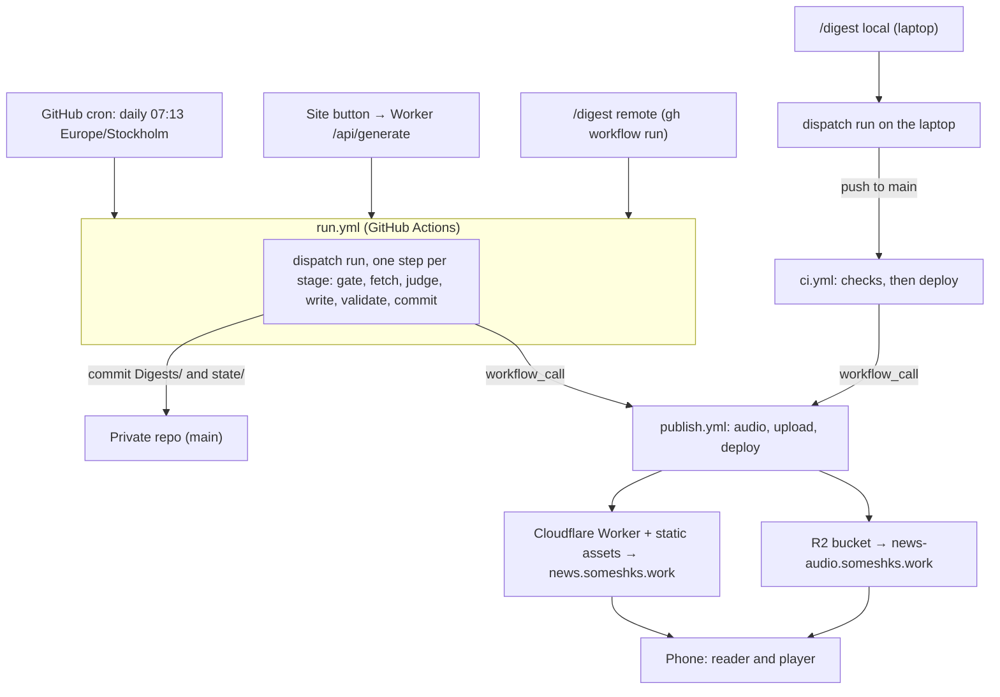

# Dispatch: Build Plan

> Executable plan for the curation engine, the `news.someshks.work` web app, and the local skills that trigger both.
>
> Vision, digest schema and taste model: [Implementation Plan.md](Implementation%20Plan.md). Source registry: [Sources.md](Sources.md). Design reference: [Reader Prototype.html](Prototype/Reader%20Prototype.html).
>
> Status: plan v2, revised 2026-10-05 after a verification pass and an independent review. No code written yet.

---

## 1. What changed from plan v1

Plan v1 ran the whole job inside a Claude Code cloud routine. Verification showed that is the wrong foundation, so v2 moves the engine into the repo and treats every trigger as a thin caller.

| v1 assumption | What verification showed | v2 decision |
| --- | --- | --- |
| Cloud routine runs the pipeline | Routines push to `claude/` branches by default, start with a restricted network allowlist, and the API trigger (`/fire`) is an experimental beta limited to 30 fires per hour per routine | Engine runs on GitHub Actions (stable, full network, own secret store). Routine becomes optional, not required |
| An agent with tools reads untrusted web text | Broad network plus tools plus secrets is the worst case for prompt injection | The LLM is a pure function: text in, schema-validated JSON out, no tools, no secrets in its reach |
| Claude API for curation | You chose Nebius, and Jev if needed | TypeSafe Jev for typed judgments and a cheap Nebius model (OpenAI-compatible API) for writing; both are config values chosen by a bake-off |
| Site button fires the routine | Experimental endpoint | Button dispatches a GitHub workflow. The REST API is stable and returns a run id (`workflow_run_id`, HTTP 200) |
| Audio per section | Speechify returns word-level marks with absolute millisecond times | One MP3 per digest plus a timeline, so the lock screen shows one track with a working scrubber, and every item can be a seek target |
| Local skill fires the routine | Personal skills do not load in cloud sessions | Project skills live in the repo. A remote mode uses `gh`, so `/digest` works from any directory |

Corrections to my own earlier claims, found during verification:

- `news.someshks.work` is covered by Cloudflare's free Universal SSL (apex plus first-level subdomains). `www.news.someshks.work` is not, so the site uses `news.someshks.work` only.
- Pushes made with `GITHUB_TOKEN` do not trigger `push` workflows, but a reusable workflow called inside the same run does execute. The pipeline is built around that.
- GitHub's secret-scanning push protection is not available for private repos on the Free plan. The plan uses gitleaks instead.

---

## 2. Product definition

**What it is.** A private briefing for a design engineer: about twelve items every second day, plus a weekly deep dive, written in plain language, readable in about two minutes or listenable in about four.

**Primary jobs, in priority order**

1. Scan on a phone in under three minutes and know what matters.
2. Listen hands-free (commute, walking) with lock-screen controls.
3. Tell the system what it got wrong in one sentence, and have tomorrow's briefing reflect it.

**Non-goals for v1:** accounts, comments, social sharing, search, push notifications, X/Twitter ingestion, offline audio, multi-language.

---

## 3. Decisions

| # | Decision | Status |
| --- | --- | --- |
| D1 | Engine runs on GitHub Actions with Nebius and TypeSafe keys (model and judgment spend well under 1 USD per month). The Claude Code routine is dropped from the critical path | Confirmed 2026-10-05 (replaces your earlier "cloud routine" choice) |
| D2 | Repo location: this folder (66-character base path). Windows long paths are currently off and deep `node_modules` paths can approach 260 characters, so enabling long paths is optional hardening that needs your approval | Confirmed 2026-10-05: this folder |
| D3 | Judge is TypeSafe Jev. Writer is the cheapest Nebius model that clears the quality bar on a golden set, starting with Qwen3-32B. A Nebius judge stays wired as the fallback | Decided; bake-off in Phase 4 |
| D4 | Framework: Astro with React islands, Base UI, hand-written token CSS | Decided, rationale in Section 8.1 |
| D5 | Audio: one MP3 per digest with word-level marks, Speechify `simba-3.2` | Decided; free-tier availability confirmed in the spike |
| D6 | Cadence: daily cron at 07:13 Stockholm with a calendar-date gate (a regular digest is due two or more days after the last one), plus a Sunday weekly pass | Decided |
| D7 | Private podcast feed (`/feed.xml`) as the reliable iOS listening path | Not now; revisit if iOS lock-screen playback proves flaky in the spike |
| D8 | Digest section "Taste & Thought of the Day" | Cut, to hold the brevity bar |
| D9 | Repository name `dispatch`, private, owner `somesh-ks` | Default; rename if you prefer |

---

## 4. Architecture

### 4.1 Flow



### 4.2 Independence contract

The pipeline must behave the same wherever it is invoked: Actions, laptop, the site button, or a skill run from another folder.

1. **One engine, one CLI.** Every trigger calls `dispatch run`. Workflows, the Worker and the skills contain no pipeline logic.
2. **Hermetic.** The engine reads only repo files and environment variables. It never reads `~/.agents`, `~/.claude`, or absolute paths. The repo root is found with `git rev-parse --show-toplevel`.
3. **Idempotent and resumable.** Each stage writes to `.cache/run/<id>/`, which survives across steps of one job and is never committed. Across jobs only committed state persists. Re-running continues; `publish` converges (a digest without audio gets audio, an up-to-date site is a no-op).
4. **Curator modes by environment.** `NEBIUS_API_KEY` present means the API curator (with `TYPESAFE_API_KEY` it judges through Jev, without it the Nebius fallback judge answers). Absent inside an interactive Claude Code session means the agent curator (the session's model writes a validated selection file). Otherwise it fails with a clear message.
5. **Machine-readable.** Every command supports `--json` and uses stable exit codes, so skills, workflows and the Worker can consume results.
6. **Skills stay thin.** They locate the repo, call the CLI, and interpret JSON. If no checkout is found, they fall back to `gh workflow run -R <owner>/<repo>`.

### 4.3 Trigger matrix

| Trigger | Runs on | Curator | Credentials it needs |
| --- | --- | --- | --- |
| Daily cron | Actions | API | Repo secrets |
| Site Generate button | Actions, via Worker | API | Worker holds a dispatch token |
| `/digest --remote` or `gh workflow run` | Actions | API | Your `gh` login only |
| `/digest` with `.env` keys | Laptop | API | Local `.env` |
| `/digest --agent` | Laptop | Claude Code session | No Nebius key; optional Exa and Firecrawl keys |
| GitHub UI "Run workflow" | Actions | API | Repo secrets |

**Publishing.** `run.yml` calls `publish.yml` as a reusable workflow after its commit, because pushes made with `GITHUB_TOKEN` do not trigger other workflows. Local runs push to `main`, which triggers `ci.yml`; its final job calls `publish.yml`. `publish.yml` has no `push` trigger of its own.

**Concurrent writers.** `run.yml`, local runs and `/learn` all write to the repo. Local runs and `/learn` start with `git pull --ff-only`, refuse to continue when the tree is dirty or behind, and refuse while a `run.yml` run is in progress (`gh run list`). Bot pushes retry with `git pull --rebase` up to three times.

**Mode defaults.** `/digest --remote` and the Generate button dispatch `mode=on-demand`, so the scheduled gate can never turn them into silent no-ops.

### 4.4 Execution model for building this

Work is split so independent streams run in parallel and every phase gets a second pair of eyes.

| Task | Agent | Why |
| --- | --- | --- |
| Source and API verification | `researcher` | Reads a lot, returns tables |
| Locating code, call sites | `scout` | Cheap, read-only |
| Per-phase design when several architectures fit | `planner` | Read-only, returns an ordered plan |
| Engine, web app, CI and skills streams | Parallel worktrees (`isolation: worktree`) | Independent file sets, merge at phase gates |
| Review after each phase | `reviewer` | Diff audit before merge |
| Motion and performance audit of the web app | `motion-reviewer` | Whole-directory sweep |
| Unknown-cause bugs | `deep` | Only after a cheaper pass fails |

Rule: subagent reports are inputs, not facts. Anything that drives a decision gets re-checked. In this planning pass one report was wrong (the SSL claim) and one cost figure was about 60 times too high (Nebius); both were caught this way. An independent review of this plan then found six blocking defects in the plan itself (publish checkout, digest id collisions, gate semantics, concurrent writers, outcome handling, phase ordering), all fixed in v2.

---

## 5. Where API keys go

Keys never go in the repo, in chat, or in `package.json`. Three stores, each fed by an interactive prompt on your machine:

| Secret | Used by | Where it lives | How to set it |
| --- | --- | --- | --- |
| `NEBIUS_API_KEY` | Writing and fallback judgments (run.yml, local API mode) | GitHub Actions secret; local `.env` | `gh secret set NEBIUS_API_KEY` |
| `TYPESAFE_API_KEY` | Jev judgments (run.yml, local API mode) | GitHub Actions secret; local `.env` | `gh secret set TYPESAFE_API_KEY` |
| `EXA_API_KEY` | Semantic discovery | GitHub Actions secret; local `.env` | `gh secret set EXA_API_KEY` |
| `FIRECRAWL_API_KEY` | Feedless sites, last-resort extraction | GitHub Actions secret; local `.env` | `gh secret set FIRECRAWL_API_KEY` |
| `SPEECHIFY_API_KEY` | Audio (publish.yml, local audio) | GitHub Actions secret; local `.env` | `gh secret set SPEECHIFY_API_KEY` |
| `CLOUDFLARE_API_TOKEN` | Deploy, R2 upload (publish.yml) | GitHub Actions secret | `gh secret set CLOUDFLARE_API_TOKEN` |
| `CLOUDFLARE_ACCOUNT_ID` | Deploy, R2 upload | GitHub Actions secret | `gh secret set CLOUDFLARE_ACCOUNT_ID` |
| `GITHUB_DISPATCH_TOKEN` | Worker triggers `run.yml` and reads run status | Worker secret | `npx wrangler secret put GITHUB_DISPATCH_TOKEN` |
| `TURNSTILE_SECRET_KEY` | Worker verifies the bot check | Worker secret | `npx wrangler secret put TURNSTILE_SECRET_KEY` |
| `GENERATE_PASSPHRASE_HASH` | Worker checks the passphrase (a salted PBKDF2 hash string with the iteration count) | Worker secret | `npx wrangler secret put GENERATE_PASSPHRASE_HASH` |
| `YOUTUBE_API_KEY` (optional) | One-time channel-ID lookup | Local `.env` only | Edit `.env` |

Details:

- **Prompts, not arguments.** `gh secret set NAME` and `wrangler secret put NAME` ask for the value in the terminal and do not echo it. Do not pass values with `--body`, which lands in shell history.
- **Local files.** Copy `.env.example` to `.env` and fill it in an editor. For Worker development, `.dev.vars` plays the same role. Both are gitignored. `.env.example` lists names with empty values and is the only env file committed.
- **Local Cloudflare access** uses `wrangler login` (OAuth), so no Cloudflare token is stored on disk for local runs.
- **Local GitHub access** uses your existing `gh` login. The `/digest` skill needs no dispatch token.
- **Dispatch token scope.** A fine-grained personal access token limited to this one repository, with Actions read and write and Contents read (to read `state/last-run.json` for the outcome), and nothing else. Set an expiry and put the renewal date in the runbook.
- **Cloudflare token scope.** A token limited to Workers Scripts edit, Workers KV edit, R2 edit and the zone's Workers Routes or DNS edit, restricted to this account and zone. The exact list is confirmed in the spike. It is exposed only to the R2 upload and deploy steps, never to the build.
- **R2 uploads** use `wrangler r2 object put` with `CLOUDFLARE_API_TOKEN`, so no separate R2 S3 credentials exist.
- **Blast radius.** The curator step receives the model, judge, search and scrape keys (`NEBIUS_API_KEY`, `TYPESAFE_API_KEY`, `EXA_API_KEY`, `FIRECRAWL_API_KEY`) only. Speechify and Cloudflare secrets are referenced only by publish steps. Workflows declare minimal `permissions:`.
- **Spend caps.** Nebius is prepaid credit with no per-key limit (account level only), so the balance is the cap: top up modestly and use a key created only for this project. Exa reports a free monthly credit and then bills per request (about 2 USD a month here), so watch its balance. Firecrawl's free credits may be one-time rather than monthly; the spike confirms. Jev has no documented spend cap, but usage is about one cent per run, so check the TypeSafe console monthly.
- **Leak prevention.** `.gitignore` covers `.env`, `.env.*` (except `.env.example`), `.dev.vars`, `.wrangler/` and `.cache/`. A gitleaks pre-commit hook and a CI job scan every change, since push protection is paid-only for private repos. The engine redacts known key patterns from logs.
- **Rotation.** If a key ever appears in chat, a log or a commit, revoke it first, then replace it.

---

## 6. Repository

### 6.1 Layout

```text
dispatch/
  .claude/skills/digest/        # /digest: trigger, status, agent-curator protocol
  .claude/skills/learn/         # /learn: free-text feedback to bounded preference patch
  .github/workflows/            # run.yml, publish.yml, ci.yml
  apps/web/                     # Astro site, React islands, Worker (src/worker/)
  packages/core/                # Zod schemas, config loader, date window utilities
  packages/engine/              # the `dispatch` CLI
  packages/cover/               # seeded cover-art templates and renderer (Section 8.11)
  config/                       # preferences.json, sources.json, voice.md
  Digests/YYYY/MM/              # <id>.md, <id>.audio.json (id: date, -weekly, -2)
  state/                        # seen.json, judgments.json, last-run.json, usage.json, runs/
  tokens/tokens.json            # W3C design tokens, source of truth
  tokens/covers.json            # cover palettes in the same format
  docs/                         # vision.md, build-plan.md, decisions.md, runbook.md
  .env.example  .gitignore  .gitattributes  .nvmrc  biome.json  package.json
```

Existing planning files move into `docs/` and `config/` with `git mv` once the repo exists (moved, never deleted). The prototype goes to `docs/prototype/` and the reference lists to `docs/reference/`; relative links are fixed in the same commit.

### 6.2 Tooling

| Concern | Choice | Reason |
| --- | --- | --- |
| Package manager | npm workspaces | pnpm is not installed, and a global install needs your approval |
| Runtime | Node 24 or newer, pinned in `.nvmrc` and `engines` | Local Node is 26; CI reads `.nvmrc` |
| Language | TypeScript, strict, no `any` | Your code standards |
| Lint and format | Biome | One fast tool; `astro check` covers `.astro` files |
| Unit tests | Vitest | Runs the engine against saved fixtures offline |
| End-to-end | Playwright (Chromium and WebKit, mobile viewport) with axe | Player behaviour, accessibility |
| Budgets | Lighthouse CI and a bundle size check | Enforce Section 8.8 |
| Hygiene | gitleaks, actionlint | Secrets and workflow syntax |
| Line endings | `.gitattributes` forces LF | Avoids CRLF churn in digests on Windows |
| Commits | Conventional Commits; bot uses `chore(digest): YYYY-MM-DD` | Your git conventions |
| Decisions log | `docs/decisions.md` | Required by your workflow rules |

### 6.3 Dependency posture

Add a dependency only when it removes real work. Candidates and the reason for each:

| Package | Why |
| --- | --- |
| `@typesafe-ai/sdk` | Typed judgments (Choice, Noul, Score) from Jev |
| `openai`, `zod` | OpenAI-compatible client pointed at Nebius, with schema-validated output (`zodResponseFormat`) |
| `fast-xml-parser` | RSS and Atom |
| `@resvg/resvg-js` (or its WASM build) | Rasterize cover art to PNG at build time |
| `@mozilla/readability`, `linkedom` | Free full-text extraction before paid scraping |
| `astro`, `@astrojs/react`, `react`, `react-dom` | Web app |
| `@base-ui/react` | Drawer, Slider, Dialog, Field, Switch |
| `wrangler` (dev) | Deploy, secrets, R2 |

Everything else uses the platform: `fetch`, `crypto.subtle`, native `<dialog>` where Base UI is overkill, View Transitions, Media Session.

---

## 7. Engine

### 7.1 Commands

| Command | Purpose |
| --- | --- |
| `dispatch doctor` | Checks Node, git, keys present (names only), and reachability of each service |
| `dispatch fetch` | Gathers candidates since the last run into `pool.json` |
| `dispatch curate` | Triage and write; `--mode api` or `--mode agent` |
| `dispatch extract --ids` | Full text for chosen items (used by agent mode) |
| `dispatch render` | Validates a selection and writes the digest and audio script |
| `dispatch validate` | Schema, link and limit checks on any digest |
| `dispatch audio --digest <id>` | Speech synthesis and timeline for one digest |
| `dispatch publish` | Audio for any digest missing it, R2 upload, commit of `.audio.json` and `usage.json`. Deployment is a separate `wrangler deploy` step |
| `dispatch run` | Orchestrates the stages. `--mode scheduled\|on-demand\|weekly`, `--stage gate\|fetch\|judge\|write\|validate` (one stage, used by workflow steps), `--force`, `--since <date>`, `--dry-run`, `--no-push` |
| `dispatch learn --apply` | Applies a validated preference patch with bounds |
| `dispatch sources discover\|check` | Finds feeds, reports failing sources |
| `dispatch status` | Last run, next eligibility, budgets |

### 7.2 Pipeline stages

| # | Stage | Detail |
| --- | --- | --- |
| 1 | Gate | A regular digest is due when the Stockholm calendar date is two or more days after the last regular digest, so a delayed cron still lands on the right day. On Sundays the weekly pass runs after the regular one. On-demand and `--force` ignore the gate |
| 2 | Fetch | Per-source timeout and retry; failures are logged, never fatal. The window starts at the last successful fetch of any kind, capped at 7 days (first run: 3 days). Overlap is harmless because `seen.json` removes items already shown |
| 3 | Normalize | One item shape, with `id = sha1(canonical_url)` |
| 4 | Dedupe | Strip tracking parameters, resolve redirects, drop anything in `seen.json`, collapse newsletter items that point at originals already in the pool |
| 5 | Prefilter | Hard-drop `disliked_patterns`; keep keyword, preferred-author and high-signal-source matches; cap near 60 |
| 6 | Judge (Jev) | Per item, from title and snippet only: category probabilities, craft depth, hype, sponsorship and funding flags. Cached by item, question set and model version |
| 7 | Score (code) | Probability-weighted category weight, times craft depth, reduced by the flags, plus a small author and keyword bonus. Threshold and caps live in code, not in a prompt. Changing weights re-scores from the cache |
| 8 | Extract | Full text for finalists, cheapest first: text Exa already returned, feed content, Readability, then Firecrawl for JavaScript-heavy or blocked pages, throttled to its free-plan rate |
| 9 | Write (LLM) | Headline, summary and why line from the extracted text only, following `config/voice.md` (Section 7.6). The spoken text is assembled by code from those fields and is never written separately |
| 10 | Validate | Schema, URLs exist in the pool, grounding check (Jev) of every summary and why sentence against the source text, voice lint and length limits (Section 7.6), no links or markdown in model text, no empty sections, no repeats |
| 11 | Persist | Digest, `seen.json`, `judgments.json`, `last-run.json` (with an `outcome`) and a run log holding counts and source status only, never fetched text. The write guard (below) runs before every commit |

**Item counts.** Target 8 to 12, hard cap 12 (weekly 18), floor 3. With 3 to 7 qualifying items the digest is shorter, never padded. Below 3, nothing is published.

**Outcomes.** Every run ends in one `outcome`, written to `state/last-run.json` and exposed as a job output: `published`, `gated`, `nothing` or `failed`. `nothing` is a successful run: it advances the fetch window, records the judged items in `seen.json`, and commits only `state/`. The site and the status endpoint use one sentence for it: "Nothing cleared the bar." `failed` leaves the window and `seen.json` untouched.

**Write guard.** Each command may change only its own paths: `run` writes `Digests/` and `state/`; `publish` writes `Digests/**/*.audio.json` and `state/usage.json`; `learn` writes `config/preferences.json`. A path outside the list aborts the commit.

**State files.** `last-run.json` keeps one record per kind (`regular`, `weekly`, `on-demand`), so an on-demand run never shifts the regular cadence. `seen.json` maps item id to date and is pruned at 90 days. `judgments.json` caches Jev answers by item id, question-set hash and model version, pruned at 30 days, so `/learn` can re-score without new calls. `.cache/` is gitignored.

### 7.3 Normalized item and digest file

```json
{
  "id": "first-12-hex-of-sha1-of-canonical-url",
  "url": "", "canonical_url": "", "title": "",
  "source_id": "", "source_type": "rss",
  "author": "", "published_at": "", "fetched_at": "",
  "snippet": "", "signals": { "hn_points": 0 }
}
```

The digest is Markdown with frontmatter. The frontmatter is the single source for the site; the body is generated from it for reading in an editor or on GitHub.

```yaml
---
id: 2026-10-07
date: 2026-10-07
kind: regular
verified: true
window: { from: 2026-10-05T05:13:00Z, to: 2026-10-07T05:13:00Z }
read_minutes: 3
audio: { url: "https://news-audio.someshks.work/2026-10-07.mp3", duration_ms: 248000 }
cover: { template: spring, palette: dusk, seed: 4117 }
items:
  - id: "3f2a9c1e5b07"
    section: ui-craft
    headline: ""
    url: ""
    source: ""
    author: ""
    summary: ""
    why: ""
    score: 0.91
---
```

**Digest ids and filenames.** A digest id is the Stockholm date, with `-weekly` for the weekly pass and `-2`, `-3` for further runs on the same day (on-demand). Files are `Digests/YYYY/MM/<id>.md` and `<id>.audio.json`, the audio is `<id>.mp3`, and the route is `/d/<id>`. The engine never overwrites an existing id; it takes the next free suffix.

**Audio timeline file** (`<id>.audio.json`):

```json
{
  "digest": "2026-10-07",
  "voice": "geffen_32",
  "model": "simba-3.2",
  "timeline": "marks",
  "duration_ms": 248000,
  "text_chars": 4710,
  "items": [{ "id": "3f2a9c1e5b07", "section": "ui-craft", "start_ms": 0, "end_ms": 21400 }],
  "sections": [{ "slug": "ui-craft", "start_ms": 0 }]
}
```

`timeline` is `marks` or `estimated`.

**Sections.** The ten weight keys map to six digest sections. `design_engineering_craft`, `ui_component_primitives`, `css_canvas_motion_techniques` and `taste_and_design_philosophy` go to Interaction craft (`ui-craft`). `ai_ux_interaction_patterns` and `frontier_model_releases` go to AI models and products (`ai`). `hci_empirical_research` goes to Research (`research`). `developer_tool_launches` goes to Launches (`launches`). Video and podcast items go to Watch and listen (`watch`) by source type. `venture_capital_and_gossip` and `generic_ai_hype_listicles` never publish. Top picks (`top`) are the three highest scores, removed from their home section. The weekly pass reserves one slot for the best item outside the top-weighted categories, so taste does not narrow.

**Schemas freeze in Phase 1.** Item, digest frontmatter, audio timeline, state files, `sources.json` (id, url, type, feed URL, tier, `high_signal`, consecutive failure count) and `preferences.json` are Zod schemas in `packages/core`, so the parallel streams share one contract.

### 7.4 Sources and access

| Channel | Access | Key |
| --- | --- | --- |
| Hacker News | Algolia `search_by_date` with `numericFilters` | None |
| GitHub releases | `releases.atom` (all nine repos tested returned a feed) | None |
| arXiv cs.HC | API query for daily freshness; RSS only announces on weekdays | None |
| TOCHI, PACMHCI | Crossref `works` with `issn` and `from-index-date`, polite `mailto` | None |
| Product Hunt, Lobsters | Public feed, `hottest.json` | None |
| Blogs and newsletters | RSS or Atom found by `sources discover` | None |
| Feedless or JavaScript-heavy pages | Firecrawl `POST /v2/scrape` (renders JavaScript, 1 credit per basic page; free plan 10 requests per minute, 2 concurrent) | Yes |
| Semantic discovery | Exa `POST /search` with `startPublishedDate`, optional inline text (about 7 USD per 1,000 searches, 1 USD per 1,000 content fetches) | Yes |
| YouTube | Channel `videos.xml` feed. Handle-to-ID resolution needs a one-time lookup | Optional, one-time |
| X/Twitter | Out of scope | n/a |

Feed discovery results from this pass (starting hints; `sources discover` re-verifies and probes common paths such as `/feed`, `/rss.xml`, `/atom.xml`, `/feed.xml`, `/atom`):

- Confirmed feeds: Josh W. Comeau, Simon Willison, Cloudflare blog, Next.js blog, Cooperpress (JavaScript Weekly and siblings), console.dev.
- Reported as no feed (unreliable; the check only read page markup): rauno.me, emilkowal.ski, jhey.dev, Anthropic, OpenAI, DeepMind, Vercel, Linear, Tailwind, shadcn changelog, bytes.dev, TLDR. These get path probing first, then Firecrawl.
- Not yet checked: css-weekly, frontendfoc.us, Smashing, sidebar.io, Friday Checkout, toools.design, uithings, auxfirst.
- Registry fixes to make in Phase 0: Rauno's handle is `@raunofreiberg` (the registry says `@rauno_rocks`); Lee Robinson left Vercel in 2025, so his registry description is stale.

### 7.5 Models and judgments

Two roles, each behind its own interface so either can be swapped without touching the pipeline.

| Role | Default | Job |
| --- | --- | --- |
| Judge | TypeSafe Jev | Typed, calibrated judgments: category, craft depth, hype and sponsorship flags, grounding check |
| Writer | Cheapest Nebius model that passes the quality bar (start with Qwen3-32B) | Two-sentence summary, why line and spoken line in the house voice |
| Fallback judge | The Nebius writer model answering the same questions as JSON | Used when Jev returns 429 or 529, or is down |

**Judge: TypeSafe Jev**

| Aspect | Design |
| --- | --- |
| Access | npm `@typesafe-ai/sdk`, `new TypeSafeClient()`, key in `TYPESAFE_API_KEY`, `POST https://api.typesafe.ai/v1/systemone` with Bearer auth, sign-up through console.typesafe.ai. Confirmed against TypeSafe's docs; confirm the Score and Noul helpers against the installed SDK types in the spike |
| Primitives | Choice (criteria object), Score (criteria array, returns the expected level plus probabilities), Noul (probability of yes). Answers carry probabilities and confidence, and the response reports token usage |
| Item judgments | One request per item. State: title, source, author, snippet, signals. Questions: `category` (Choice over the weight keys plus `none`), `craft_depth` (Score, five levels from "announcement or opinion with no technique" to "mechanism shown with code or measurements"), and Noul flags `is_listicle_or_hype`, `is_sponsored_or_promotional`, `is_funding_news`. The questions are independent, so they run in parallel in one call |
| Score in code | `taste` = the sum over categories of `P(category) x weight[category]`, times normalized craft depth, reduced by the hype, sponsorship and funding probabilities, plus the small author and keyword bonus. Probabilities rather than the top pick keep near-ties honest |
| Weights without inference | Judgments are cached by item id, question-set hash and model version. `/learn` changes weights and the pool is re-scored from the cache with no new calls |
| Grounding check | A Noul per summary and why sentence over the sentence and the relevant source excerpt (about 36 checks per run): "The excerpt directly supports the sentence." Below the tuned threshold the item is rewritten once, then dropped |
| Thresholds | Tuned on the golden set and never copied from documentation examples |
| Limits | The docs state 255 options per Choice and list 401, 422, 429 and 529 as errors. Figures from secondary sources and not yet confirmed: about 32K tokens of state, about 2,400 requests per minute, 70 to 500 ms per call. Retry with backoff on 429 and 529 |
| Price | About 0.04 USD per million input tokens, derived from TypeSafe's published "238x lower input price" claim against a 10 USD per million model. Roughly 0.01 USD per run at this volume. TypeSafe says the price may be subsidized, which is why the fallback judge stays wired |
| Early-stage risk | Use `jev-latest` while tuning, pin the exact version once thresholds are set, keep the fallback judge, and revalidate quarterly |
| Data | Confirm retention and training terms in the console before enabling |

**Writer: Nebius Token Factory**

| Aspect | Design |
| --- | --- |
| Provider | OpenAI-compatible. Base URL `https://api.tokenfactory.nebius.com/v1/` (override with `NEBIUS_BASE_URL`), header `Authorization: Bearer $NEBIUS_API_KEY` |
| Client | The official `openai` npm package with `baseURL`, behind one `LlmClient` interface |
| Models | Config holds a primary and a fallback ID (`DISPATCH_MODEL`, `DISPATCH_FALLBACK_MODEL`). IDs are pinned exactly: Nebius retired dozens of text models in 2026 and the reported notice periods are inconsistent. `dispatch doctor` checks both IDs against `GET /v1/models`, and the client fails over on model-not-found |
| Choosing the model | The cheapest model that clears the bar in the Phase 4 bake-off. Start with Qwen3-32B (reported 0.10 and 0.30 USD per million input and output tokens). Stronger references for comparison: gpt-oss-120b and DeepSeek-V3. The bar: voice-lint pass rate, grounding pass rate, JSON validity, and a read-through of the golden outputs. IDs and prices are confirmed against the live model list and pricing page in the spike |
| Structured output | `response_format: json_schema` (strict) through `zodResponseFormat` from `openai/helpers/zod`; `json_object` where a model mishandles strict schemas. Every response is re-validated with Zod, retried once with the error appended, then the item is dropped and logged |
| Sampling | Temperature at or below 0.2, thinking disabled (the toggle name varies by model, so the spike confirms it) |
| Caching | None reported on Nebius. Negligible at about 40K input tokens per run |
| Budget guard | No token-counting endpoint, so the engine estimates locally, reads `usage` after each call, and aborts above `MAX_TOKENS_PER_RUN` (default 400,000). The prepaid balance is the hard cap |
| Limits | Reported Starter tier: 400K tokens and 600 requests per minute. Concurrency 4 with backoff on 429 and 5xx |
| Batch API | Not used; on-demand runs need answers in minutes |
| Data handling | Reported: no training on customer data, zero-data-retention available at organization level, EU (Finland) hosting. Read the policy in Phase 0 and enable zero retention |
| Embeddings (v1.1) | Qwen3-Embedding-8B was reported at about 0.01 USD per million tokens, enough for semantic duplicate detection across sources |
| Quality escape hatch | Agent curator: the Claude Code session writes the selection, validated by the same code |

Safeguards that apply to both roles:

- Summaries come from extracted text only and are short by construction (Section 7.6).
- Fetched content reaches the models as clearly delimited data. Neither model has tools or secrets, every output URL must exist in the input pool, and the site escapes all model text.
- Judge and writer outputs are validated by code, so a wrong or missing answer degrades one item, never the run.

### 7.6 Editorial voice

The voice is distilled from your communication playbook: brevity signals status, specific craft recognition replaces praise, and nothing opens with a preamble. The rules live in `config/voice.md` (distilled rules only; the playbook itself stays out of the repo). The writer prompt loads that file and the validator enforces its measurable parts.

| Principle | In the digest |
| --- | --- |
| Brevity is status | No greeting, intro paragraph, sign-off or "in today's briefing". A headline, two short sentences, one line on why |
| Specific over general | Name the technique, feature, number or result. Authors are credited by what they shipped, never praised |
| No hype, no flattery | No "game-changing", "excited", "huge", "must-read", "revolutionary" or exclamation marks |
| Peer to peer | The reader is a design engineer. No explaining basics, no "you should", no questions to the reader |
| Curator, not aggregator | Few items. Empty sections are omitted. A quiet day publishes nothing and the site says "Nothing cleared the bar." |
| Why is usable | The why line names what the reader can try, copy or watch for, never that something "matters" |

Measurable limits, enforced in validation:

| Field | Limit |
| --- | --- |
| Headline | 12 words |
| Summary | 35 words, two sentences at most |
| Why | 18 words, one sentence |
| Items | Regular digest: target 8 to 12, hard cap 12, floor 3; about 2 minutes to read and 4 to listen. Weekly: up to 18 |

Pairs the writer prompt uses as exemplars:

| Weak | Strong |
| --- | --- |
| An exciting new library makes animations easier | Springlet 2.0 retargets springs mid-flight, so interrupted drawers keep their velocity |
| This could change how we design agent interfaces | Four measures for agent UIs: first useful signal, correction cost, interruptions, recovery |
| Why: important for anyone interested in motion | Why: copy the retargeting pattern for drawers and toasts |

Deterministic voice lint, run on every written field:

- Banned words and phrases (hype adjectives, stock AI vocabulary, "in today's", "delve", "landscape", "unlock", "game-changer" and similar), kept in `config/voice.md`.
- No em dashes, no exclamation marks, no emoji, no markdown or links inside model text.
- No "not just X but Y" contrasts, no rhetorical questions, no second-person imperatives.

A failing field is rewritten once with the lint error appended, then the item is dropped and logged. The weekly golden evaluation also runs the `humanizer` skill's checks as a stricter offline review.

Audio follows the same bar: one opening line ("Dispatch, Wednesday 7 October. Eleven items."), the section name as the only transition, no outro. Site copy follows it too: sentence case, plain verbs, and errors that say what happened and what to do.

### 7.7 Audio

| Aspect | Design |
| --- | --- |
| Endpoint | `POST /v1/audio/stream/with-timestamps` (Server-Sent Events; `speech.chunk` carries base64 audio and marks, `speech.done` ends the stream) |
| Marks | Word level: `start` and `end` are character offsets into the request `input`; `start_time` and `end_time` are absolute milliseconds |
| Timeline | Spoken text is assembled by code from each item's headline, summary and why, with known character ranges, so the first mark at or after each range gives that item's start time. Stored in `<id>.audio.json` (schema in Section 7.3) |
| Format | `mp3_24000_128`; try a 64 kbps variant in the spike to halve storage |
| Limits | 20,000 characters per request. A digest is about 5,000 characters (weekly about 8,000), so one request always suffices. The engine fails closed above 19,000 instead of splitting |
| Rate | Free plan: 3 concurrent requests, 1 per second. Calls run sequentially |
| Budget | `state/usage.json` tracks characters, is committed by `publish`, and so survives between runs; stop at 90 percent of the monthly allowance |
| Fallback | If marks are unavailable on the free plan, use `/v1/audio/stream` and estimate chapter starts from character share, flagged `timeline: "estimated"` |
| Storage | R2 bucket, key `<id>.mp3`, uploaded with `wrangler r2 object put` |
| Allowance | Speechify's pricing page lists 500K characters per month on the free tier with a hard cap. One verification report said there is no monthly quota. Treat 500K as the planning figure and confirm in the spike |

The spoken text is derived from the same fields the page displays, which keeps word-level read-along possible later.

### 7.8 Taste feedback

`/learn "more shaders, less VC funding"` flow: the session model turns the sentence into a patch (weight deltas, keyword and pattern edits); `dispatch learn --apply` enforces plus or minus 0.05 per weight per call, schema validity and an overall drift limit, appends to `feedback_history`, prints the diff, and only then commits and pushes. Because the patch is data, `/learn` works with or without an API key.

### 7.9 Failure behaviour

- A failed source is logged; the digest footer mentions failures only when three or more sources failed.
- A total failure leaves `last-run.json` unchanged, so the next window grows and nothing is lost.
- A TTS failure still publishes the text digest with `audio: null`; the player shows "Audio is still being prepared", and `publish.yml` retries on the next `run.yml` of any outcome, including `gated` and `nothing`, because `run.yml` always calls it.
- Concurrency: `run.yml` declares `concurrency: { group: dispatch, cancel-in-progress: false }`. `publish.yml` declares none, because a called workflow that shares its caller's group gets cancelled. GitHub keeps one pending run per group, so duplicate presses collapse.

---

## 8. Web app

### 8.1 Stack and why

| Option | First-load JS for reading | Persistent player | Fit with your standards | Verdict |
| --- | --- | --- | --- | --- |
| Astro with React islands | Near zero for content; islands load on idle | Module-scope audio singleton survives navigation | React, Base UI, CSS-first | Chosen |
| Vite React SPA with a router | React plus router on every load | Trivial | Same | Heavier for a reading app |
| SvelteKit | Smallest runtime | Trivial | Leaves your React ecosystem and Base UI | Good, but not worth the switch |

The reading experience should be HTML first and instant, with the player as progressive enhancement. Astro delivers that. The audio element lives in a JavaScript module as `new Audio()` (not in the DOM), so it keeps playing across client-side navigations regardless of how the router swaps the page. This avoids a reported Astro regression where media inside `transition:persist` containers was recreated on navigation (issue 17749). A fix (PR 17750) is reported in Astro 7.3.x, but the design does not depend on it. Astro's docs say module scripts run once and do not re-run on navigation; the spike confirms that on a real phone.

### 8.2 UI library and styling

- **Base UI** (`@base-ui/react`, 1.8.x at the time of writing): unstyled and accessible, so the look stays ours. Components used: Drawer (chapters, Generate, archive; swipe, snap points, virtual-keyboard support), Slider (scrubber), Dialog, Field (passphrase), Switch (settings). Radix is skipped because the shadcn and Radix drawer rests on Vaul, which is unmaintained.
- **Not Tailwind or shadcn.** Both pull toward the templated look you want to avoid.
- **Tokens.** `tokens/tokens.json` in the W3C format (primitive, semantic, component tiers, OKLCH), compiled by a small script into CSS custom properties. Dark mode swaps semantic tokens.
- **Motion.** CSS transitions, `@starting-style`, and the View Transitions API. Add `motion` only if a gesture needs a spring. Durations and easings come from your design standards file, not from literals.
- **Fonts.** Schibsted Grotesk and Literata, self-hosted as subset variable files with metric-matched fallbacks, instead of the Google Fonts CDN used in the prototype.

### 8.3 Screens and components

| Screen or part | Notes |
| --- | --- |
| Digest page (`/`, `/d/YYYY-MM-DD`) | Hero with date and play, the timeline rail, items grouped by chapter. Server-rendered HTML |
| Archive (`/archive`, month pages) | Year then month then day; weekly dives marked |
| Player bar | Persistent. Cover thumbnail, title, play and pause, next item. Tap or swipe up to expand |
| Expanded player (Drawer) | Large cover, scrubber with item ticks, plus and minus 15 seconds, previous and next item, chapter list, speed 1x to 2x |
| Generate sheet (Drawer) | Passphrase, bot check, progress steps, clear errors |
| Settings sheet | Theme, default speed, install hint |
| States | Empty, nothing new, audio preparing, offline, error, stale briefing |

The prototype's rail, one-item-at-a-time dimming and hero layout carry over. With a real timeline the rail fills continuously inside an item, not in steps.

### 8.4 Player behaviour

- One `<audio>` element created in JavaScript, never in the DOM. State is a small external store read with `useSyncExternalStore`, so no state library is added.
- Media Session: title and artwork; handlers for play, pause, seek backward and forward, seek to, previous and next track (mapped to items); `setPositionState` so the lock-screen scrubber works.
- Item seek from any play button using the timeline; chapter list in the Drawer.
- Remembers position per digest and resumes there.
- iOS: use a plain `<audio>` element (Web Audio is treated as ambient and is silenced in the background). Background playback in standalone apps has worked since iOS 15.4 (WebKit bug 198277), but reports of pause-and-resume and lock-screen quirks persist, so Section 12 makes a real-device test a gate.
- If the lock screen drops controls during the spike, first try re-registering the Media Session handlers on `visibilitychange`. A "silent carrier audio" workaround circulates but is unverified and is not planned.

**Feel.** The player should behave like a native one: instant response, continuous motion, no waiting on the network for anything the listener can already see.

| Aspect | Design |
| --- | --- |
| Response | Press feedback within one frame on every control (scale 0.97 on press). Play starts from the first tap with the audio request already warm: `preload="metadata"` on the digest page, and the source is attached before the tap |
| Scrubber | Pointer-capture drag with a 44px tall hit area over a thin track, velocity-aware, with a tick at each item start from the timeline and a time label that follows the thumb. Dragging never fights playback updates. Keyboard: arrows seek 5 seconds, page keys seek by item |
| Mini to full | The cover is a shared element between the bar and the expanded player, morphed with the View Transitions API and a CSS fallback. The Drawer follows the finger, snaps with a spring, and dismisses by flick |
| Rail link | The reading page's rail position and the scrubber are one state, so scrubbing moves the page and tapping an item moves the audio |
| Buffering | Skeleton track and a quiet spinner only after 300 ms; never a layout shift |
| Interruptions | On `pause` caused by the system (call, alarm), remember it and offer resume instead of auto-playing. Resume position per digest is saved every 5 seconds |
| Speed | 1x, 1.25x, 1.5x, 2x with `preservesPitch` on; remembered |
| Up next | After the last item the player offers the previous digest, not an autoplay chain |
| Sleep timer | v1.1: 5, 15, 30 minutes or end of digest |
| Haptics | None promised: iOS Safari exposes no vibration API. Visual and motion feedback carry the feel |
| Reduced motion | Morphs become crossfades; the rail and scrubber still update |
| Lock screen | Title is the digest date, artist "Dispatch", album the month, artwork is the generated cover (Section 8.11) |

### 8.5 Responsive behaviour

Mobile first, with breakpoints chosen where the content stops fitting, not by device.

| Width | Layout |
| --- | --- |
| Under 40rem | Single column, bottom player, sheets slide up |
| 40rem to 72rem | Reading column stays 40rem; chapters appear as a sticky aside when there is room; sheets become centered dialogs |
| Over 72rem | Same column, centered, more air; no extra chrome added just to fill space |

Layout rules: logical properties throughout, no fixed widths on text, container queries for components, content bleeds while controls stay inside safe areas, no controls in the top-left 64px (iPadOS windowed apps overlay window controls there and `env()` does not report it), layout correct when the top safe-area inset is `0px`.

### 8.6 PWA and iOS

| Item | Decision |
| --- | --- |
| Head | `viewport-fit=cover`, `apple-mobile-web-app-capable`, `mobile-web-app-capable`, status-bar style `black-translucent`, `theme-color` pair for light and dark |
| Status-bar tint | Safari 26 samples a full-width sticky header's `background-color`, so the header gets an explicit opaque background. Hidden overlays use `display: none`, never `opacity: 0` |
| Manifest | `standalone`, `start_url`, name and short name; PNG icons only at 192 and 512 plus maskable |
| Icons | One SVG mark rendered at build to opaque PNGs, including the 180px apple touch icon. Icon, splash and body share one background color |
| Splash screens | Skipped in v1 (they need many device sizes); body background matches the icon to avoid a flash |
| Install hint | Safari on iOS only, not already installed, two or more visits, dismissal remembered permanently, copy says "Add to Home Screen", never "install" |
| Standalone navigation | Visible back control wherever a user can leave the entry screen |
| Keyboard | Generate sheet uses Base UI's virtual-keyboard support; inputs stay at 16px or larger to prevent iOS zoom |
| Touch | `touch-action: manipulation`, tap highlight removed only where another pressed state exists, `overscroll-behavior` set in a stylesheet (not from script) |
| Storage | Treat as best effort; save only convenience state (theme, speed, positions) |
| Service worker | Caches the shell and recent digests, stale-while-revalidate. Audio is not cached in v1, because serving audio from the Cache API without correct Range handling breaks Safari playback |

### 8.7 Accessibility

Native elements first; every control has an accessible name; visible `:focus-visible` rings (two-layer ring that reads on any background, with a forced-colors fallback); 44px touch targets; a polite live region for generation status and playback announcements; correct heading order with one `h1`; reduced motion removes movement but keeps opacity and color transitions; 200 percent zoom and 320px reflow without horizontal scroll; color never the only state signal; sheets trap and restore focus (native `inert` behaviour via Base UI).

### 8.8 Performance budget

| Metric | Budget |
| --- | --- |
| Lighthouse mobile (performance, accessibility, best practices, SEO) | 95 or higher each; your standard is 90 |
| LCP on mid-range phone, 4G | 1.5 s or less |
| CLS, INP | 0 and under 200 ms |
| Render-blocking JavaScript | None (content is server-rendered HTML; islands hydrate on idle) |
| JavaScript total on first load | 100 KB gzipped or less. React and ReactDOM are the main cost (about 55 KB by a reported figure); Base UI parts are measured in the spike |
| Fonts | Subset, self-hosted, one preloaded, 80 KB or less in total |

Techniques: inline critical CSS, `content-visibility: auto` on long digests, prefetch on intent for archive links, no third-party scripts besides the Turnstile widget (loaded only when the Generate sheet opens).

### 8.9 Worker and Generate flow

Worker serves static assets and handles `/api/*` through `run_worker_first: ["/api/*"]` with `not_found_handling: "404-page"`.

1. The sheet collects a passphrase and a Turnstile token and posts to `/api/generate`.
2. The Worker verifies the token with Turnstile's `siteverify`, derives a PBKDF2 hash of the passphrase (salt and iteration count stored inside the secret) and compares it with `crypto.subtle.timingSafeEqual`, counts failures per IP in KV, then checks a KV cooldown (one run per 6 hours) and a daily cap (3).
3. It dispatches `run.yml` through the REST API with fixed inputs (`mode=on-demand`), stores the returned `workflow_run_id` in KV and returns it.
4. The sheet polls `/api/status?run=ID`. The Worker answers only for run ids it stored in KV, reads the run and its job steps (cached a few seconds), and returns a whitelist of fields: the current step name mapped to the progress list (Waiting, Reading sources, Judging, Writing, Checking, Publishing) and, when the run completes, the `outcome` read from `state/last-run.json`. On `published` the sheet offers "Open the new briefing".
5. Errors say what happened and what to do: wrong passphrase, cooldown with the time remaining, "Nothing cleared the bar." when the outcome is `nothing`, and a failed run with a link to it.

KV is eventually consistent, so two quick presses can both pass the cooldown. The workflow's `concurrency` group and the engine gate make a duplicate harmless.

### 8.10 Delivery surfaces

| Surface | Status |
| --- | --- |
| Web app | v1 |
| Private podcast feed `/feed.xml` with MP3 enclosures | Deferred (D7). Podcast apps are the most reliable lock-screen and background path on iOS, so this is the first fallback if the spike shows web playback is flaky. Apple Podcasts can follow an unlisted feed by URL; it needs HTTPS and byte-range support |
| Web push when a briefing lands | Later |
| Word-level read-along | Later; the timeline already supports it |
| Search (static index) | Later |
| Offline audio | Later; needs Range-aware caching |

### 8.11 Cover art system

Every digest gets its own album-style cover, generated from the digest and never stored by hand. It is the one expressive element of the player; the rest stays quiet.

**Principles**

- Deterministic: the same digest always yields the same cover, from a seed in the frontmatter (`cover: { template, palette, seed }`).
- Varied: eight launch templates times twelve curated palettes times seeded parameters give far more than a year of distinct covers, and no two consecutive digests share a template or a palette.
- Meaningful: the lead item's category biases the template, so a cover hints at what the briefing is about.
- Legible: the date is the typographic anchor, large and set in Schibsted Grotesk, and passes contrast on every palette.
- Free of stock motifs: no gradients-as-decoration, no neon, no AI imagery. Forms come from the craft the briefing covers: curves, grids, dither, contours.

**Templates at launch**

| Template | Form | Biased toward |
| --- | --- | --- |
| Spring | Overlapping spring-response curves with different damping, drawn as fine strokes | Interaction craft, motion |
| Dither | Ordered-dither gradient field with a hard-edged shape cut from it | AI models and products |
| Contour | Topographic contour lines from seeded noise | Research |
| Numeral | The day number set huge and cropped by the frame, flat color blocks behind it | Quiet days, any |
| Lattice | Triangular or square lattice with a few cells lit | Developer tools, launches |
| Orbit | Concentric arcs offset along a seeded path | Taste and philosophy |
| Aperture | Overlapping circles forming lens shapes with blend-like overlaps drawn as flat tints | Mixed digests |
| Band | Stacked wave bands with phase shifts | Watch and listen |

The weekly digest uses the same templates in a darker palette family, with a framing rule so it reads as a different kind of record at a glance.

**Palettes.** Twelve OKLCH palettes of three or four colors each, tuned in light and dark pairs, drawn from the lingonberry, fog and sea family and extended with a few warm and cool accents so the archive has real range. Each palette carries a verified text color for the date. Palettes live in `tokens/covers.json` in the same token format as the rest of the system.

**Rendering**

- A `packages/cover` module takes `{ id, date, kind, lead_category, seed }` and returns SVG. Templates are pure functions with a seeded random generator, so they are testable.
- A build step rasterizes with a Node SVG renderer (`@resvg/resvg-js` or its WASM build; confirm in the spike) to `/covers/<id>-512.png` and `-1024.png`, plus a 1200 by 630 social image. PNG because lock screens and Media Session do not reliably take SVG.
- Covers are static assets of the site build, cached by content hash in CI, so a run adds only the new digest's images. The in-page player uses the same PNG with a solid placeholder color from the palette, so there is no empty flash.
- The expanded player takes its accent color from the cover palette, shifting the progress color and the status-bar tint through CSS custom properties on the Drawer.

**Quality gates**

- A contact-sheet route (`/dev/covers`, excluded from production builds) shows every template across every palette for review.
- Snapshot tests render each template with fixed seeds, and a contrast test checks the date against its palette.
- Anti-repeat rule: the engine reads the last cover from `state/last-run.json` and rerolls on a match.
- Generative image models are not used: they cost money, drift in style, and cannot be reproduced from a seed.

**Later:** cover variants from the digest's actual content (for example the lead headline's first letters as a typographic study) and special covers for milestones such as the hundredth briefing.

---

## 9. Local skills

Both skills live in `.claude/skills/` so clones and cloud sessions get them, and both set `disable-model-invocation: true` because they spend money or push commits. Each follows your five-part layout (`SKILL.md`, `scripts/`, `references/`, `assets/`, `evals/` with at least two cases) and gets an Antigravity workflow file. A personal-scope junction (`mklink /J`) exposes them from any folder; creating it is part of Phase 7, because `/digest --remote` is only available outside the repo with it.

### 9.1 `/digest`

| Form | Behaviour |
| --- | --- |
| `/digest` | Auto-select: local API mode if keys exist, else agent mode, else remote |
| `/digest --remote` | `gh workflow run run.yml -f mode=on-demand -R <owner>/<repo>` then `gh run watch`; works from any folder |
| `/digest --local` | `dispatch run` with `.env` keys on this machine |
| `/digest --agent` | Session model curates (protocol below); no Nebius key |
| `/digest --weekly`, `--dry-run`, `--since <date>` | Pass-throughs |
| `/digest status` | Last run, next eligibility, budgets, failing sources |

Skill frontmatter uses `argument-hint`, a tight `allowed-tools` list (`npm run dispatch`, `gh workflow`, `gh run`, read access), and a dynamic-context line that shows `dispatch status` when the skill loads.

Agent-mode protocol: `dispatch fetch --json` writes `pool.json`; the session reads it with `preferences.json`, calls `dispatch extract --ids` for finalists, writes `selection.json` against the generated JSON Schema, and runs `dispatch render` and `dispatch publish`. Validation is the same code path as API mode, except the Jev grounding check, which needs a key the session does not hold. Digests written this way carry `verified: false` in frontmatter and the run log says so. A project permission rule denies the session from reading `.env`, and the session only writes through the CLI's checked paths.

### 9.2 `/learn`

Takes a sentence, produces a patch, shows the diff, applies it through `dispatch learn --apply`, commits as `chore(prefs): ...`, pushes. Never edits `preferences.json` directly.

### 9.3 Skill quality gates

Description under 1,024 characters with "Use when" phrases and a boundary; host-neutral wording; validator from your skill-creator passes in strict mode; evals cover a normal run, a "nothing new" run, a missing-key run and a remote fallback.

---

## 10. CI/CD and environments

| Workflow | Triggers | Does |
| --- | --- | --- |
| `run.yml` | `schedule` (07:13, `timezone: Europe/Stockholm`), `workflow_dispatch` (inputs `mode`, `force`, `since`, `dry_run`) | One step per stage (`dispatch run --stage gate`, then `fetch`, `judge`, `write`, `validate`), then a commit step behind the write guard. It always calls `publish.yml` afterwards, including after `gated` and `nothing`, so audio retries are never starved |
| `publish.yml` | `workflow_call`, `workflow_dispatch` | Checks out `main` (not the caller's SHA, which predates the bot commit), runs `dispatch publish` (audio, R2 upload, commit of `.audio.json` and `usage.json`), builds the site without any Cloudflare token, then runs `wrangler deploy`. The upload and deploy steps alone receive `CLOUDFLARE_API_TOKEN` |
| `ci.yml` | `pull_request`, `push` to `main` | A `changes` job detects code changes. Typecheck, Biome, Vitest, build, size check, Playwright, Lighthouse CI and actionlint run only when code changed; gitleaks always runs. On `main`, a final `deploy` job calls `publish.yml`, so digest-only local pushes skip the heavy checks and still deploy |

Notes:

- The schedule runs at 07:13 rather than 07:00 because GitHub delays scheduled runs at the top of the hour. The `timezone` key keeps it at 07:13 Stockholm time across daylight saving.
- One daily cron plus the calendar-date gate gives every second day, and a delayed cron still lands on its own date, so drift never costs a cycle. Day-of-month `*/2` is avoided because it resets at month end.
- GitHub documents that scheduled runs can be delayed or dropped under load and are disabled after 60 days without repository activity in public repos. Confirm the private-repo behaviour in the spike; digest commits count as activity.
- Pin third-party actions to commit SHAs, use `npm ci`, enable Dependabot.
- The Free plan includes 2,000 private-repo Actions minutes per month; expected use is about 120.
- GitHub emails the workflow owner when a scheduled run fails; the run log and `$GITHUB_STEP_SUMMARY` carry details.

### Cloudflare resources

| Resource | Name | Notes |
| --- | --- | --- |
| Worker with static assets | `dispatch-news` | Custom domain `news.someshks.work` through a `custom_domain` route |
| R2 bucket | `dispatch-audio` | Custom domain `news-audio.someshks.work`; confirm Range support and caching in the spike |
| KV namespace | `dispatch-rate` | Cooldown and daily counter |
| Turnstile widget | `dispatch-generate` | Site key is public; secret is a Worker secret |

Estimated monthly cost (arithmetic from reported prices; re-checked against the live pricing pages in the spike and measured from usage logs in Phase 4), at about 23 run-equivalents per month:

| Item | Estimate |
| --- | --- |
| Jev judgments | About 0.01 USD per run (60 item judgments plus about 36 grounding checks, at about 0.04 USD per million input tokens) |
| Nebius writer | Under 0.01 USD per run on Qwen3-32B (about 40K input and 3K output tokens at 0.10 and 0.30 USD per million). Even a 1.40 and 4.40 USD per million model costs about 0.07 USD per run |
| Exa | About 1.85 USD per month at 200 searches (7 USD per 1,000) and 450 content fetches (1 USD per 1,000), before any free credit |
| Firecrawl | Free plan (1,000 credits) covers 450 basic scrapes, throttled to 10 requests per minute |
| Speechify, Cloudflare, GitHub | Free tiers |
| Total | About 2 USD per month, dominated by Exa. Model and judgment spend is well under 1 USD |

Because model cost is this small, the writer is chosen on quality and reliability, with price as a tie-breaker.

---

## 11. Security and privacy

| Risk | Control |
| --- | --- |
| Prompt injection from fetched text | LLM has no tools or secrets; output schema-validated; URLs must exist in the pool; text escaped on the site |
| Key leakage | Section 5; gitleaks; log redaction; minimal `permissions:` |
| Button abuse | Turnstile, passphrase with per-IP failure counting, cooldown, daily cap, fixed workflow inputs, fine-grained dispatch token, workflow concurrency. The status endpoint answers only for run ids it issued and returns whitelisted fields |
| Agent-mode session | Reads untrusted text with tools available. A project permission rule denies `.env` reads, writes go through the CLI's checked paths, and the digests it produces carry `verified: false` |
| Supply chain | Lockfile, `npm ci`, pinned action SHAs, Dependabot |
| Repo exposure | Repo is private; the build asserts that `config/` and `state/` never reach `dist/` |
| Third-party content | Store metadata and our own short summaries with links; extracted full text stays in the gitignored cache |
| Discoverability | `noindex` meta, `X-Robots-Tag`, `robots.txt` disallow, no sitemap, no inbound links. Unlisted is not private |
| Bot commits | Per-command write allowlists (Section 7.2) before every commit, including `/learn` |
| Logs and summaries | Run logs and `$GITHUB_STEP_SUMMARY` hold counts and source status only, never fetched text or key material; known key patterns are redacted |

---

## 12. Quality gates

| Layer | Gate |
| --- | --- |
| Engine | Vitest on saved fixtures, so tests run offline; contract tests for each fetcher |
| Curation | A golden set of candidate pools with expected keep and drop judgments, plus source texts for grounding and voice checks. Run on demand (`npm run eval`): Jev against the Nebius fallback judge, the writer bake-off, and threshold tuning |
| Web | Playwright on mobile viewports (Chromium and WebKit) with a stub audio file; axe on every route; Lighthouse CI against the budgets in 8.8 |
| Skills | `evals/evals.json` cases and the strict validator |
| Workflows | actionlint, a dry run on a branch, then a real run |
| Real devices | iPhone on the current iOS, installed to the home screen: lock-screen play and pause, resume after a notification, speed change, rotation, keyboard in the Generate sheet, offline launch. One Android phone. Desktop Chrome, Safari and Firefox |

Done means: two consecutive unattended scheduled runs succeed with no repeated items, the budgets pass in CI, and the iPhone checklist passes.

---

## 13. Phases

Sizes: S under half a day, M about a day, L several days.

| Phase | Work | Size | Exit criteria |
| --- | --- | --- | --- |
| 0 | Your answers to Section 15, accounts created at Nebius, TypeSafe, Exa, Firecrawl, Speechify, Cloudflare and GitHub (no keys stored yet), preferences and source clean-up from the vision doc, Speechify terms read | S | Section 15 answered; accounts exist; registry fixes made |
| 1 | Foundation: init repo, create the private GitHub repo, workspaces, Biome, tokens, CI skeleton, docs, `.env.example`, gitleaks, placeholder Worker on `news.someshks.work`, frozen Zod schemas (Section 7.3), then keys stored with `gh secret set` and `wrangler secret put` now that the repo and Worker exist | M | CI green; placeholder live on your domain; keys stored; schemas frozen |
| 2 | Spike: cron with `timezone`; `gh workflow run` and a Worker dispatch; Speechify with-timestamps on the free plan (marks and 64 kbps); R2 upload and playback on a locked iPhone with Range; module-scope audio across Astro navigation; Base UI Drawer with the iOS keyboard; one Jev call and one Nebius call on real items (probabilities, tokens, latency, `json_schema` behaviour); one Exa search and one Firecrawl scrape; the Firecrawl free-credit model (monthly or one-time); a delayed scheduled run against the calendar-date gate; one cover rendered to PNG and shown on a real lock screen | M | Go or no-go table; plan amended where a result disagrees |
| 3 | Engine core: schemas, config, source discovery, fetchers, normalize, dedupe, prefilter, fixtures | L | Local fetch returns a normalized pool from at least 90 percent of sources |
| 4 | Curation: Jev judgments, composite score, extract, write in the house voice, validate, render; API and agent modes; golden eval, threshold tuning and writer bake-off | L | Dry runs on the last 2 and 7 days that you would read unprompted |
| 5 | Audio and publish: TTS, timeline, `publish.yml`, deploy | M | A pushed digest has audio and is live within minutes |
| 6 | Web app: design lock from the prototype and a cover-art contact sheet, reader, archive, native-feel player, cover generator (Section 8.11), PWA, accessibility, performance | L | Budgets pass; reading and listening work on your phone, installed |
| 7 | Triggers: `run.yml`, Generate button and status, `/digest`, `/learn`, personal-scope junction, skill evals | M | A button press yields a digest without disturbing the next scheduled run |
| 8 | Hardening: spend limits, failure visibility, runbook, device matrix, two consecutive unattended runs (about four days) | M | Done criteria in Section 12 |
| 9 | Optional: podcast feed, push, read-along, search, offline audio | M each | Per feature |

Parallelism: after Phase 2, the engine (3 to 5), web app (6) and CI with skills (7) run as separate worktrees, with the web app using fixture digests until the engine lands.

---

## 14. Risks

| Risk | Impact | Mitigation |
| --- | --- | --- |
| iOS background audio in a standalone web app is quirky | Poor listening | Plain `<audio>` plus Media Session; real-device gate; podcast feed as the reliable path |
| R2 custom domain Range or caching behaviour unconfirmed | Seeking fails on iOS | Spike test; Cache Rule or Worker proxy with Range as fallback |
| Speechify free plan lacks marks or has a monthly cap lower than expected | No chapters or audio gaps | Estimated timeline fallback; character budget guard |
| Summaries drift from sources | Trust loss | Written from extracted text only; grounding check; golden eval |
| A cheap open-weight model writes less faithfully or less crisply than a frontier model | Trust loss, off-voice copy | Grounding check, voice lint with one rewrite, low temperature, bake-off before launch, agent curator as an escape hatch |
| Nebius retires or renames a model | Runs fail | Pinned IDs, fallback model, `dispatch doctor` checks `/v1/models`, bake-off rerun on any change |
| Jev is early stage: price may be subsidized, limits are volatile, no deprecation policy | Judge unavailable or repriced | Nebius fallback judge, version pinned after tuning, quarterly revalidation |
| GitHub delays or drops a scheduled run under load | Missed day | Off-peak minute, calendar-date gate, the next daily trigger widens the window |
| Laptop, Actions and `/learn` write `state/` or `preferences.json` at once | Repeated or lost items | Section 4.3: fast-forward pull, refuse while a run is in progress, rebase retry, per-command write guards |
| Speechify terms on publicly reachable generated audio | Policy breach | Read the terms in Phase 0; the audio URL is unlisted but public |
| Firecrawl free credits are one-time | Extraction cost | Spike confirms; Exa text, feed content and Readability come first |
| Cover renderer or fonts behave differently across machines | Covers differ between local and CI | Fixed font files in the repo, snapshot tests run in CI, renderer pinned |
| Nebius outage (best-effort availability reported) | Missed run | The next daily trigger retries and the window grows, so nothing is lost; agent mode for a manual run |
| Feed rot and bot blocking | Quiet coverage loss | Failure counters; monthly `sources discover`; flag sources failing five runs in a row |
| Taste drift from repeated `/learn` | Digest narrows | Bounded steps, history, diffs, one off-profile slot per week |
| Dispatch token expiry | Button stops working | Expiry date in runbook; status shows a clear message |
| Windows long paths | Install failures | D2 |
| Astro or Base UI changes | Breakage | Pin versions; upgrade deliberately |
| Subagent report errors during building | Wrong decisions | Re-verify anything decision-driving (Section 4.4) |

---

## 15. Open questions

Decided: engine on GitHub Actions, repo in this folder, podcast feed deferred, "Thought of the Day" cut.

1. Accounts: do you already have Nebius and TypeSafe accounts? Nebius is prepaid (reported 25 USD minimum top-up); TypeSafe signs up through its console.
2. Exa and Firecrawl accounts: create both (free tiers cover this workload).
3. Voice: confirm the limits in Section 7.6 (headline 12 words, summary 35, why 18, 8 to 12 items).
4. Notification when a digest lands: commit only, or also a Gmail draft?
5. Speechify voice: your sample used `geffen_32`; confirm after hearing it in the spike.
6. Phase 0 content: which `preferences.json` author entries to keep, and which low-signal newsletters to drop.
