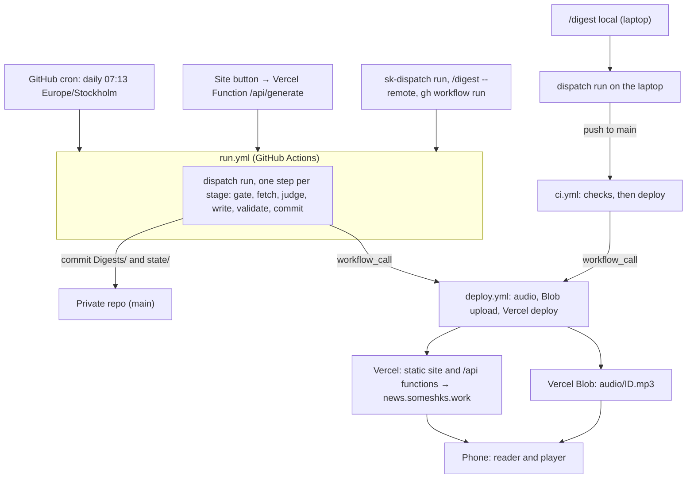

# Dispatch: build plan

> Executable plan for the curation engine, the `news.someshks.work` web app, and the skills that trigger both.
>
> Vision, digest schema and taste model: [vision.md](vision.md). Source registry: [sources.md](../config/sources.md). Decision log: [decisions.md](decisions.md). Operations: [runbook.md](runbook.md). Canonical UI and sound references: [design-spec.md](design/design-spec.md) and [sound-design.md](design/sound-design.md). First design reference: [reader-prototype.html](prototype/reader-prototype.html).
>
> Status: plan v3, revised 2026-10-06. Phase 0 is done and Phase 1 is in progress (repository created, scaffold committed, core contracts frozen). The engine, the web app and the skills are being built in parallel from 2026-10-06 and none is finished: sections below describe the target design, and the phase table in Section 13 records what is done.

---

## 1. What changed from earlier plans

Plan v1 ran the whole job inside a Claude Code cloud routine. Verification showed that is the wrong foundation, so v2 moved the engine into the repo and treats every trigger as a thin caller. Plan v3 (2026-10-06) moves hosting from Cloudflare to Vercel; the changes are listed after the v2 table.

| v1 assumption | What verification showed | v2 decision |
| --- | --- | --- |
| Cloud routine runs the pipeline | Routines push to `claude/` branches by default, start with a restricted network allowlist, and the API trigger (`/fire`) is an experimental beta limited to 30 fires per hour per routine | Engine runs on GitHub Actions (stable, full network, own secret store). Routine becomes optional, not required |
| An agent with tools reads untrusted web text | Broad network plus tools plus secrets is the worst case for prompt injection | The LLM is a pure function: text in, schema-validated JSON out, no tools, no secrets in its reach |
| Claude API for curation | You chose Nebius, and Jev if needed | TypeSafe Jev for typed judgments and a cheap Nebius model (OpenAI-compatible API) for writing; both are config values chosen by a bake-off |
| Site button fires the routine | Experimental endpoint | Button dispatches a GitHub workflow. The REST API is stable and returns a run id (`workflow_run_id`, HTTP 200) |
| Audio per section | Speechify returns word-level marks with absolute millisecond times | One MP3 per digest plus a timeline, so the lock screen shows one track with a working scrubber, and every item can be a seek target |
| Local skill fires the routine | Personal skills do not load in cloud sessions | Skills for work inside the repo live in `.claude/skills`. A personal-scope skill, `sk-dispatch`, works from any directory and falls back to `gh` when no checkout exists (Section 9) |

What changed in v3 (2026-10-06):

| v2 assumption | v3 decision |
| --- | --- |
| Cloudflare Workers static assets, R2, KV and Turnstile | Vercel: static site plus server-rendered `/api/*` routes, Vercel Blob for audio, DNS stays on Cloudflare (D10) |
| Generate button is a Worker with KV counters and a bot check | A Vercel Function with a stateless cooldown read from the GitHub API, no KV and no Turnstile in v1 (Section 8.9) |
| `publish.yml` publishes and deploys, called by `run.yml` and `ci.yml` | A reusable `deploy.yml` does the same work with the Vercel CLI; the Vercel Git integration is not used (Section 10) |
| Keys set one at a time with `gh secret set` and `wrangler secret put` | Fill a gitignored `.env`, then run `npm run secrets:push`; the agent never sees key values (Section 5) |
| One personal-scope junction exposes the in-repo skills | A separate personal skill, `sk-dispatch`, built in `~/.agents/skills` (D16) |
| UI and sound described in this file | Specified in the design docs; this file keeps the product requirements (Section 8) |

Corrections to my own earlier claims, found during verification:

- Pushes made with `GITHUB_TOKEN` do not trigger `push` workflows, but a reusable workflow called inside the same run does execute. The pipeline is built around that.
- GitHub's secret-scanning push protection is not available for private repos on the Free plan. The plan uses gitleaks instead.
- The site uses `news.someshks.work` only. `www.news.someshks.work` is never created.

---

## 2. Product definition

**What it is.** A private briefing for a design engineer: about twelve items every second day, plus a weekly deep dive, written in plain language, readable in about two minutes or listenable in about four.

**Primary jobs, in priority order**

1. Scan on a phone in under three minutes and know what matters.
2. Listen hands-free (commute, walking) with lock-screen controls.
3. Tell the system what it got wrong in one sentence, and have tomorrow's briefing reflect it.

**Non-goals for v1:** accounts, comments, social sharing, search, push notifications, X/Twitter ingestion, offline audio, multi-language. A digest landing is announced by its commit only (D11).

---

## 3. Decisions

[decisions.md](decisions.md) is the log: date, reason and rejected alternatives for each entry. This table is the index, with the section that implements each decision.

| # | Decision | Where |
| --- | --- | --- |
| D1 | Engine runs on GitHub Actions | 4 |
| D2 | Repository lives in this folder | 6 |
| D3 | Judge is TypeSafe Jev; writer is a cheap Nebius model chosen by a bake-off | 7.5 |
| D4 | Astro with React islands, Base UI, hand-written token CSS | 8.1 |
| D5 | One MP3 per digest with word marks, from Speechify | 7.7 |
| D6 | Daily cron with a calendar-date gate, plus a Sunday weekly pass | 7.2, 10 |
| D7 | Podcast feed deferred | 8.10 |
| D8 | "Thought of the Day" cut | [vision.md](vision.md) Section 3 |
| D9 | Repository `somesh-ks/dispatch`, private | 6 |
| D10 | Hosting on Vercel | 8.9, 10 |
| D11 | Notification is the commit only | 2 |
| D12 | Voice limits as specified in 7.6 | 7.6 |
| D13 | Accounts for Nebius, TypeSafe, Exa, Firecrawl and Speechify exist | 13 |
| D14 | Docs and config filenames are lowercase kebab-case | 6 |
| D15 | Persisted keys are snake_case and code follows them | 7.3 |
| D16 | Personal-scope skill `sk-dispatch`, built separately | 9 |
| D17 | UI and sound specified in `docs/design/` | 8 |
| D18 | UI sounds are procedural Web Audio from `@dispatch/sound` | 8.12 |

---

## 4. Architecture

### 4.1 Flow



### 4.2 Independence contract

The pipeline must behave the same wherever it is invoked: Actions, laptop, the site button, or a skill run from another folder.

1. **One engine, one CLI.** Every trigger calls `dispatch run`. Workflows, the Generate function and the skills contain no pipeline logic.
2. **Hermetic.** The engine reads only repo files and environment variables. It never reads `~/.agents`, `~/.claude`, or absolute paths. The repo root is found with `git rev-parse --show-toplevel`.
3. **Idempotent and resumable.** Each stage writes to `.cache/run/<id>/`, which survives across steps of one job and is never committed. Across jobs only committed state persists. Re-running continues; `publish` converges (a digest without audio gets audio, an up-to-date site is a no-op).
4. **Curator modes by environment.** `NEBIUS_API_KEY` present means the API curator (with `TYPESAFE_API_KEY` it judges through Jev, without it the Nebius fallback judge answers). Absent inside an interactive Claude Code session means the agent curator (the session's model writes a validated selection file). Otherwise it fails with a clear message.
5. **Machine-readable.** Every command supports `--json` and uses stable exit codes, so skills and workflows can consume results. The status endpoint reads `state/last-run.json` instead.
6. **Skills stay thin.** They locate the repo, call the CLI, and interpret JSON. If no checkout is found, they fall back to `gh workflow run -R <owner>/<repo>`.

### 4.3 Trigger matrix

| Trigger | Runs on | Curator | Credentials it needs |
| --- | --- | --- | --- |
| Daily cron | Actions | API | Repo secrets |
| Site Generate button | Actions, via a Vercel Function | API | The function holds a dispatch token as a Vercel environment variable |
| `sk-dispatch run`, `/digest --remote` or `gh workflow run` | Actions | API | Your `gh` login only |
| `/digest` with `.env` keys | Laptop | API | Local `.env` |
| `/digest --agent` | Laptop | Claude Code session | No Nebius key; optional Exa and Firecrawl keys |
| GitHub UI "Run workflow" | Actions | API | Repo secrets |

**Deploying.** `run.yml` calls `deploy.yml` as a reusable workflow after its commit, because pushes made with `GITHUB_TOKEN` do not trigger other workflows. Local runs push to `main`, which triggers `ci.yml`; its final job calls `deploy.yml`. `deploy.yml` has no `push` trigger of its own. It deploys with the Vercel CLI, not the Vercel Git integration (reasons in Section 10).

**Concurrent writers.** `run.yml`, local runs and `/learn` all write to the repo. Local runs and `/learn` start with `git pull --ff-only`, refuse to continue when the tree is dirty or behind, and refuse while a `run.yml` run is in progress (`gh run list`). Bot pushes retry with `git pull --rebase` up to three times.

**Mode defaults.** `/digest --remote`, `sk-dispatch run` and the Generate button dispatch `mode=on-demand`, so the scheduled gate can never turn them into silent no-ops.

### 4.4 Execution model for building this

Work is split so independent streams run in parallel and every phase gets a second pair of eyes.

| Task | Agent | Why |
| --- | --- | --- |
| Source and API verification | `researcher` | Reads a lot, returns tables |
| Locating code, call sites | `scout` | Cheap, read-only |
| Per-phase design when several architectures fit | `planner` | Read-only, returns an ordered plan |
| Engine, web app, design, docs and skills streams | Parallel worktrees (`isolation: worktree`) | Independent file sets, merge at phase gates |
| Review after each phase | `reviewer` | Diff audit before merge |
| Motion and performance audit of the web app | `motion-reviewer` | Whole-directory sweep |
| Unknown-cause bugs | `deep` | Only after a cheaper pass fails |

Rule: subagent reports are inputs, not facts. Anything that drives a decision gets re-checked. In the first planning pass one report was wrong (a certificate-coverage claim) and one cost figure was about 60 times too high (Nebius); both were caught this way. An independent review of the v1 plan then found six blocking defects in the plan itself (publish checkout, digest id collisions, gate semantics, concurrent writers, outcome handling, phase ordering), all fixed in v2.

---

## 5. Where API keys go

Keys never go in the repo, in chat, or in `package.json`. One flow feeds every store:

1. Copy `.env.example` to `.env` and fill it in an editor. `.env` is gitignored.
2. Run `npm run passphrase` once to create the Generate passphrase hash (it prompts with echo off and writes the hash to `.env`).
3. Run `npm run secrets:push`. The script reads `.env` and sends each value to GitHub Actions (`gh secret set NAME`, value on stdin) and to Vercel (`vercel env add NAME production`, value on stdin). It prints names and results, never values.

The agent never sees key values: `.claude/settings.json` denies reading or editing `.env` and `.env.*`, and only `.env.example` (names, empty values) is readable and committed. Step-by-step setup is in [runbook.md](runbook.md).

| Name | Used by | Stored as |
| --- | --- | --- |
| `NEBIUS_API_KEY` | Writing and fallback judgments (`run.yml`, local API mode) | GitHub Actions secret; local `.env` |
| `TYPESAFE_API_KEY` | Jev judgments (`run.yml`, local API mode) | GitHub Actions secret; local `.env` |
| `EXA_API_KEY` | Semantic discovery | GitHub Actions secret; local `.env` |
| `FIRECRAWL_API_KEY` | Feedless sites, last-resort extraction | GitHub Actions secret; local `.env` |
| `SPEECHIFY_API_KEY` | Audio (`dispatch publish` in `deploy.yml`, local audio) | GitHub Actions secret; local `.env` |
| `BLOB_READ_WRITE_TOKEN` | Audio upload and prune (`dispatch publish` in `deploy.yml`) | GitHub Actions secret; local `.env` |
| `VERCEL_TOKEN` | `vercel pull`, `build` and `deploy` (`deploy.yml`) | GitHub Actions secret; local `.env` |
| `VERCEL_ORG_ID` | Same Vercel steps | GitHub Actions secret; local `.env` |
| `VERCEL_PROJECT_ID` | Same Vercel steps | GitHub Actions secret; local `.env` |
| `GITHUB_DISPATCH_TOKEN` | Generate function dispatches `run.yml` and reads run status | Vercel environment variable; local `.env` |
| `GITHUB_REPOSITORY` | Generate function names the repository (`somesh-ks/dispatch`) | Vercel environment variable; local `.env` |
| `GENERATE_PASSPHRASE_HASH` | Generate function checks the passphrase (a salted scrypt hash string with its cost parameters) | Vercel environment variable; local `.env` |
| `YOUTUBE_API_KEY` (optional) | One-time channel-ID lookup | Local `.env` |

Plain configuration with no secret value (`NEBIUS_BASE_URL`, `DISPATCH_MODEL`, `DISPATCH_FALLBACK_MODEL`, `SPEECHIFY_VOICE_ID`) is sent to GitHub Actions variables by the same script, so it stays visible in run logs.

Details:

- **Passphrase.** The Generate function hashes the submitted passphrase with `node:crypto` `scrypt` and the salt and cost stored in the hash string, then compares with `timingSafeEqual`. Choose a long passphrase: it is the only gate on the button (Section 8.9).
- **Local access.** GitHub uses your existing `gh` login. Vercel uses `VERCEL_TOKEN` from `.env`. The `/digest` and `sk-dispatch` skills need no dispatch token.
- **Dispatch token scope.** A fine-grained personal access token limited to this one repository, with Actions read and write and Contents read (to read `state/last-run.json` for the outcome), and nothing else. Set an expiry and record the renewal date in [runbook.md](runbook.md).
- **Vercel token.** Create it with an expiry. It is exposed only to the Vercel steps of `deploy.yml`, never to the build or the curator.
- **Blob token.** Vercel creates `BLOB_READ_WRITE_TOKEN` with the Blob store. The engine uploads with it, so no other storage credentials exist.
- **Blast radius.** The curator step receives the model, judge, search and scrape keys (`NEBIUS_API_KEY`, `TYPESAFE_API_KEY`, `EXA_API_KEY`, `FIRECRAWL_API_KEY`) only. Speechify, Blob and Vercel secrets are referenced only by the publish and deploy steps. Workflows declare minimal `permissions:`.
- **Spend caps.** Nebius is prepaid credit with no per-key limit (account level only), so the balance is the cap: top up modestly and use a key created only for this project. Exa reports a free monthly credit and then bills per request (about 2 USD a month here), so watch its balance. Firecrawl's free credits may be one-time rather than monthly; the spike confirms. Jev has no documented spend cap, but usage is about one cent per run, so check the TypeSafe console monthly. Vercel Blob on Hobby holds 1 GB, which pruning keeps in bounds (Section 7.7).
- **Leak prevention.** `.gitignore` covers `.env`, `.env.*` (except `.env.example`), `.vercel/` and `.cache/`. A gitleaks pre-commit hook and a CI job scan every change, since push protection is paid-only for private repos. The engine redacts known key patterns from logs.
- **Rotation.** If a key ever appears in chat, a log or a commit, revoke it first, then replace it. After changing a Vercel environment variable, redeploy: new values apply only to new deployments.

---

## 6. Repository

### 6.1 Layout

```text
dispatch/
  .claude/skills/digest/        # /digest: trigger, status, agent-curator protocol
  .claude/skills/learn/         # /learn: free-text feedback to bounded preference patch
  .github/workflows/            # run.yml, deploy.yml, ci.yml
  apps/web/                     # @dispatch/web: Astro site, React islands, /api functions
  packages/core/                # @dispatch/core: Zod schemas, env, ids, paths, time
  packages/engine/              # @dispatch/engine: the `dispatch` CLI
  packages/cover/               # @dispatch/cover: seeded cover-art templates and renderer (Section 8.11)
  packages/sound/               # @dispatch/sound: procedural UI sounds on Web Audio (Section 8.12)
  config/                       # preferences.json, sources.md, sources.json, voice.md
  Digests/YYYY/MM/              # <id>.md, <id>.audio.json (id: date, -weekly, -2)
  state/                        # seen.json, judgments.json, last-run.json, usage.json, runs/
  scripts/                      # npm run secrets:push and npm run passphrase
  tokens/tokens.json            # W3C design tokens, source of truth
  tokens/covers.json            # cover palettes in the same format
  docs/                         # build-plan.md, vision.md, decisions.md, runbook.md,
                                #   design/, prototype/, reference/
  .env.example  .gitignore  .gitattributes  .nvmrc  biome.json  package.json
```

`docs/design/` holds `design-spec.md` and `sound-design.md`. `docs/prototype/` holds `reader-prototype.html`, `ui-prototype.html`, `sound-lab.html` and `cover-contact-sheet.html` (the last three arrive with the design work). `docs/reference/` holds `resources.md` and `sources-reference.md`. Docs and config filenames are lowercase kebab-case (D14).

Shared interfaces already exist: the Zod contracts in `packages/core` (item, digest, audio timeline, state files, sources, preferences, env) and the command context and logger in `packages/engine/src/context.ts`. Persisted keys are snake_case and the TypeScript code uses the persisted names (D15).

### 6.2 Tooling

| Concern | Choice | Reason |
| --- | --- | --- |
| Package manager | npm workspaces | pnpm is not installed, and a global install needs your approval |
| Runtime | Node 24 or newer, pinned in `.nvmrc` and `engines` | Local Node is 26; CI reads `.nvmrc` |
| Language | TypeScript, strict, no `any` | Your code standards |
| Lint and format | Biome | One fast tool; `astro check` covers `.astro` files |
| Unit tests | Vitest | Runs the engine against saved fixtures offline |
| End-to-end | Playwright (Chromium and WebKit, mobile viewport) with axe | Player behaviour, accessibility |
| Budgets | Lighthouse CI and a bundle size check | Enforce Section 8.8 |
| Hygiene | gitleaks, actionlint | Secrets and workflow syntax |
| Hosting CLI | Vercel CLI (`vercel`), run in `deploy.yml` from `apps/web` | Prebuilt deploys without the Git integration (Section 10) |
| Line endings | `.gitattributes` forces LF | Avoids CRLF churn in digests on Windows |
| Commits | Conventional Commits; bot uses `chore(digest): YYYY-MM-DD` | Your git conventions |
| Decisions log | [decisions.md](decisions.md) | Required by your workflow rules |

### 6.3 Dependency posture

Add a dependency only when it removes real work. Candidates and the reason for each:

| Package | Why |
| --- | --- |
| `@typesafe-ai/sdk` | Typed judgments (Choice, Noul, Score) from Jev |
| `openai`, `zod` | OpenAI-compatible client pointed at Nebius, with schema-validated output (`zodResponseFormat`) |
| `fast-xml-parser` | RSS and Atom |
| `@resvg/resvg-js` (or its WASM build) | Rasterize cover art to PNG at build time |
| `@mozilla/readability`, `linkedom` | Free full-text extraction before paid scraping |
| `astro`, `@astrojs/react`, `@astrojs/vercel`, `react`, `react-dom` | Web app and its Vercel adapter |
| `@base-ui/react` | Drawer, Slider, Dialog, Field, Switch |
| `@vercel/blob` | Audio upload and prune from the engine |
| `vercel` (CLI) | Pull, build and deploy in `deploy.yml`, project and domain setup |

Everything else uses the platform: `fetch`, `node:crypto` (`scrypt`, `timingSafeEqual`) in the Generate function, native `<dialog>` where Base UI is overkill, View Transitions, Media Session, Web Audio for UI sounds.

---

## 7. Engine

### 7.1 Commands

| Command | Purpose |
| --- | --- |
| `dispatch doctor` | Checks Node, git, keys present (names only), and reachability of each service |
| `dispatch fetch` | Gathers candidates since the last run into `pool.json` |
| `dispatch curate` | Triage and write; `--mode api` or `--mode agent` |
| `dispatch extract --ids` | Full text for chosen items (used by agent mode) |
| `dispatch render` | Validates a selection and writes the digest and audio script |
| `dispatch validate` | Schema, link and limit checks on any digest |
| `dispatch audio --digest <id>` | Speech synthesis and timeline for one digest |
| `dispatch publish` | Audio for any digest inside the retention window that lacks it, upload to Vercel Blob, commit of `.audio.json`, the digest's `audio` field and `usage.json`. `--prune` deletes audio older than about 120 days from Blob. Deployment is a separate Vercel CLI step |
| `dispatch run` | Orchestrates the stages. `--mode scheduled\|on-demand\|weekly`, `--stage gate\|fetch\|judge\|write\|validate` (one stage, used by workflow steps), `--force`, `--since <date>`, `--dry-run`, `--no-push` |
| `dispatch learn --apply` | Applies a validated preference patch with bounds |
| `dispatch sources discover\|check` | Finds feeds, reports failing sources |
| `dispatch status` | Last run, next eligibility, budgets |

### 7.2 Pipeline stages

| # | Stage | Detail |
| --- | --- | --- |
| 1 | Gate | A regular digest is due when the Stockholm calendar date is two or more days after the last regular digest, so a delayed cron still lands on the right day. On Sundays the weekly pass runs after the regular one. On-demand and `--force` ignore the gate |
| 2 | Fetch | Per-source timeout and retry; failures are logged, never fatal. The window starts at the last successful fetch of any kind, capped at 7 days (first run: 3 days). Overlap is harmless because `seen.json` removes items already shown |
| 3 | Normalize | One item shape, with `id = sha1(canonical_url)` |
| 4 | Dedupe | Strip tracking parameters, resolve redirects, drop anything in `seen.json`, collapse newsletter items that point at originals already in the pool |
| 5 | Prefilter | Hard-drop `disliked_patterns`; keep keyword, preferred-author and high-signal-source matches; cap near 60 |
| 6 | Judge (Jev) | Per item, from title and snippet only: category probabilities, craft depth, hype, sponsorship and funding flags. Cached by item, question set and model version |
| 7 | Score (code) | Probability-weighted category weight, times craft depth, reduced by the flags, plus a small author and keyword bonus. Threshold and caps live in code, not in a prompt. Changing weights re-scores from the cache |
| 8 | Extract | Full text for finalists, cheapest first: text Exa already returned, feed content, Readability, then Firecrawl for JavaScript-heavy or blocked pages, throttled to its free-plan rate |
| 9 | Write (LLM) | Headline, summary and why line from the extracted text only, following `config/voice.md` (Section 7.6). The spoken text is assembled by code from those fields and is never written separately |
| 10 | Validate | Schema, URLs exist in the pool, grounding check (Jev) of every summary and why sentence against the source text, voice lint and length limits (Section 7.6), no links or markdown in model text, no empty sections, no repeats |
| 11 | Persist | Digest, `seen.json`, `judgments.json`, `last-run.json` (with an `outcome`) and a run log holding counts and source status only, never fetched text. The write guard (below) runs before every commit |

**Item counts.** Target 8 to 12, hard cap 12 (weekly 18), floor 3. With 3 to 7 qualifying items the digest is shorter, never padded. Below 3, nothing is published.

**Outcomes.** Every run ends in one `outcome`, written to `state/last-run.json` and exposed as a job output: `published`, `gated`, `nothing` or `failed`. `nothing` is a successful run: it advances the fetch window, records the judged items in `seen.json`, and commits only `state/`. The site and the status endpoint use one sentence for it: "Nothing cleared the bar." `failed` leaves the window and `seen.json` untouched.

**Write guard.** Each command may change only its own paths: `run` writes `Digests/` and `state/`; `publish` writes `Digests/**/*.audio.json`, the `audio` field in the frontmatter of the digest it voiced, and `state/usage.json`; `learn` writes `config/preferences.json`. A path outside the list aborts the commit.

**State files.** `last-run.json` keeps one record per kind (keys `regular`, `weekly`, `on_demand`), so an on-demand run never shifts the regular cadence. It also holds the end of the last successful fetch and the last cover, so the next cover can avoid repeating it. `seen.json` maps item id to date and is pruned at 90 days. `judgments.json` caches Jev answers by item id, question-set hash and model version, pruned at 30 days, so `/learn` can re-score without new calls. `.cache/` is gitignored.

### 7.3 Normalized item and digest file

```json
{
  "id": "first-12-hex-of-sha1-of-canonical-url",
  "url": "", "canonical_url": "", "title": "",
  "source_id": "", "source_type": "rss",
  "author": "", "published_at": "", "fetched_at": "",
  "snippet": "", "signals": { "hn_points": 0 }
}
```

The digest is Markdown with frontmatter. The frontmatter is the single source for the site; the body is generated from it for reading in an editor or on GitHub.

```yaml
---
id: 2026-10-07
date: 2026-10-07
kind: regular
verified: true
generated_at: 2026-10-07T05:21:00Z
window: { from: 2026-10-05T05:13:00Z, to: 2026-10-07T05:13:00Z }
read_minutes: 3
listen_minutes: 4
audio: { url: "https://<store>.public.blob.vercel-storage.com/audio/2026-10-07.mp3", duration_ms: 248000 }
cover: { template: spring, palette: dusk, seed: 4117 }
items:
  - id: "3f2a9c1e5b07"
    section: ui-craft
    category: design_engineering_craft
    source_type: rss
    headline: ""
    url: ""
    source: ""
    author: ""
    summary: ""
    why: ""
    score: 0.91
---
```

`audio` is `null` until `dispatch publish` has voiced the digest, which then sets it to the Blob URL and duration. `kind` is `regular`, `weekly` or `on-demand`.

**Digest ids and filenames.** A digest id is the Stockholm date, with `-weekly` for the weekly pass and `-2`, `-3` for further runs on the same day (on-demand). Files are `Digests/YYYY/MM/<id>.md` and `<id>.audio.json`, the audio is `audio/<id>.mp3` in the Blob store, and the route is `/d/<id>`. The engine never overwrites an existing id; it takes the next free suffix.

**Audio timeline file** (`<id>.audio.json`):

```json
{
  "digest": "2026-10-07",
  "voice": "geffen_32",
  "model": "simba-3.2",
  "timeline": "marks",
  "duration_ms": 248000,
  "text_chars": 4710,
  "items": [{ "id": "3f2a9c1e5b07", "section": "ui-craft", "start_ms": 0, "end_ms": 21400 }],
  "sections": [{ "slug": "ui-craft", "start_ms": 0 }]
}
```

`timeline` is `marks` or `estimated`.

**Naming.** Persisted keys are snake_case in every file (frontmatter, JSON, state), and the TypeScript types use the same names, so no mapping layer exists (D15). Enum values keep their own spelling, for example `on-demand`, `ui-craft` and `design_engineering_craft`.

**Sections.** The ten weight keys map to six digest sections. `design_engineering_craft`, `ui_component_primitives`, `css_canvas_motion_techniques` and `taste_and_design_philosophy` go to Interaction craft (`ui-craft`). `ai_ux_interaction_patterns` and `frontier_model_releases` go to AI models and products (`ai`). `hci_empirical_research` goes to Research (`research`). `developer_tool_launches` goes to Launches (`launches`). Items from `youtube` sources go to Watch and listen (`watch`) whatever their category. `venture_capital_and_gossip` and `generic_ai_hype_listicles` never publish. Top picks (`top`) are the three highest scores, removed from their home section. The weekly pass reserves one slot for the best item outside the top-weighted categories, so taste does not narrow.

**Contracts are frozen.** Item, digest frontmatter, audio timeline, state files, `sources.json` (id, url, type, feed URL, tier, `high_signal`, consecutive failure count) and `preferences.json` are Zod schemas in `packages/core`, and the engine's command context is in `packages/engine/src/context.ts`, so the parallel streams share one contract. Changing a frozen schema needs an entry in [decisions.md](decisions.md) and a note to every stream.

### 7.4 Sources and access

| Channel | Access | Key |
| --- | --- | --- |
| Hacker News | Algolia `search_by_date` with `numericFilters` | None |
| GitHub releases | `releases.atom` (all nine repos tested returned a feed) | None |
| arXiv cs.HC | API query for daily freshness; RSS only announces on weekdays | None |
| TOCHI, PACMHCI | Crossref `works` with `issn` and `from-index-date`, polite `mailto` | None |
| Product Hunt, Lobsters | Public feed, `hottest.json` | None |
| Blogs and newsletters | RSS or Atom found by `sources discover` | None |
| Feedless or JavaScript-heavy pages | Firecrawl `POST /v2/scrape` (renders JavaScript, 1 credit per basic page; free plan 10 requests per minute, 2 concurrent) | Yes |
| Semantic discovery | Exa `POST /search` with `startPublishedDate`, optional inline text (about 7 USD per 1,000 searches, 1 USD per 1,000 content fetches) | Yes |
| YouTube | Channel `videos.xml` feed. Handle-to-ID resolution needs a one-time lookup | Optional, one-time |
| X/Twitter | Out of scope | n/a |

Feed discovery results from this pass (starting hints; `sources discover` re-verifies and probes common paths such as `/feed`, `/rss.xml`, `/atom.xml`, `/feed.xml`, `/atom`):

- Confirmed feeds: Josh W. Comeau, Simon Willison, Cloudflare blog, Next.js blog, Cooperpress (JavaScript Weekly and siblings), console.dev.
- Reported as no feed (unreliable; the check only read page markup): rauno.me, emilkowal.ski, jhey.dev, Anthropic, OpenAI, DeepMind, Vercel, Linear, Tailwind, shadcn changelog, bytes.dev, TLDR. These get path probing first, then Firecrawl.
- Not yet checked: css-weekly, frontendfoc.us, Smashing, sidebar.io, Friday Checkout, toools.design, uithings, auxfirst.
- Registry fixes still open (carried from Phase 0 into Phase 3): Rauno's handle is `@raunofreiberg` (the registry says `@rauno_rocks`); Lee Robinson left Vercel in 2025, so his registry description is stale.

### 7.5 Models and judgments

Two roles, each behind its own interface so either can be swapped without touching the pipeline.

| Role | Default | Job |
| --- | --- | --- |
| Judge | TypeSafe Jev | Typed, calibrated judgments: category, craft depth, hype and sponsorship flags, grounding check |
| Writer | Cheapest Nebius model that passes the quality bar (start with Qwen3-32B) | Two-sentence summary, why line and spoken line in the house voice |
| Fallback judge | The Nebius writer model answering the same questions as JSON | Used when Jev returns 429 or 529, or is down |

**Judge: TypeSafe Jev**

| Aspect | Design |
| --- | --- |
| Access | npm `@typesafe-ai/sdk`, `new TypeSafeClient()`, key in `TYPESAFE_API_KEY`, `POST https://api.typesafe.ai/v1/systemone` with Bearer auth, sign-up through console.typesafe.ai. Confirmed against TypeSafe's docs; confirm the Score and Noul helpers against the installed SDK types in the spike |
| Primitives | Choice (criteria object), Score (criteria array, returns the expected level plus probabilities), Noul (probability of yes). Answers carry probabilities and confidence, and the response reports token usage |
| Item judgments | One request per item. State: title, source, author, snippet, signals. Questions: `category` (Choice over the weight keys plus `none`), `craft_depth` (Score, five levels from "announcement or opinion with no technique" to "mechanism shown with code or measurements"), and Noul flags `is_listicle_or_hype`, `is_sponsored_or_promotional`, `is_funding_news`. The questions are independent, so they run in parallel in one call |
| Score in code | `taste` = the sum over categories of `P(category) x weight[category]`, times normalized craft depth, reduced by the hype, sponsorship and funding probabilities, plus the small author and keyword bonus. Probabilities rather than the top pick keep near-ties honest |
| Weights without inference | Judgments are cached by item id, question-set hash and model version. `/learn` changes weights and the pool is re-scored from the cache with no new calls |
| Grounding check | A Noul per summary and why sentence over the sentence and the relevant source excerpt (about 36 checks per run): "The excerpt directly supports the sentence." Below the tuned threshold the item is rewritten once, then dropped |
| Thresholds | Tuned on the golden set and never copied from documentation examples |
| Limits | The docs state 255 options per Choice and list 401, 422, 429 and 529 as errors. Figures from secondary sources and not yet confirmed: about 32K tokens of state, about 2,400 requests per minute, 70 to 500 ms per call. Retry with backoff on 429 and 529 |
| Price | About 0.04 USD per million input tokens, derived from TypeSafe's published "238x lower input price" claim against a 10 USD per million model. Roughly 0.01 USD per run at this volume. TypeSafe says the price may be subsidized, which is why the fallback judge stays wired |
| Early-stage risk | Use `jev-latest` while tuning, pin the exact version once thresholds are set, keep the fallback judge, and revalidate quarterly |
| Data | Confirm retention and training terms in the console before enabling |

**Writer: Nebius Token Factory**

| Aspect | Design |
| --- | --- |
| Provider | OpenAI-compatible. Base URL `https://api.tokenfactory.nebius.com/v1/` (override with `NEBIUS_BASE_URL`), header `Authorization: Bearer $NEBIUS_API_KEY` |
| Client | The official `openai` npm package with `baseURL`, behind one `LlmClient` interface |
| Models | Config holds a primary and a fallback ID (`DISPATCH_MODEL`, `DISPATCH_FALLBACK_MODEL`). IDs are pinned exactly: Nebius retired dozens of text models in 2026 and the reported notice periods are inconsistent. `dispatch doctor` checks both IDs against `GET /v1/models`, and the client fails over on model-not-found |
| Choosing the model | The cheapest model that clears the bar in the Phase 4 bake-off. Start with Qwen3-32B (reported 0.10 and 0.30 USD per million input and output tokens). Stronger references for comparison: gpt-oss-120b and DeepSeek-V3. The bar: voice-lint pass rate, grounding pass rate, JSON validity, and a read-through of the golden outputs. IDs and prices are confirmed against the live model list and pricing page in the spike |
| Structured output | `response_format: json_schema` (strict) through `zodResponseFormat` from `openai/helpers/zod`; `json_object` where a model mishandles strict schemas. Every response is re-validated with Zod, retried once with the error appended, then the item is dropped and logged |
| Sampling | Temperature at or below 0.2, thinking disabled (the toggle name varies by model, so the spike confirms it) |
| Caching | None reported on Nebius. Negligible at about 40K input tokens per run |
| Budget guard | No token-counting endpoint, so the engine estimates locally, reads `usage` after each call, and aborts above `MAX_TOKENS_PER_RUN` (default 400,000). The prepaid balance is the hard cap |
| Limits | Reported Starter tier: 400K tokens and 600 requests per minute. Concurrency 4 with backoff on 429 and 5xx |
| Batch API | Not used; on-demand runs need answers in minutes |
| Data handling | Reported: no training on customer data, zero-data-retention available at organization level, EU (Finland) hosting. Read the policy and enable zero retention before the first live call (Phase 2) |
| Embeddings (v1.1) | Qwen3-Embedding-8B was reported at about 0.01 USD per million tokens, enough for semantic duplicate detection across sources |
| Quality escape hatch | Agent curator: the Claude Code session writes the selection, validated by the same code |

Safeguards that apply to both roles:

- Summaries come from extracted text only and are short by construction (Section 7.6).
- Fetched content reaches the models as clearly delimited data. Neither model has tools or secrets, every output URL must exist in the input pool, and the site escapes all model text.
- Judge and writer outputs are validated by code, so a wrong or missing answer degrades one item, never the run.

### 7.6 Editorial voice

The voice is distilled from your communication playbook: brevity signals status, specific craft recognition replaces praise, and nothing opens with a preamble. The rules live in [voice.md](../config/voice.md) (distilled rules only; the playbook itself stays out of the repo). The writer prompt loads that file and the validator enforces its measurable parts. The limits below are confirmed (D12) and mirrored in code as `VOICE_LIMITS` in `packages/core`.

| Principle | In the digest |
| --- | --- |
| Brevity is status | No greeting, intro paragraph, sign-off or "in today's briefing". A headline, two short sentences, one line on why |
| Specific over general | Name the technique, feature, number or result. Authors are credited by what they shipped, never praised |
| No hype, no flattery | No "game-changing", "excited", "huge", "must-read", "revolutionary" or exclamation marks |
| Peer to peer | The reader is a design engineer. No explaining basics, no "you should", no questions to the reader |
| Curator, not aggregator | Few items. Empty sections are omitted. A quiet day publishes nothing and the site says "Nothing cleared the bar." |
| Why is usable | The why line names what the reader can try, copy or watch for, never that something "matters" |

Measurable limits, enforced in validation:

| Field | Limit |
| --- | --- |
| Headline | 12 words |
| Summary | 35 words, two sentences at most |
| Why | 18 words, one sentence |
| Items | Regular digest: target 8 to 12, hard cap 12, floor 3; about 2 minutes to read and 4 to listen. Weekly: up to 18 |

Pairs the writer prompt uses as exemplars:

| Weak | Strong |
| --- | --- |
| An exciting new library makes animations easier | Springlet 2.0 retargets springs mid-flight, so interrupted drawers keep their velocity |
| This could change how we design agent interfaces | Four measures for agent UIs: first useful signal, correction cost, interruptions, recovery |
| Why: important for anyone interested in motion | Why: copy the retargeting pattern for drawers and toasts |

Deterministic voice lint, run on every written field:

- Banned words and phrases (hype adjectives, stock AI vocabulary, "in today's", "delve", "landscape", "unlock", "game-changer" and similar), kept in `config/voice.md`.
- No em dashes, no exclamation marks, no emoji, no markdown or links inside model text.
- No "not just X but Y" contrasts, no rhetorical questions, no second-person imperatives.

A failing field is rewritten once with the lint error appended, then the item is dropped and logged. The weekly golden evaluation also runs the `humanizer` skill's checks as a stricter offline review.

Audio follows the same bar: one opening line ("Dispatch, Wednesday 7 October. Eleven items."), the section name as the only transition, no outro. Site copy follows it too: sentence case, plain verbs, and errors that say what happened and what to do.

### 7.7 Audio

| Aspect | Design |
| --- | --- |
| Endpoint | `POST /v1/audio/stream/with-timestamps` (Server-Sent Events; `speech.chunk` carries base64 audio and marks, `speech.done` ends the stream) |
| Marks | Word level: `start` and `end` are character offsets into the request `input`; `start_time` and `end_time` are absolute milliseconds |
| Timeline | Spoken text is assembled by code from each item's headline, summary and why, with known character ranges, so the first mark at or after each range gives that item's start time. Stored in `<id>.audio.json` (schema in Section 7.3) |
| Format | `mp3_24000_128`; try a 64 kbps variant in the spike to halve storage. A four-minute digest is about 4 MB at 128 kbps and about 2 MB at 64 kbps |
| Limits | 20,000 characters per request. A digest is about 5,000 characters (weekly about 8,000), so one request always suffices. The engine fails closed above 19,000 instead of splitting |
| Rate | Free plan: 3 concurrent requests, 1 per second. Calls run sequentially |
| Budget | `state/usage.json` tracks characters, is committed by `publish`, and so survives between runs; stop at 90 percent of the monthly allowance |
| Fallback | If marks are unavailable on the free plan, use `/v1/audio/stream` and estimate chapter starts from character share, flagged `timeline: "estimated"` |
| Storage | Vercel Blob, public store, key `audio/<id>.mp3`, uploaded by the engine with `@vercel/blob` and `BLOB_READ_WRITE_TOKEN`. The URL the upload returns is stored in the digest's `audio.url`. Blob answers Range requests; the spike confirms seeking on a locked iPhone |
| Retention | Hobby Blob storage is 1 GB. Audio older than about 120 days is deleted by `dispatch publish --prune`, which `deploy.yml` runs on every deploy. At about 20 digests a month and 4 MB each, 120 days is about 320 MB. The text digest and the timeline stay. The player shows no audio for a digest past the window (one retention constant shared by the engine and the site) and treats a 404 the same way. Other Hobby limits (operations, transfer) are checked in the spike |
| Allowance | Speechify's pricing page lists 500K characters per month on the free tier with a hard cap. One verification report said there is no monthly quota. Treat 500K as the planning figure and confirm in the spike |

The spoken text is derived from the same fields the page displays, which keeps word-level read-along possible later.

### 7.8 Taste feedback

`/learn "more shaders, less VC funding"` flow: the session model turns the sentence into a patch (weight deltas, keyword and pattern edits); `dispatch learn --apply` enforces plus or minus 0.05 per weight per call, schema validity and an overall drift limit, appends to `feedback_history`, prints the diff, and only then commits and pushes. Because the patch is data, `/learn` works with or without an API key.

### 7.9 Failure behaviour

- A failed source is logged; the digest footer mentions failures only when three or more sources failed.
- A total failure leaves `last-run.json` unchanged, so the next window grows and nothing is lost.
- A TTS failure still publishes the text digest with `audio: null`; the player shows "Audio is still being prepared", and `deploy.yml` retries on the next `run.yml` of any outcome, including `gated` and `nothing`, because `run.yml` always calls it.
- Concurrency: `run.yml` declares `concurrency: { group: dispatch, cancel-in-progress: false }`. `deploy.yml` declares none, because a called workflow that shares its caller's group gets cancelled. The deploy job in `ci.yml` joins the same group on the calling job, so a deploy never overlaps a `run.yml` run. GitHub keeps one pending run per group, so duplicate presses collapse.

---

## 8. Web app

[design-spec.md](design/design-spec.md) is the canonical reference for the interface (layout, type, color, components, motion, states) and [sound-design.md](design/sound-design.md) for UI sounds (D17). This section keeps what the product must do and the technical constraints behind it. Where the two disagree on visual or interaction detail, the design docs win; where they disagree on a requirement stated here, raise it before building.

### 8.1 Stack and why

| Option | First-load JS for reading | Persistent player | Fit with your standards | Verdict |
| --- | --- | --- | --- | --- |
| Astro with React islands | Near zero for content; islands load on idle | Module-scope audio singleton survives navigation | React, Base UI, CSS-first | Chosen |
| Vite React SPA with a router | React plus router on every load | Trivial | Same | Heavier for a reading app |
| SvelteKit | Smallest runtime | Trivial | Leaves your React ecosystem and Base UI | Good, but not worth the switch |

The reading experience should be HTML first and instant, with the player as progressive enhancement. Astro delivers that. The audio element lives in a JavaScript module as `new Audio()` (not in the DOM), so it keeps playing across client-side navigations regardless of how the router swaps the page. This avoids a reported Astro regression where media inside `transition:persist` containers was recreated on navigation (issue 17749). A fix (PR 17750) is reported in Astro 7.3.x, but the design does not depend on it. Astro's docs say module scripts run once and do not re-run on navigation; the spike confirms that on a real phone.

The site is built static. Only `/api/*` runs on the server, as Vercel Functions through `@astrojs/vercel` (Section 8.9).

### 8.2 UI library and styling

Details live in [design-spec.md](design/design-spec.md). The constraints that shape the build:

- **Base UI** (`@base-ui/react`): unstyled and accessible, so the look stays ours. Used for Drawer, Slider, Dialog, Field and Switch. Radix is skipped because the shadcn and Radix drawer rests on Vaul, which is unmaintained.
- **Not Tailwind or shadcn.** Both pull toward the templated look you want to avoid.
- **Tokens.** `tokens/tokens.json` in the W3C format, compiled by a small script into CSS custom properties. Dark mode swaps semantic tokens. No literal durations, easings or colors in components.
- **Motion.** CSS transitions, `@starting-style` and the View Transitions API first; `motion` only if a gesture needs a spring.
- **Fonts.** Schibsted Grotesk and Literata, self-hosted as subset variable files, never a font CDN.

### 8.3 Screens and components

The design spec defines each screen. The product needs these parts:

| Screen or part | Notes |
| --- | --- |
| Digest page (`/`, `/d/<id>`) | Date, play, a timeline rail, items grouped by section. Server-rendered HTML |
| Archive (`/archive`, month pages) | Year then month then day; weekly dives marked |
| Player bar and expanded player | Persistent bar; expands to cover, scrubber with item ticks, 15 second skips, previous and next item, chapter list, speed |
| Generate sheet | Passphrase, progress steps, clear errors (Section 8.9) |
| Settings sheet | Theme, default speed, UI sounds, install hint |
| States | Empty, nothing new, audio preparing, audio expired, offline, error, stale briefing |

[reader-prototype.html](prototype/reader-prototype.html) is the first reference for the rail, the one-item-at-a-time dimming and the hero. With a real timeline the rail fills continuously inside an item, not in steps.

### 8.4 Player behaviour

- One `<audio>` element created in JavaScript, never in the DOM. State is a small external store read with `useSyncExternalStore`, so no state library is added.
- Media Session: title and artwork; handlers for play, pause, seek backward and forward, seek to, previous and next track (mapped to items); `setPositionState` so the lock-screen scrubber works.
- Item seek from any play button using the timeline; chapter list in the Drawer.
- Remembers position per digest and resumes there.
- A digest past the audio retention window has no player (Section 7.7); the page says the audio has expired.
- iOS: use a plain `<audio>` element for narration (Web Audio is treated as ambient and is silenced in the background). UI sounds are separate and never carry narration (Section 8.12). Background playback in standalone apps has worked since iOS 15.4 (WebKit bug 198277), but reports of pause-and-resume and lock-screen quirks persist, so Section 12 makes a real-device test a gate.
- If the lock screen drops controls during the spike, first try re-registering the Media Session handlers on `visibilitychange`. A "silent carrier audio" workaround circulates but is unverified and is not planned.

**Feel.** The player should behave like a native one: instant response, continuous motion, no waiting on the network for anything the listener can already see.

| Aspect | Design |
| --- | --- |
| Response | Press feedback within one frame on every control (scale 0.97 on press). Play starts from the first tap with the audio request already warm: `preload="metadata"` on the digest page, and the source is attached before the tap |
| Scrubber | Pointer-capture drag with a 44px tall hit area over a thin track, velocity-aware, with a tick at each item start from the timeline and a time label that follows the thumb. Dragging never fights playback updates. Keyboard: arrows seek 5 seconds, page keys seek by item |
| Mini to full | The cover is a shared element between the bar and the expanded player, morphed with the View Transitions API and a CSS fallback. The Drawer follows the finger, snaps with a spring, and dismisses by flick |
| Rail link | The reading page's rail position and the scrubber are one state, so scrubbing moves the page and tapping an item moves the audio |
| Buffering | Skeleton track and a quiet spinner only after 300 ms; never a layout shift |
| Interruptions | On `pause` caused by the system (call, alarm), remember it and offer resume instead of auto-playing. Resume position per digest is saved every 5 seconds |
| Speed | 1x, 1.25x, 1.5x, 2x with `preservesPitch` on; remembered |
| Up next | After the last item the player offers the previous digest, not an autoplay chain |
| Sleep timer | v1.1: 5, 15, 30 minutes or end of digest |
| Haptics | None promised: iOS Safari exposes no vibration API. Visual and motion feedback carry the feel |
| Reduced motion | Morphs become crossfades; the rail and scrubber still update |
| Lock screen | Title is the digest date, artist "Dispatch", album the month, artwork is the generated cover (Section 8.11) |

### 8.5 Responsive behaviour

Mobile first, with breakpoints chosen where the content stops fitting, not by device.

| Width | Layout |
| --- | --- |
| Under 40rem | Single column, bottom player, sheets slide up |
| 40rem to 72rem | Reading column stays 40rem; chapters appear as a sticky aside when there is room; sheets become centered dialogs |
| Over 72rem | Same column, centered, more air; no extra chrome added just to fill space |

Layout rules: logical properties throughout, no fixed widths on text, container queries for components, content bleeds while controls stay inside safe areas, no controls in the top-left 64px (iPadOS windowed apps overlay window controls there and `env()` does not report it), layout correct when the top safe-area inset is `0px`.

### 8.6 PWA and iOS

| Item | Decision |
| --- | --- |
| Head | `viewport-fit=cover`, `apple-mobile-web-app-capable`, `mobile-web-app-capable`, status-bar style `black-translucent`, `theme-color` pair for light and dark |
| Status-bar tint | Safari 26 samples a full-width sticky header's `background-color`, so the header gets an explicit opaque background. Hidden overlays use `display: none`, never `opacity: 0` |
| Manifest | `standalone`, `start_url`, name and short name; PNG icons only at 192 and 512 plus maskable |
| Icons | One SVG mark rendered at build to opaque PNGs, including the 180px apple touch icon. Icon, splash and body share one background color |
| Splash screens | Skipped in v1 (they need many device sizes); body background matches the icon to avoid a flash |
| Install hint | Safari on iOS only, not already installed, two or more visits, dismissal remembered permanently, copy says "Add to Home Screen", never "install" |
| Standalone navigation | Visible back control wherever a user can leave the entry screen |
| Keyboard | Generate sheet uses Base UI's virtual-keyboard support; inputs stay at 16px or larger to prevent iOS zoom |
| Touch | `touch-action: manipulation`, tap highlight removed only where another pressed state exists, `overscroll-behavior` set in a stylesheet (not from script) |
| Storage | Treat as best effort; save only convenience state (theme, speed, positions) |
| Service worker | Caches the shell and recent digests, stale-while-revalidate. Audio is not cached in v1, because serving audio from the Cache API without correct Range handling breaks Safari playback |

### 8.7 Accessibility

Native elements first; every control has an accessible name; visible `:focus-visible` rings (two-layer ring that reads on any background, with a forced-colors fallback); 44px touch targets; a polite live region for generation status and playback announcements; correct heading order with one `h1`; reduced motion removes movement but keeps opacity and color transitions; 200 percent zoom and 320px reflow without horizontal scroll; color never the only state signal; sheets trap and restore focus (native `inert` behaviour via Base UI).

### 8.8 Performance budget

| Metric | Budget |
| --- | --- |
| Lighthouse mobile (performance, accessibility, best practices, SEO) | 95 or higher each; your standard is 90 |
| LCP on mid-range phone, 4G | 1.5 s or less |
| CLS, INP | 0 and under 200 ms |
| Render-blocking JavaScript | None (content is server-rendered HTML; islands hydrate on idle) |
| JavaScript total on first load | 100 KB gzipped or less. React and ReactDOM are the main cost (about 55 KB by a reported figure); Base UI parts and `@dispatch/sound` are measured in the spike |
| Fonts | Subset, self-hosted, one preloaded, 80 KB or less in total |

Techniques: inline critical CSS, `content-visibility: auto` on long digests, prefetch on intent for archive links, no third-party scripts.

### 8.9 Generate function and flow

The site is static. `/api/generate` and `/api/status` are Astro endpoints with `export const prerender = false`, so they alone run on demand as Vercel Functions through `@astrojs/vercel`. Astro's `output` setting stays at its default, `static`: per the on-demand rendering guide on docs.astro.build (Astro 7, checked 2026-10-06), an adapter plus `prerender = false` on the endpoint is enough, and the old `hybrid` output mode is not used.

The function needs three environment variables: `GITHUB_DISPATCH_TOKEN`, `GITHUB_REPOSITORY` and `GENERATE_PASSPHRASE_HASH` (Section 5). It keeps no state and uses no KV and no bot check in v1 (D10).

1. The sheet collects a passphrase and posts it to `/api/generate`.
2. The function derives a scrypt hash of the passphrase (`node:crypto` `scrypt`, salt and cost read from the stored hash string) and compares it with `GENERATE_PASSPHRASE_HASH` using `timingSafeEqual`.
3. It checks the limits statelessly. Using `GITHUB_DISPATCH_TOKEN`, it lists recent `workflow_dispatch` runs of `run.yml` through the GitHub API and refuses when one started in the last 6 hours or three started in the last 24 hours. The count includes runs started by `gh`, the skills and the GitHub UI, so any manual run uses the allowance.
4. It dispatches `run.yml` through the REST API with fixed inputs (`mode=on-demand`) and returns the `workflow_run_id`.
5. The sheet polls `/api/status?run=ID`. The function answers only when the run is a `workflow_dispatch` run of `run.yml`, reads the run and its job steps (cached a few seconds), and returns a whitelist of fields: the current step name mapped to the progress list (Waiting, Reading sources, Judging, Writing, Checking, Publishing) and, when the run completes, the `outcome` read from `state/last-run.json` through the Contents API. On `published` the sheet offers "Open the new briefing".
6. Errors say what happened and what to do: wrong passphrase, cooldown with the time remaining, "Nothing cleared the bar." when the outcome is `nothing`, and a failed run with a link to it.

Two quick presses can both pass the limit check before the first run is listed. The workflow's `concurrency` group and the engine gate make a duplicate harmless.

Residual risk, recorded in Section 11: with no per-IP failure counting and no bot check, the passphrase can be guessed at the price of one scrypt computation per attempt. The scrypt cost, a long passphrase, the unlisted URL and the run cap (spend stays bounded at three runs a day even if the passphrase leaks) are the mitigations.

### 8.10 Delivery surfaces

| Surface | Status |
| --- | --- |
| Web app | v1 |
| Private podcast feed `/feed.xml` with MP3 enclosures | Deferred (D7). Podcast apps are the most reliable lock-screen and background path on iOS, so this is the first fallback if the spike shows web playback is flaky. Apple Podcasts can follow an unlisted feed by URL; it needs HTTPS and byte-range support |
| Web push when a briefing lands | Later |
| Word-level read-along | Later; the timeline already supports it |
| Search (static index) | Later |
| Offline audio | Later; needs Range-aware caching |

### 8.11 Cover art system

Every digest gets its own album-style cover, generated from the digest and never stored by hand. It is the one expressive element of the player; the rest stays quiet.

**Principles**

- Deterministic: the same digest always yields the same cover, from a seed in the frontmatter (`cover: { template, palette, seed }`).
- Varied: eight launch templates times twelve curated palettes times seeded parameters give far more than a year of distinct covers, and no two consecutive digests share a template or a palette.
- Meaningful: the lead item's category biases the template, so a cover hints at what the briefing is about.
- Legible: the date is the typographic anchor, large and set in Schibsted Grotesk, and passes contrast on every palette.
- Free of stock motifs: no gradients-as-decoration, no neon, no AI imagery. Forms come from the craft the briefing covers: curves, grids, dither, contours.

**Templates at launch**

| Template | Form | Biased toward |
| --- | --- | --- |
| Spring | Overlapping spring-response curves with different damping, drawn as fine strokes | Interaction craft, motion |
| Dither | Ordered-dither gradient field with a hard-edged shape cut from it | AI models and products |
| Contour | Topographic contour lines from seeded noise | Research |
| Numeral | The day number set huge and cropped by the frame, flat color blocks behind it | Quiet days, any |
| Lattice | Triangular or square lattice with a few cells lit | Developer tools, launches |
| Orbit | Concentric arcs offset along a seeded path | Taste and philosophy |
| Aperture | Overlapping circles forming lens shapes with blend-like overlaps drawn as flat tints | Mixed digests |
| Band | Stacked wave bands with phase shifts | Watch and listen |

The weekly digest uses the same templates in a darker palette family, with a framing rule so it reads as a different kind of record at a glance.

**Palettes.** Twelve OKLCH palettes of three or four colors each, tuned in light and dark pairs, drawn from the lingonberry, fog and sea family and extended with a few warm and cool accents so the archive has real range. Each palette carries a verified text color for the date. Palettes live in `tokens/covers.json` in the same token format as the rest of the system.

**Rendering**

- A `packages/cover` module takes `{ id, date, kind, lead_category, seed }` and returns SVG. Templates are pure functions with a seeded random generator, so they are testable.
- A build step rasterizes with a Node SVG renderer (`@resvg/resvg-js` or its WASM build; confirm in the spike) to `/covers/<id>-512.png` and `-1024.png`, plus a 1200 by 630 social image. PNG because lock screens and Media Session do not reliably take SVG.
- Covers are static assets of the site build, cached by content hash in CI, so a run adds only the new digest's images. The in-page player uses the same PNG with a solid placeholder color from the palette, so there is no empty flash.
- The expanded player takes its accent color from the cover palette, shifting the progress color and the status-bar tint through CSS custom properties on the Drawer.

**Quality gates**

- A contact sheet shows every template across every palette for review: first the static [cover-contact-sheet.html](prototype/cover-contact-sheet.html), later a `/dev/covers` route excluded from production builds.
- Snapshot tests render each template with fixed seeds, and a contrast test checks the date against its palette.
- Anti-repeat rule: the engine reads the last cover from `state/last-run.json` and rerolls on a match.
- Generative image models are not used: they cost money, drift in style, and cannot be reproduced from a seed.

**Later:** cover variants from the digest's actual content (for example the lead headline's first letters as a typographic study) and special covers for milestones such as the hundredth briefing.

### 8.12 UI sounds

[sound-design.md](design/sound-design.md) is the canonical reference; `docs/prototype/sound-lab.html` is the listening prototype. The sounds are synthesized in the browser by `@dispatch/sound` (D18).

| Aspect | Requirement |
| --- | --- |
| Purpose | Confirm a few deliberate actions (for example play starting, a finished generation, an error). Sound never carries information that is not also visible |
| Optional | A Settings switch turns UI sounds on or off; the default is set in the sound design |
| Restrained | Short, quiet, few in number |
| Procedural | Synthesized with Web Audio. No sample files, no downloads |
| Narration first | Off while narration is playing unless the sound design says otherwise |
| iOS silent switch | UI sounds respect it. Web Audio output is muted by the ringer switch on iOS (the spike confirms); narration plays through the `<audio>` element and is unaffected |
| No high-frequency actions | None for scrubbing, scrolling, hovering or repeated taps |

The spike tests UI sounds with the iOS silent switch on and off, and with narration playing (Section 13).

---

## 9. Skills

Two layers exist. Both spend money or push commits, so both are explicit-invocation only (`disable-model-invocation: true` for the in-repo ones).

| Layer | Skills | Lives in | Works |
| --- | --- | --- | --- |
| In-repo | `digest`, `learn` | `.claude/skills/` in this repository, so clones and cloud sessions get them | Inside the repository |
| Personal | `sk-dispatch` | `~/.agents/skills`, built separately with the `sk-skill-creator` skill (D16) | From any directory |

Each skill follows the five-part layout (`SKILL.md`, `scripts/`, `references/`, `assets/`, `evals/` with at least two cases) and gets an Antigravity workflow file.

### 9.1 `/digest`

| Form | Behaviour |
| --- | --- |
| `/digest` | Auto-select: local API mode if keys exist, else agent mode, else remote |
| `/digest --remote` | `gh workflow run run.yml -f mode=on-demand -R somesh-ks/dispatch` then `gh run watch`; needs only the `gh` login |
| `/digest --local` | `dispatch run` with `.env` keys on this machine |
| `/digest --agent` | Session model curates (protocol below); no Nebius key |
| `/digest --weekly`, `--dry-run`, `--since <date>` | Pass-throughs |
| `/digest status` | Last run, next eligibility, budgets, failing sources |

Skill frontmatter uses `argument-hint`, a tight `allowed-tools` list (`npm run dispatch`, `gh workflow`, `gh run`, read access), and a dynamic-context line that shows `dispatch status` when the skill loads.

Agent-mode protocol: `dispatch fetch --json` writes `pool.json`; the session reads it with `preferences.json`, calls `dispatch extract --ids` for finalists, writes `selection.json` against the generated JSON Schema, and runs `dispatch render` and `dispatch publish`. Validation is the same code path as API mode, except the Jev grounding check, which needs a key the session does not hold. Digests written this way carry `verified: false` in frontmatter and the run log says so. A project permission rule denies the session from reading `.env`, and the session only writes through the CLI's checked paths.

### 9.2 `/learn`

Takes a sentence, produces a patch, shows the diff, applies it through `dispatch learn --apply`, commits as `chore(prefs): ...`, pushes. Never edits `preferences.json` directly. From outside the repository, `sk-dispatch learn` does the same through the repo CLI (Section 9.3).

### 9.3 `sk-dispatch` (personal scope)

Built separately in `~/.agents/skills` with the `sk-skill-creator` skill (D16), so it is not part of this repository and is not tracked here. It works from any directory: it locates a checkout of this repository, and when none exists it falls back to `gh` against `somesh-ks/dispatch`.

| Action | Behaviour |
| --- | --- |
| status | Last run, next eligibility, latest digest |
| run | Dispatches `run.yml` remotely (`mode=on-demand`) and watches the run |
| read | Shows the latest digest, from a checkout or through `gh` |
| learn | Turns a sentence into a bounded preference patch and applies it through the repo CLI (`dispatch learn --apply`), so it needs a checkout |
| open | Opens `news.someshks.work` |

### 9.4 Skill quality gates

Description under 1,024 characters with "Use when" phrases and a boundary; host-neutral wording; validator from the skill creator passes in strict mode; evals cover a normal run, a "nothing new" run, a missing-key run and a remote fallback. `sk-dispatch` adds a no-checkout run to its evals.

---

## 10. CI/CD and environments

| Workflow | Triggers | Does |
| --- | --- | --- |
| `run.yml` | `schedule` (07:13, `timezone: Europe/Stockholm`), `workflow_dispatch` (inputs `mode`, `force`, `since`, `dry_run`) | One step per stage (`dispatch run --stage gate`, then `fetch`, `judge`, `write`, `validate`), then a commit step behind the write guard. It always calls `deploy.yml` afterwards, including after `gated` and `nothing`, so audio retries are never starved |
| `deploy.yml` | `workflow_call`, `workflow_dispatch` | Reusable. Checks out `main` (`ref: main`, not the caller's SHA, which predates the bot commit), runs `dispatch publish --prune` (audio, Blob upload, commit of `.audio.json`, the digest's `audio` field and `usage.json`, deletion of expired audio), then builds and deploys with the Vercel CLI from `apps/web`. The publish step receives `SPEECHIFY_API_KEY` and `BLOB_READ_WRITE_TOKEN`; the Vercel steps alone receive `VERCEL_TOKEN`, `VERCEL_ORG_ID` and `VERCEL_PROJECT_ID` |
| `ci.yml` | `pull_request`, `push` to `main` | A `changes` job detects code changes. Typecheck, Biome, Vitest, build, size check, Playwright, Lighthouse CI and actionlint run only when code changed; gitleaks always runs. On `main`, a final `deploy` job calls `deploy.yml`, so digest-only local pushes skip the heavy checks and still deploy |

The Vercel steps in `deploy.yml`:

```bash
cd apps/web
npx vercel pull --yes --environment=production
npx vercel build --prod
npx vercel deploy --prebuilt --prod
```

`VERCEL_TOKEN`, `VERCEL_ORG_ID` and `VERCEL_PROJECT_ID` come from GitHub Actions secrets, and the project's Root Directory setting stays empty because the commands already run from `apps/web` (the spike confirms). The Vercel Git integration is not connected to the repository: pushes made with `GITHUB_TOKEN` do not reliably trigger it, and Vercel Hobby blocks deploys whose commit author is not the account owner, which every bot commit would be. A prebuilt CLI deploy avoids both.

Notes:

- The schedule runs at 07:13 rather than 07:00 because GitHub delays scheduled runs at the top of the hour. The `timezone` key keeps it at 07:13 Stockholm time across daylight saving.
- One daily cron plus the calendar-date gate gives every second day, and a delayed cron still lands on its own date, so drift never costs a cycle. Day-of-month `*/2` is avoided because it resets at month end.
- GitHub documents that scheduled runs can be delayed or dropped under load and are disabled after 60 days without repository activity in public repos. Confirm the private-repo behaviour in the spike; digest commits count as activity.
- Pin third-party actions to commit SHAs, use `npm ci`, enable Dependabot.
- The Free plan includes 2,000 private-repo Actions minutes per month; expected use is about 120.
- GitHub emails the workflow owner when a scheduled run fails; the run log and `$GITHUB_STEP_SUMMARY` carry details.

### Vercel and DNS resources

| Resource | Notes |
| --- | --- |
| Vercel project (Hobby) | Static site plus `/api/*` functions. Created with `vercel link` from `apps/web`; the Git integration is not connected |
| Vercel Blob store | Public. Keys `audio/<id>.mp3`. 1 GB on Hobby, kept in bounds by pruning |
| Domain `news.someshks.work` | Added with `vercel domains add news.someshks.work`. Vercel issues the certificate. No `www` variant |
| DNS | The domain stays on Cloudflare DNS. One CNAME record for `news`, pointing at the target Vercel shows after the domain is added, DNS only (proxy off) |

Setup steps are in [runbook.md](runbook.md).

Estimated monthly cost (arithmetic from reported prices; re-checked against the live pricing pages in the spike and measured from usage logs in Phase 4), at about 23 run-equivalents per month:

| Item | Estimate |
| --- | --- |
| Jev judgments | About 0.01 USD per run (60 item judgments plus about 36 grounding checks, at about 0.04 USD per million input tokens) |
| Nebius writer | Under 0.01 USD per run on Qwen3-32B (about 40K input and 3K output tokens at 0.10 and 0.30 USD per million). Even a 1.40 and 4.40 USD per million model costs about 0.07 USD per run |
| Exa | About 1.85 USD per month at 200 searches (7 USD per 1,000) and 450 content fetches (1 USD per 1,000), before any free credit |
| Firecrawl | Free plan (1,000 credits) covers 450 basic scrapes, throttled to 10 requests per minute |
| Speechify, Vercel (Hobby), GitHub, Cloudflare DNS | Free tiers |
| Total | About 2 USD per month, dominated by Exa. Model and judgment spend is well under 1 USD |

Because model cost is this small, the writer is chosen on quality and reliability, with price as a tie-breaker.

---

## 11. Security and privacy

| Risk | Control |
| --- | --- |
| Prompt injection from fetched text | LLM has no tools or secrets; output schema-validated; URLs must exist in the pool; text escaped on the site |
| Key leakage | Section 5; gitleaks; log redaction; minimal `permissions:` |
| Button abuse | Passphrase checked against a scrypt hash with `timingSafeEqual`; stateless cooldown (one run per 6 hours) and cap (three per 24 hours) read from the GitHub API; fixed workflow inputs; fine-grained dispatch token; workflow concurrency. `/api/status` answers only for `workflow_dispatch` runs of `run.yml` and returns whitelisted fields. Residual risk: no per-IP failure counting and no bot check in v1, so guesses cost one scrypt computation each. Mitigations: scrypt cost, a long passphrase, the unlisted URL, and the run cap, which bounds spend. Reassess with KV counters or Turnstile if the endpoint ever sees abuse |
| Agent-mode session | Reads untrusted text with tools available. A project permission rule denies `.env` reads, writes go through the CLI's checked paths, and the digests it produces carry `verified: false` |
| Supply chain | Lockfile, `npm ci`, pinned action SHAs, Dependabot |
| Repo exposure | Repo is private; the build asserts that `config/` and `state/` never reach the build output |
| Third-party content | Store metadata and our own short summaries with links; extracted full text stays in the gitignored cache |
| Discoverability | `noindex` meta, `X-Robots-Tag`, `robots.txt` disallow, no sitemap, no inbound links. The project's default `*.vercel.app` domain also serves the site and carries the same headers. The Blob audio URLs are public and protected only by obscurity. Unlisted is not private |
| Bot commits | Per-command write allowlists (Section 7.2) before every commit, including `/learn` |
| Logs and summaries | Run logs and `$GITHUB_STEP_SUMMARY` hold counts and source status only, never fetched text or key material; known key patterns are redacted |

---

## 12. Quality gates

| Layer | Gate |
| --- | --- |
| Engine | Vitest on saved fixtures, so tests run offline; contract tests for each fetcher |
| Curation | A golden set of candidate pools with expected keep and drop judgments, plus source texts for grounding and voice checks. Run on demand (`npm run eval`): Jev against the Nebius fallback judge, the writer bake-off, and threshold tuning |
| Web | Playwright on mobile viewports (Chromium and WebKit) with a stub audio file; axe on every route; Lighthouse CI against the budgets in 8.8 |
| Skills | `evals/evals.json` cases and the strict validator |
| Workflows | actionlint, a dry run on a branch, then a real run |
| Real devices | iPhone on the current iOS, installed to the home screen: lock-screen play and pause, resume after a notification, speed change, rotation, keyboard in the Generate sheet, offline launch, UI sounds with the silent switch on and off and with narration playing. One Android phone. Desktop Chrome, Safari and Firefox |

Done means: two consecutive unattended scheduled runs succeed with no repeated items, the budgets pass in CI, and the iPhone checklist passes.

---

## 13. Phases

Sizes: S under half a day, M about a day, L several days. Status as of 2026-10-06.

| Phase | Status | Work | Size | Exit criteria |
| --- | --- | --- | --- | --- |
| 0 | Done | Decisions made (D1 to D18) and accounts created at Nebius, TypeSafe, Exa, Firecrawl and Speechify (D13). Carried forward: preference and source clean-up (Phase 3), Speechify terms and the Nebius data policy (read in Phase 2) | S | Decisions logged; accounts exist |
| 1 | In progress | Foundation. Done: repository created (private, `somesh-ks/dispatch`), scaffold committed (workspaces, Biome, `.env.example`, docs layout), core contracts frozen (`packages/core`, `packages/engine/src/context.ts`). Remaining: tokens, CI skeleton, gitleaks, Vercel project, domain and DNS record, Blob store, keys stored with `npm run secrets:push`, a placeholder site on `news.someshks.work` | M | CI green; placeholder live on your domain; keys stored |
| 2 | Planned | Spike: cron with `timezone`; `gh workflow run` and a Generate dispatch from the Vercel Function; a `vercel deploy --prebuilt` from Actions; Speechify with-timestamps on the free plan (marks and 64 kbps); Blob upload from Actions, and Blob playback on a locked iPhone with Range; module-scope audio across Astro navigation; Base UI Drawer with the iOS keyboard; one Jev call and one Nebius call on real items (probabilities, tokens, latency, `json_schema` behaviour); one Exa search and one Firecrawl scrape; the Firecrawl free-credit model (monthly or one-time); a delayed scheduled run against the calendar-date gate; one cover rendered to PNG and shown on a real lock screen; UI sounds with the iOS silent switch and with narration playing | M | Go or no-go table; plan amended where a result disagrees |
| 3 | In progress (fetch stream) | Engine core: config, source discovery, fetchers, normalize, dedupe, prefilter, fixtures; preference and source clean-up from [vision.md](vision.md) | L | Local fetch returns a normalized pool from at least 90 percent of sources |
| 4 | In progress (curate stream) | Curation: Jev judgments, composite score, extract, write in the house voice, validate, render; API and agent modes; golden eval, threshold tuning and writer bake-off | L | Dry runs on the last 2 and 7 days that you would read unprompted |
| 5 | In progress (audio stream) | Audio and publish: TTS, timeline, Blob upload and prune, `deploy.yml`, Vercel deploy | M | A pushed digest has audio and is live within minutes |
| 6 | In progress (design and cover streams) | Web app: implement [design-spec.md](design/design-spec.md), reader, archive, native-feel player, cover generator (Section 8.11), UI sounds (Section 8.12), PWA, accessibility, performance | L | Budgets pass; reading and listening work on your phone, installed |
| 7 | Planned (`sk-dispatch` is being built separately) | Triggers: `run.yml`, the Generate function and status, `/digest`, `/learn`, `sk-dispatch` (built in `~/.agents/skills`), skill evals | M | A button press yields a digest without disturbing the next scheduled run |
| 8 | Planned | Hardening: spend limits, failure visibility, runbook walk-through, device matrix, two consecutive unattended runs (about four days) | M | Done criteria in Section 12 |
| 9 | Optional | Podcast feed, push, read-along, search, offline audio | M each | Per feature |

Parallelism: from 2026-10-06 the engine, web app, design, docs and skills are built in separate worktrees against the frozen contracts, with the web app on fixture digests until the engine lands. The spike (Phase 2) runs alongside and its results amend this plan. Exit criteria apply per phase, whatever the order the work lands in. Status marks work begun, not finished; none of Phases 3 to 7 has met its exit criteria.

---

## 14. Risks

| Risk | Impact | Mitigation |
| --- | --- | --- |
| iOS background audio in a standalone web app is quirky | Poor listening | Plain `<audio>` plus Media Session; real-device gate; podcast feed as the reliable path |
| Vercel Blob Range or CDN behaviour unconfirmed | Seeking fails on iOS | Spike on a locked iPhone; fallback is a thin proxy route that forwards Range requests |
| Vercel Blob Hobby limits (1 GB storage; operations and transfer limits unverified) | Uploads or playback blocked | Prune audio older than about 120 days, try 64 kbps, check the other limits in the spike |
| Vercel Hobby blocks deploys whose commit author is not the account owner | Bot deploys fail | Deploy with the CLI and `--prebuilt` from Actions; the Git integration stays off |
| Speechify free plan lacks marks or has a monthly cap lower than expected | No chapters or audio gaps | Estimated timeline fallback; character budget guard |
| Summaries drift from sources | Trust loss | Written from extracted text only; grounding check; golden eval |
| A cheap open-weight model writes less faithfully or less crisply than a frontier model | Trust loss, off-voice copy | Grounding check, voice lint with one rewrite, low temperature, bake-off before launch, agent curator as an escape hatch |
| Nebius retires or renames a model | Runs fail | Pinned IDs, fallback model, `dispatch doctor` checks `/v1/models`, bake-off rerun on any change |
| Jev is early stage: price may be subsidized, limits are volatile, no deprecation policy | Judge unavailable or repriced | Nebius fallback judge, version pinned after tuning, quarterly revalidation |
| GitHub delays or drops a scheduled run under load | Missed day | Off-peak minute, calendar-date gate, the next daily trigger widens the window |
| Laptop, Actions and `/learn` write `state/` or `preferences.json` at once | Repeated or lost items | Section 4.3: fast-forward pull, refuse while a run is in progress, rebase retry, per-command write guards |
| Generate endpoint has no per-IP failure counting and no bot check | Passphrase guessing | scrypt cost, long passphrase, unlisted URL, run cap bounds spend; add KV counters or Turnstile if abuse appears (Section 11) |
| Speechify terms on publicly reachable generated audio | Policy breach | Read the terms before the first upload (Phase 2); the audio URL is unlisted but public |
| Firecrawl free credits are one-time | Extraction cost | Spike confirms; Exa text, feed content and Readability come first |
| Cover renderer or fonts behave differently across machines | Covers differ between local and CI | Fixed font files in the repo, snapshot tests run in CI, renderer pinned |
| Nebius outage (best-effort availability reported) | Missed run | The next daily trigger retries and the window grows, so nothing is lost; agent mode for a manual run |
| Feed rot and bot blocking | Quiet coverage loss | Failure counters; monthly `sources discover`; flag sources failing five runs in a row |
| Taste drift from repeated `/learn` | Digest narrows | Bounded steps, history, diffs, one off-profile slot per week |
| Dispatch or Vercel token expiry | Button stops working, or deploys fail | Expiry dates in the runbook; the status endpoint shows a clear message |
| Windows long paths | Install failures | D2 |
| Astro, `@astrojs/vercel` or Base UI changes | Breakage | Pin versions; upgrade deliberately |
| Subagent report errors during building | Wrong decisions | Re-verify anything decision-driving (Section 4.4) |

---

## 15. Open items

Decided and logged in [decisions.md](decisions.md): D1 to D18, including the engine host, hosting, voice limits, accounts and the notification choice.

1. Speechify voice: the sample used `geffen_32`; confirm after hearing it in the spike.
2. Preference and source clean-up: which `preferences.json` author entries to keep, which sources to add or drop, and the low-signal newsletters (see [vision.md](vision.md) Section 5).
3. Speechify terms of use and the Nebius data policy: read both before the first live call (Phase 2).
4. Spike results that may change this plan: Blob Range on iOS, Hobby limits, UI sounds on iOS, the Root Directory setting for the CLI deploy.
