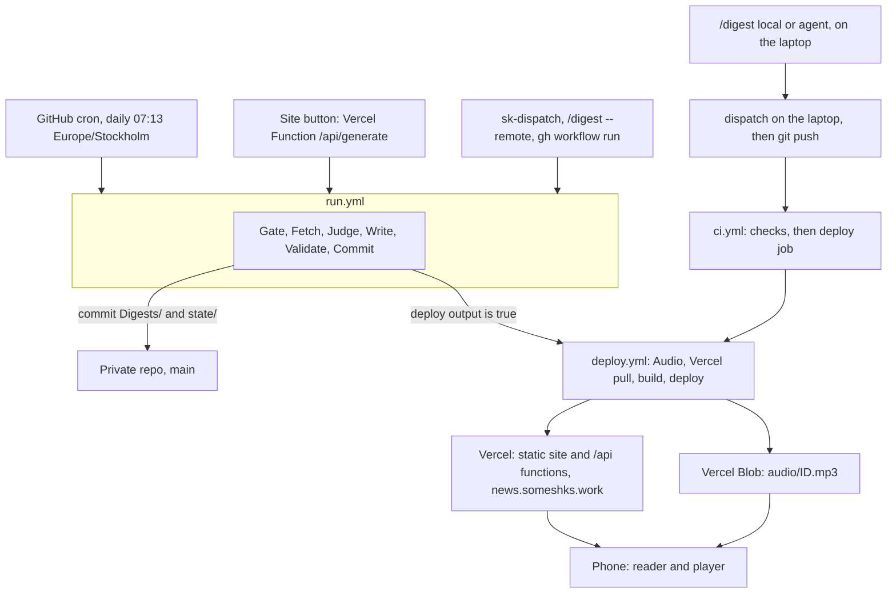

# Dispatch: build plan

> Plan and as-built record for the curation engine, the `news.someshks.work` web app and the skills that trigger both.
>
> Vision, digest schema and taste model: [vision.md](vision.md). Source registry: [sources.md](../config/sources.md). Decision log: [decisions.md](decisions.md). Operations: [runbook.md](runbook.md). UI and sound: [design-spec.md](design/design-spec.md) and [sound-design.md](design/sound-design.md). First design reference: [reader-prototype.html](prototype/reader-prototype.html).
>
> Status: plan v4, revised 2026-10-06. Everything is built and tested offline. Nothing has run against a real service, and the CI workflows have never run on GitHub. Section 13 lists what is verified and what is not.

---

## 1. What changed from earlier plans

| Plan | Design | Why it changed |
| --- | --- | --- |
| v1 | The pipeline ran inside a Claude Code cloud routine. Hosting on Cloudflare (Workers, R2, KV, Turnstile). One audio file per section. Qwen3-32B as the writer | Routines push to `claude/` branches, start with a restricted network allowlist and expose only an experimental trigger. An agent with tools reading untrusted web text is the worst case for prompt injection |
| v2 (2026-10-05) | The engine is a CLI on GitHub Actions and every trigger is a thin caller. Models are pure functions: text in, schema-validated JSON out. One MP3 per digest with a timeline of item start times | Actions is stable, has full network and its own secret store. One track keeps the lock-screen scrubber working |
| v3 (2026-10-06) | Vercel replaces Cloudflare: static site, `/api/*` functions, Blob audio. The Generate button uses a stateless cooldown, with no KV and no Turnstile. `deploy.yml` deploys with the Vercel CLI. Keys flow from `.env` through `npm run secrets:push` | One platform for hosting, functions and audio (D10) |
| v4 (2026-10-06) | As built. The writer model is picked from the live Nebius list because Qwen3-32B left its serverless tier on 2026-08-31 (D24). Source health moved to `state/` (D21). TypeScript is pinned to 6 (D19). The engine tolerates audio failure (D23) | The code exists, so the plan records what it does |

---

## 2. Product definition

**What it is.** A private briefing for a design engineer: about twelve items every second day, plus a weekly deep dive, written in plain language, readable in about two minutes or listenable in about four.

**Primary jobs, in priority order**

1. Scan on a phone in under three minutes and know what matters.
2. Listen hands-free (commute, walking) with lock-screen controls.
3. Tell the system what it got wrong in one sentence, and have tomorrow's briefing reflect it.

**Non-goals for v1:** accounts, comments, social sharing, search, push notifications, X/Twitter ingestion, offline audio, multi-language. A digest landing is announced by its commit only (D11).

---

## 3. Decisions

[decisions.md](decisions.md) holds the date, reason and rejected alternatives for each entry. This table is the index, with the section that implements each.

| # | Decision | Where |
| --- | --- | --- |
| D1 | Engine runs on GitHub Actions | 4 |
| D2 | Repository lives in this folder | 6 |
| D3 | Judge is TypeSafe Jev; the writer is a cheap Nebius model (writer choice superseded by D24) | 7.5 |
| D4 | Astro with React islands, Base UI, hand-written token CSS | 8.1 |
| D5 | One MP3 per digest with word marks, from Speechify | 7.7 |
| D6 | Daily cron with a calendar-date gate, plus a Sunday weekly pass | 7.2, 10 |
| D7 | Podcast feed deferred | 8.10 |
| D8 | "Thought of the Day" cut | [vision.md](vision.md) Section 3 |
| D9 | Repository `somesh-ks/dispatch`, private | 6 |
| D10 | Hosting on Vercel, deploys by CLI | 8.9, 10 |
| D11 | Notification is the commit only | 2 |
| D12 | Voice limits | 7.6 |
| D13 | Accounts for Nebius, TypeSafe, Exa, Firecrawl and Speechify exist | 13 |
| D14 | Docs and config filenames are lowercase kebab-case | 6 |
| D15 | Persisted keys are snake_case and code follows them | 7.3 |
| D16 | Personal-scope skill `sk-dispatch`, built separately | 9 |
| D17 | UI and sound specified in `docs/design/` | 8 |
| D18 | UI sounds are procedural Web Audio from `@dispatch/sound` | 8.12 |
| D19 | TypeScript 6 pinned repository-wide | 6.2 |
| D20 | One preferences key, `dispatch:preferences`, for theme and settings | 8.6 |
| D21 | Source health lives in `state/source-health.json` | 7.2 |
| D22 | `deploy.yml` owns the deploy: its own concurrency group, token only in the Vercel steps | 10 |
| D23 | The engine tolerates audio failure and publishes text with `audio: null` | 7.9 |
| D24 | The writer model is picked from the live Nebius list | 7.5 |

---

## 4. Architecture

### 4.1 Flow



### 4.2 Independence contract

The pipeline behaves the same wherever it is invoked: Actions, laptop, the site button, or a skill run from another folder.

1. **One engine, one CLI.** Every trigger calls `dispatch`. Workflows, the Generate function and the skills hold no pipeline logic.
2. **Hermetic.** The engine reads only repo files and environment variables. It loads `.env` from the repository root (variables already in the environment win, so CI secrets are never replaced). The root comes from `git rev-parse --show-toplevel` or `--root`.
3. **Resumable.** Stages hand work to each other through `.cache/run/<id>/` (gitignored). `publish` converges: a digest without audio gets audio, an up-to-date site is a no-op.
4. **Two curator modes.** `curate --mode api` (the default, and the only mode `dispatch run` uses) needs `NEBIUS_API_KEY` and `DISPATCH_MODEL`. With `TYPESAFE_API_KEY` it judges through Jev and checks grounding; without it the Nebius judge answers alone and the digest is `verified: false`. `curate --mode agent` validates a selection a Claude Code session wrote (Section 9.1).
5. **Machine-readable.** `--json` prints one document on stdout and logs go to stderr. Exit codes: 0 success, 1 failure, 2 usage error.
6. **Skills stay thin.** They locate the repo, call the CLI and read its JSON. With no checkout, `sk-dispatch` falls back to `gh`.

### 4.3 Trigger matrix

| Trigger | Runs on | Curator | Credentials it needs |
| --- | --- | --- | --- |
| Daily cron, GitHub UI "Run workflow" | Actions | API | Repo secrets and variables |
| Site Generate button | Actions, via a Vercel Function | API | The function holds a dispatch token as a Vercel environment variable |
| `sk-dispatch run`, `/digest --remote`, `gh workflow run` | Actions | API | Your `gh` login only |
| `/digest --local` | Laptop | API | Local `.env` |
| `/digest --agent` | Laptop | Claude Code session | No Nebius key; optional Exa and Firecrawl keys |

`/digest` with no flag picks local when `dispatch doctor` reports both `NEBIUS_API_KEY` and `DISPATCH_MODEL`, else agent, else remote. `/digest --remote`, `sk-dispatch run` and the Generate button dispatch `mode=on-demand`, so the scheduled gate never turns them into silent no-ops.

**Deploying.** `run.yml` calls `deploy.yml` as a reusable workflow, because pushes made with `GITHUB_TOKEN` do not trigger other workflows. It does so only when the Commit step reports `deploy=true`: a digest was published, or a digest from the last 7 days still lacks audio. A local push to `main` triggers `ci.yml`, whose final `deploy` job calls `deploy.yml`.

**Concurrent writers.** `run.yml`, local runs and `/learn` all write to the repo. The skills start with `git pull --ff-only` and refuse on a dirty tree or while a `run.yml` run is in progress; `dispatch learn --commit` refuses on a dirty tree or when behind the remote. Bot pushes retry with a rebase up to three times.

---

## 5. Where API keys go

Keys never go in the repo, in chat, or in `package.json`. One flow feeds every store:

1. Copy `.env.example` to `.env` and fill it in an editor. `.env` is gitignored.
2. Run `npm run passphrase` once. It prompts twice with echo off and writes the scrypt hash to `.env` as `GENERATE_PASSPHRASE_HASH`.
3. Run `npm run secrets:push` (flags `--dry-run`, `--only github|vercel`). It sends each non-empty value with the value on stdin and prints names and results, never values.

The agent never sees key values: `.claude/settings.json` denies reading or editing `.env` and `.env.*` and allows `.env.example`. Setup steps are in [runbook.md](runbook.md).

| Store | Names |
| --- | --- |
| GitHub Actions secrets | `TYPESAFE_API_KEY`, `NEBIUS_API_KEY`, `EXA_API_KEY`, `FIRECRAWL_API_KEY`, `SPEECHIFY_API_KEY`, `BLOB_READ_WRITE_TOKEN`, `VERCEL_TOKEN`, `VERCEL_ORG_ID`, `VERCEL_PROJECT_ID`, `YOUTUBE_API_KEY` (optional, one-time channel lookup) |
| GitHub Actions variables | `NEBIUS_BASE_URL`, `DISPATCH_MODEL`, `DISPATCH_FALLBACK_MODEL`, `SPEECHIFY_VOICE_ID` (not secret, so visible in run logs) |
| Vercel production environment | `GITHUB_DISPATCH_TOKEN`, `GITHUB_REPOSITORY`, `GENERATE_PASSPHRASE_HASH` (read by `/api/generate` and `/api/status`) |

`MAX_TOKENS_PER_RUN` (default 400,000) and `SPEECHIFY_MONTHLY_CHARS` (default 500,000) are optional engine settings the script does not push.

- **Passphrase.** A salted scrypt hash string (`scrypt$N$r$p$salt$hash`, N = 2^15, r = 8, p = 1) of 8 or more characters. It is the only gate on the button, so make it long (Section 8.9).
- **Dispatch token.** A fine-grained personal access token for this repository only, with Actions read and write and Contents read. Set an expiry and record it in [runbook.md](runbook.md).
- **Vercel token.** Created with an expiry. Only the Vercel pull and deploy steps of `deploy.yml` receive it, not the build. `BLOB_READ_WRITE_TOKEN` comes with the Blob store and is the only storage credential.
- **Blast radius.** Each workflow step receives only the keys it uses: Fetch gets Exa and Firecrawl, Judge gets TypeSafe and Nebius, Write gets Nebius and Firecrawl, Validate gets TypeSafe and Nebius, Commit gets none, and the deploy Audio step gets Speechify and Blob. Workflows declare minimal `permissions:`.
- **Spend caps.** Nebius is prepaid credit with no per-key limit, so the balance is the cap: use a key made for this project and top up modestly. Jev has no documented cap (about one cent per run). Exa bills per request after any free credit. Blob on Hobby holds 1 GB, kept in bounds by pruning (Section 7.7).
- **Leak prevention.** `.gitignore` covers `.env`, `.env.*` (except `.env.example`), `.vercel/` and `.cache/`. A gitleaks job in `ci.yml` scans every push and pull request; no local pre-commit hook is configured. The engine redacts known key patterns from logs.
- **Rotation.** If a key appears in chat, a log or a commit, revoke it first, then replace it. After changing a Vercel variable, redeploy: new values apply only to new deployments.

---

## 6. Repository

### 6.1 Layout

```text
dispatch/
  .claude/skills/digest/        # /digest: trigger, status, agent-mode protocol
  .claude/skills/learn/         # /learn: one sentence to a bounded preference patch
  .github/                      # workflows run.yml, deploy.yml, ci.yml; dependabot.yml
  apps/web/                     # @dispatch/web: Astro site, React islands, /api functions
  packages/core/                # @dispatch/core: Zod schemas, env, ids, paths, time, passphrase
  packages/engine/              # @dispatch/engine: the `dispatch` CLI
  packages/cover/               # @dispatch/cover: seeded cover-art templates and renderer
  packages/sound/               # @dispatch/sound: procedural UI sounds on Web Audio
  config/                       # preferences.json, queries.json, sources.md, sources.json, voice.md
  Digests/YYYY/MM/              # <id>.md and <id>.audio.json; created by the first run
  state/                        # seen, judgments, last-run, usage, source-health; created by the first run
  scripts/                      # secrets:push, passphrase, tokens, icons, prototype builders
  tokens/                       # tokens.json (W3C design tokens), covers.json (cover palettes)
  docs/                         # build-plan, vision, decisions, runbook, design/, prototype/, reference/
```

The Zod contracts in `packages/core/src` are the shared interface (item, digest, audio timeline, state files, sources, preferences, env). A schema change needs an entry in [decisions.md](decisions.md). Persisted keys are snake_case and the TypeScript types use the same names (D15). Docs and config filenames are lowercase kebab-case (D14).

### 6.2 Tooling

| Concern | Choice | Reason |
| --- | --- | --- |
| Package manager | npm workspaces | pnpm is not installed, and a global install needs approval |
| Runtime | Node 24 or newer, pinned in `.nvmrc` and `engines` | CI reads `.nvmrc`; the laptop runs Node 26 |
| Language | TypeScript `~6.0.3` in the root and in `apps/web`, strict, no `any` (D19) | The Astro language tooling (`@astrojs/check`) breaks under TypeScript 7, so one version is pinned repository-wide |
| Lint and format | Biome, with `noUnusedImports` and `noUnusedVariables` off for `.astro` files | Biome cannot see imports and variables used in Astro templates, so those rules give false positives. `astro check` covers `.astro` files |
| Unit tests | Vitest, 60 second test and hook timeout | Suites drive real git processes in temporary repositories, which is slow on Windows |
| End-to-end | Playwright (Chromium, phone and desktop sizes) with axe, in `apps/web`; run locally, not in CI | Player behavior and accessibility |
| Budgets | `apps/web/scripts/checkBundle.ts`, the web build's `postbuild` step | Enforces Section 8.8 |
| Hygiene | gitleaks, Dependabot (weekly npm and Actions updates) | Secrets; dependency drift |
| Hosting CLI | Vercel CLI, run in `deploy.yml` from `apps/web` | Prebuilt deploys without the Git integration (Section 10) |
| Commits | Conventional Commits. The engine commits as `chore(digest): <id>`, `chore(state): ...`, `chore(audio): ...` and `chore(prefs): ...` | One format for humans and bots |

`.gitattributes` forces LF line endings to avoid CRLF churn in digests on Windows.

**Local web builds on Windows.** The Vercel adapter bundles functions with symlinks, which Windows refuses without Developer Mode. Use `DISPATCH_STATIC_ONLY=1` for local builds and the e2e run: the adapter is skipped and the two API routes become static stubs. CI on Linux builds with the adapter. `DISPATCH_FIXTURES=1` makes the site read invented digests from `apps/web/src/fixtures/` (CI's build, the e2e suite and the dev lab).

Add a dependency only when it removes real work; the platform covers the rest (`fetch`, `node:crypto`, View Transitions, Media Session, Web Audio). Versions are in the `package.json` files.

---

## 7. Engine

### 7.1 Commands

`dispatch <command> [args] [--json] [--root <path>]`, run as `npm run dispatch -- <command>`. `dispatch <command> --help` lists every flag.

| Command | Purpose |
| --- | --- |
| `sources import\|discover\|check` | `import` builds `config/sources.json` from `config/sources.md` (offline, keeps discovered feeds); `discover` finds and verifies feeds; `check` is a reachability pass |
| `fetch` | Normalize, dedupe and prefilter candidates into `.cache/run/<id>/pool.json` (`--since`, `--weekly`, `--update-health`) |
| `curate` | `--mode api` judges, scores, selects, extracts, writes and grounds a pool. `--mode agent` writes `selection-schema.json`, then validates the `agent-selection.json` a session wrote. `--kind`, `--threshold` |
| `extract --ids` | Full text for chosen pool items (agent mode) |
| `render` | Turns a run's selection into a digest file, never overwriting; does not commit |
| `validate <path>` | Schema, voice and limit checks on any digest; `--pool` also checks every URL came from the pool |
| `audio --digest <id>` | Narrates one digest and uploads it, without committing |
| `publish` | Narrates every digest that lacks audio, uploads to Blob, writes `.audio.json`, the digest's `audio` field and `state/usage.json`, then commits. `--digest`, `--prune <days>`, `--no-push`. A failed narration leaves `audio` null and does not fail the command |
| `learn` | `--schema` prints the patch schema. `--apply <patch> [--dry-run]` applies a bounded patch; `--commit [--no-push]` also commits `config/preferences.json` as `chore(prefs): ...` and pushes |
| `run` | The staged pipeline. `--mode scheduled\|on-demand\|weekly`, `--stage gate\|fetch\|judge\|write\|validate\|commit`, `--run <id>`, `--force`, `--since`, `--dry-run`, `--no-push` |
| `status` | Offline report: last runs, next due date, audio, failing sources, Speechify budget |
| `doctor` | Offline checks of Node, git, config, state, key names and model ids. `--online` adds authenticated requests to each service |
| `models` | Lists the Nebius text models your key can use (`--all`, `--limit`) |
| `eval --yes` | Golden-set evaluation of judges, grounding and writer models (`--only judges,grounding,bakeoff`, `--models`, `--thinking`). Spends money and never runs in CI; without `--yes` it prints a notice and exits 2 |

### 7.2 Pipeline stages

`dispatch run` runs the stages in order; the workflow runs one per step (`--stage`). The step names Gate, Fetch, Judge, Write, Validate and Commit are a contract: the Generate sheet maps them to its progress list.

| Stage | Work |
| --- | --- |
| Gate | A regular digest is due when the Stockholm calendar date is two or more days after the last regular run that evaluated candidates. On Sundays the weekly pass runs after the regular one, once per Sunday. `on-demand` and `--force` ignore the gate; `weekly` runs the weekly pass alone |
| Fetch | Per-source timeout and retry; a failed source is logged, never fatal. The window starts at the last successful fetch of any kind, capped at 7 days (first run 3 days; weekly always 7). Items are normalized (`id` is the first 12 hex characters of sha1 of the canonical URL), deduped (tracking parameters stripped, `seen.json` applied, newsletter links to originals already in the pool collapsed) and prefiltered: hard-drop `disliked_patterns`, keep keyword, preferred-author and high-signal-source matches, cap at 60 |
| Judge | Jev answers per item from title and snippet only: category probabilities, craft depth, hype, sponsorship and funding flags. Items Jev cannot answer go to the Nebius fallback judge. Answers are cached by item, question set and model. If most of a pool goes unjudged the stage fails rather than recording a quiet day |
| Write | Score in code, select, extract full text for finalists, write headline, summary and why with the Nebius writer, one rewrite per failing field. Fewer than 3 survivors is the `nothing` outcome. The weekly pass withholds items the regular pass just chose |
| Validate | Grounding check of every summary and why sentence against its source text with Jev; an unsupported sentence gets one rewrite and one more check, then the item drops. Then the final validation: schema, URLs in the pool, voice lint, limits, no links or markdown in model text, no repeats. `verified: true` only when the grounder ran and every kept item passed |
| Commit | Builds each digest from the validated selection, picks its cover, writes `seen.json`, `judgments.json` and `last-run.json`, runs the write guard, then makes one commit and pushes with a rebase retry |

**Score in code.** `taste` is the sum over categories of `P(category) x weight[category]`, times normalized craft depth, reduced by the hype, sponsorship and funding probabilities, plus a small author and keyword bonus. The default threshold is 0.4 (`--threshold` tunes it). Changing weights re-scores from the cache with no new calls.

**Item counts.** Target 8 to 12, hard cap 12 (weekly 18), floor 3. With 3 to 7 qualifying items the digest is shorter, never padded.

**Outcomes.** The Commit step reports `outcome` and `deploy`:

| Outcome | State written |
| --- | --- |
| `published` | Digest, `seen.json`, `judgments.json`, a `last-run.json` record for the pass kind. Commit `chore(digest): <ids>` |
| `nothing` | A `last-run.json` record, the fetch window advanced, judged items marked seen. Commit `chore(state): run <date> nothing cleared the bar`. The site and the status endpoint say "Nothing cleared the bar." |
| `gated` | Nothing recorded, so the cadence anchor stays put |
| `failed` | Nothing written; the window and `seen.json` are untouched. Exit code 1 |

**Write guard.** Each command may change only its own paths; anything else aborts the commit.

| Command | May write |
| --- | --- |
| `run` | `Digests/` and `state/` |
| `publish` | `Digests/**/*.audio.json`, the `audio` field of an existing digest (every other frontmatter field is compared with `HEAD`), `state/usage.json` |
| `learn` | `config/preferences.json` |

**State files** (`state/`, versioned JSON, created by the first run):

| File | Holds | Pruned |
| --- | --- | --- |
| `seen.json` | Item id to the date it was shown or judged | 90 days |
| `judgments.json` | Judge answers keyed by item id, question-set hash and model, so `/learn` re-scores without new calls | 30 days |
| `last-run.json` | One record per kind (`regular`, `weekly`, `on_demand`) with outcome and digest id; the end of the last successful fetch; the last cover | n/a |
| `usage.json` | Speechify characters used in the current month | n/a |
| `source-health.json` | Per source id: consecutive failures and last success (D21) | n/a |

Source health lives in `state/` because the write guard lets `run` write only `Digests/` and `state/`, and a run must never rewrite hand-edited configuration. It is overlaid onto the registry when the registry loads.

### 7.3 Digest file and ids

The digest is Markdown with frontmatter; the frontmatter is the single source for the site and the body is generated from it ([vision.md](vision.md) Section 3). The frontmatter holds `id`, `date`, `kind` (`regular`, `weekly` or `on-demand`), `verified`, `generated_at`, `window`, `read_minutes`, `listen_minutes`, `audio` (`null` until `dispatch publish` voices the digest, then the Blob URL and duration), `cover` (`template`, `palette`, `seed`) and 3 to 18 `items`. Each item has `id`, `section`, `category`, `source_type`, `headline`, `url`, `source`, `author`, `summary`, `why`, `score` and `published_at`. The audio timeline `<id>.audio.json` holds `voice`, `model`, `timeline` (`marks` or `estimated`), `duration_ms`, `text_chars` and the start and end of each item and section. The Zod schemas in `packages/core/src` are authoritative.

**Digest ids and filenames.** The id is the Stockholm date, with `-weekly` for the weekly pass and `-2`, `-3` for further runs on the same day. Files are `Digests/YYYY/MM/<id>.md` and `<id>.audio.json`, the audio is `audio/<id>.mp3` in the Blob store, and the route is `/d/<id>`. The engine never overwrites an existing id; it takes the next free suffix.

**Sections.** The ten weight keys map to six digest sections.

| Section (slug) | Categories |
| --- | --- |
| Interaction craft (`ui-craft`) | `design_engineering_craft`, `ui_component_primitives`, `css_canvas_motion_techniques`, `taste_and_design_philosophy` |
| AI models and products (`ai`) | `ai_ux_interaction_patterns`, `frontier_model_releases` |
| Research (`research`) | `hci_empirical_research` |
| Launches (`launches`) | `developer_tool_launches` |
| Watch and listen (`watch`) | Any item from a `youtube` source, whatever its category |
| Top picks (`top`) | The three highest scores, removed from their home section |

`venture_capital_and_gossip` and `generic_ai_hype_listicles` never publish. The weekly pass reserves one slot for the best item in a category weighted below the median, so taste does not narrow.

### 7.4 Sources and access

`config/sources.md` is the human list; `sources import` turns it into `config/sources.json` (101 sources, 98 enabled: 56 RSS or Atom, 21 Firecrawl scrapes, 13 GitHub release feeds, 4 YouTube, 2 Crossref, and one each for Hacker News, arXiv, Product Hunt, Lobsters and Exa). Exa queries live in `config/queries.json`. `dispatch status` flags a source failing five runs in a row.

| Channel | Access | Key |
| --- | --- | --- |
| Hacker News | Algolia `search_by_date`, Show HN above 30 points | None |
| GitHub releases | `releases.atom` | None |
| arXiv cs.HC, TOCHI and PACMHCI | arXiv API query; Crossref `works` by `issn` | None |
| Product Hunt, Lobsters | Public feeds | None |
| Blogs and newsletters | RSS or Atom found by `sources discover` | None |
| Feedless or JavaScript-heavy pages | Firecrawl scrape (free plan: 10 requests per minute) | Yes |
| Semantic discovery | Exa search with a start date | Yes |
| YouTube | Channel `videos.xml` feed | Optional |
| X/Twitter | Out of scope | n/a |

Extraction for finalists tries the cheapest source first: text Exa already returned, feed content, Readability, then Firecrawl.

### 7.5 Models and judgments

Two roles, each behind its own interface so either can be swapped without touching the pipeline.

| Role | Default | Job |
| --- | --- | --- |
| Judge | TypeSafe Jev | Calibrated judgments: category, craft depth, hype and sponsorship flags; also the grounding check |
| Writer | A Nebius model picked from the live list (D24) | Headline, two-sentence summary and why line in the house voice |
| Fallback judge | The Nebius writer model answering the same questions as JSON | Items Jev cannot answer (429, 529, outage), five per request, two requests in flight. Used alone when `TYPESAFE_API_KEY` is unset |

**Judge: TypeSafe Jev.** `@typesafe-ai/sdk` with the `jev-latest` alias; pin an exact version once thresholds are tuned. One request per item with five questions: `category` (Choice over the ten weight keys plus `none`), `craft_depth` (Score, five levels from "announcement or opinion with no technique" to "mechanism shown with code or measurements") and Noul flags for hype, sponsorship and funding. The score uses probabilities, not the top pick, so near-ties stay honest. The grounding check is a Noul per summary and why sentence against the best source excerpt (about 36 checks per run). Thresholds are tuned on the golden set with `dispatch eval`, never copied from documentation. Price: about 0.042 USD per million input tokens, output free, roughly 0.01 USD per run; it may be subsidized, which is why the fallback judge stays wired. Retry with backoff on 429 and 529, revalidate quarterly, and confirm TypeSafe's retention and training terms before the first live call.

**Writer: Nebius Token Factory.**

| Aspect | Design |
| --- | --- |
| Provider | OpenAI-compatible. Base URL `https://api.tokenfactory.nebius.com/v1/` (override with `NEBIUS_BASE_URL`), bearer `NEBIUS_API_KEY`, through the `openai` package |
| Model ids | `DISPATCH_MODEL` and `DISPATCH_FALLBACK_MODEL`, pinned exactly. The client fails over to the fallback id on model-not-found |
| Choosing the model | List what your key can use with `dispatch models`. Check both ids against the live list with `dispatch doctor --online`. Compare candidates with `dispatch eval --yes --only bakeoff --models a,b` (`--thinking <spec>` for models that switch thinking off another way). The bar: voice-lint pass rate, grounding pass rate, JSON validity and a read-through of the golden outputs. Quality and reliability decide; price breaks ties |
| History | Qwen3-32B was the original pick. It left Nebius's serverless tier on 2026-08-31, which is why no id is hardcoded and `doctor` checks both |
| Structured output | `response_format: json_schema`. If a model rejects schemas, the client uses `json_object` for the rest of the run. Every response is validated with Zod; a failing field is rewritten once, then the item drops |
| Sampling | Temperature 0.2, thinking off with `reasoning_effort: "none"` by default (the switch is data, because models differ), four requests in flight |
| Limits | The baseline limit is 60 requests per minute, so the fallback judge batches items and the client retries 429 and 5xx with backoff. `MAX_TOKENS_PER_RUN` aborts a runaway run; the prepaid balance is the hard cap |
| Data | Reported: no training on customer data, zero data retention available at organization level, EU hosting. Read the policy and enable zero retention before the first live call |

Safeguards for both roles: summaries come from extracted text only; fetched content reaches the models as delimited untrusted data; neither model has tools or secrets; every output URL must exist in the input pool; the site escapes all model text; code validates every output, so a wrong or missing answer degrades one item, never the run.

### 7.6 Editorial voice

[voice.md](../config/voice.md) holds the rules (principles, limits, examples, banned words). The writer prompt loads it and the validator enforces its measurable parts. The limits are confirmed (D12) and mirrored as `VOICE_LIMITS` in `packages/core`.

| Field | Limit |
| --- | --- |
| Headline | 12 words |
| Summary | 35 words, two sentences at most |
| Why | 18 words, one sentence |
| Items | Regular: target 8 to 12, hard cap 12, floor 3. Weekly: up to 18 |

The deterministic lint runs on every written field: banned words, no em dashes, exclamation marks, emoji, markdown or links, no "not just X but Y" contrasts, no rhetorical questions, no second-person commands. A failing field is rewritten once with the lint error appended, then the item drops. Audio follows the same bar: one opening line ("Dispatch, Wednesday 7 October. Eleven items."), the section name as the only transition, no outro. Site copy is sentence case with plain verbs, and errors say what happened and what to do.

### 7.7 Audio

| Aspect | Design |
| --- | --- |
| Endpoint | Speechify `POST /v1/audio/stream/with-timestamps` (server-sent events with base64 audio and word marks), model `simba-3.2`, voice `SPEECHIFY_VOICE_ID` (default `geffen_32`), format `mp3_24000_128` (about 4 MB for four minutes) |
| Timeline | Spoken text is assembled by code from each item's headline, summary and why, with known character ranges, so the first mark at or after a range gives that item's start time |
| Limits | 20,000 characters per request; a digest is about 5,000 (weekly about 8,000). The engine fails closed above 19,000 instead of splitting. Calls run sequentially |
| Budget | `state/usage.json` counts characters for the month. Synthesis stops at 90 percent of `SPEECHIFY_MONTHLY_CHARS` (default 500,000, the free-tier figure from Speechify's pricing page; unconfirmed) |
| Fallback | If marks are unavailable or cannot place every item, the timeline is estimated from character share and flagged `timeline: "estimated"` |
| Storage | Vercel Blob, public store, key `audio/<id>.mp3`, uploaded with `@vercel/blob`. The returned URL is stored in the digest's `audio.url` |
| Retention | `dispatch publish --prune 120`, run by every deploy, deletes Blob audio uploaded more than 120 days ago, to stay inside the 1 GB Hobby store. The text and timeline stay. Pruning leaves the digest's `audio` field alone, so a pruned digest's player reports "The audio for this briefing is not available" on the 404. The "audio has expired" state shows only when `audio` is null and a timeline exists |

### 7.8 Taste feedback

`/learn "more shaders, less VC funding"`: the session turns the sentence into a patch (weight deltas, keyword, author and pattern edits). `dispatch learn --apply` enforces at most 0.05 per weight and 0.15 per call, weights between 0 and 1, and schema validity; it appends to `feedback_history`, prints the diff, and with `--commit` commits and pushes. Because the patch is data, `/learn` works with or without an API key.

### 7.9 Failure behavior

- A failed source is logged and counted in `state/source-health.json`.
- A failed stage leaves `state/` untouched, so the next window grows and nothing is lost.
- The engine tolerates audio failure (D23): a speech, Blob or credential error publishes the text digest with `audio: null`, and the player says "Audio is still being prepared". `publish` retries every digest that lacks audio, and the Commit step sets `deploy=true` while any digest from the last 7 days lacks it, so the next `run.yml` of any outcome retries.
- `run.yml` declares `concurrency: { group: dispatch, cancel-in-progress: false }`, so duplicate presses collapse into one pending run. `deploy.yml` uses its own group, `deploy`, because a called workflow that shares its caller's group is cancelled (D22).

---

## 8. Web app

[design-spec.md](design/design-spec.md) is the canonical reference for the interface and [sound-design.md](design/sound-design.md) for UI sounds (D17). This section keeps what the product must do and the technical constraints behind it. Where the design docs and this section disagree on visual or interaction detail, the design docs win; on a requirement stated here, raise it.

### 8.1 Stack

Astro 7 with React 19 islands, built static; only `/api/*` runs on the server, as Vercel Functions through `@astrojs/vercel` (Section 8.9). Reading is HTML first, with the player as progressive enhancement. The audio element is created in a JavaScript module with `new Audio()` and never sits in the DOM, so it keeps playing across `ClientRouter` navigations. Rationale and rejected stacks: D4.

### 8.2 UI library and styling

- **Base UI** (`@base-ui/react`): unstyled and accessible, so the look stays ours. Radix is skipped because the shadcn and Radix drawer rests on Vaul, which is unmaintained. No Tailwind or shadcn.
- **Tokens.** `tokens/tokens.json` in the W3C format, compiled by `scripts/buildTokens.ts` (the web `prebuild` step) into CSS custom properties. No literal durations, easings or colors in components.
- **Motion.** CSS transitions, `@starting-style` and the View Transitions API.
- **Fonts.** Schibsted Grotesk and Literata, self-hosted as subset variable files, never a font CDN.

### 8.3 Pages and components

| Route | Notes |
| --- | --- |
| `/` | Latest digest: date, play, a timeline rail, items grouped by section. With no digest it shows "No briefings yet" |
| `/d/<id>` | One digest, with previous and next links |
| `/archive` | One page: year, then month, then day; weekly dives marked |
| `/offline`, `/404` | Static pages |
| `/latest.json`, `/manifest.webmanifest` | Latest digest summary; web app manifest |
| `/covers/<id>-512.png`, `/covers/<id>-1024.png` | Cover art rendered at build (Section 8.11) |
| `/api/generate`, `/api/status` | The only server routes (Section 8.9) |

The `/dev` lab pages and `/fixtures/audio.wav` serve the player e2e suite and the fixture build; outside `astro dev` the lab pages answer 404. Parts: the player bar and expanded player, the Generate sheet, the Settings sheet (theme, interface sounds with volume, default speed, install hint) and the page states (empty, nothing new, audio preparing, audio unavailable, offline, error, stale).

**Reader and player contract.** The page is server-rendered HTML and the player only toggles attributes: `[data-item-id]` per item and `[data-chapter]` per section (matching the audio timeline), `data-state` of `played` or `current`, `.briefing[data-live]`, and the triggers `[data-play-digest]`, `[data-play-item]` and `[data-chapter-play]`. The page embeds its digest as a JSON block with id `dispatch-digest-data`. The full contract is in [design-spec.md](design/design-spec.md) under "Contract between the reader and the player".

### 8.4 Player behavior

- One `<audio>` element created in JavaScript. State is a small external store read with `useSyncExternalStore`, so no state library is added.
- Media Session: title and artwork; handlers for play, pause, seek backward and forward (15 seconds), seek to, previous and next track (mapped to items); `setPositionState` keeps the lock-screen scrubber working.
- Item seek from any play button using the timeline; chapter list in the expanded player; resume position per digest in `localStorage` (`dispatch:resume:<id>`); speed 1x, 1.25x, 1.5x or 2x with `preservesPitch`.
- After the last item the player offers the previous digest, not an autoplay chain. After a system pause (call, alarm) it offers resume instead of auto-playing. `preload="metadata"` keeps play instant without downloading the MP3.
- iOS: a plain `<audio>` element carries narration, because Web Audio is ambient and is silenced in the background. UI sounds are separate and never carry narration (Section 8.12). Background playback in standalone web apps works from iOS 15.4, but pause-and-resume and lock-screen quirks persist, so a real-device test is a gate (Section 12). If the lock screen drops controls, first re-register the Media Session handlers on `visibilitychange`.
- Feel (press feedback within one frame, pointer-capture scrubber, cover morph between mini and expanded player, reduced-motion crossfades) is specified in the design spec. No haptics: iOS Safari has no vibration API. A sleep timer is later.

### 8.5 Responsive behavior

Mobile first, with breakpoints where the content stops fitting: under 40rem a single column with a bottom player and sliding sheets; from 40rem the reading column stays 40rem, chapters appear as a sticky aside when there is room and sheets become centered dialogs; above 72rem the same column, centered. Layout rules: logical properties, container queries, controls inside safe areas, nothing in the top-left 64px (iPadOS windowed apps overlay window controls there), and a correct layout when the top safe-area inset is `0px`. Detail: the design spec.

### 8.6 PWA and iOS

| Item | Decision |
| --- | --- |
| Head | `viewport-fit=cover`, `apple-mobile-web-app-capable`, status-bar style `black-translucent`, `theme-color` pair for light and dark, `noindex`. The sticky header has an explicit opaque background, because Safari 26 samples it for the status-bar tint |
| Manifest and icons | `standalone`; PNG icons at 192 and 512, a maskable icon and a 180px apple touch icon, rendered from one SVG by `scripts/buildIcons.ts`. No splash screens in v1; the body background matches the icon |
| Install hint | Safari on iOS only, not already installed, two or more visits, dismissal remembered permanently. Copy says "Add to Home Screen", never "install" |
| Storage | Best effort, convenience only. `dispatch:preferences` is one JSON object holding theme, sounds, volume and speed (D20); an inline theme script reads the same key before first paint, and its hash is allowed in the Content-Security-Policy. Other keys: `dispatch:resume:<id>`, `dispatch:install-hint-visits`, `dispatch:install-hint-dismissed` |
| Service worker | `public/sw.js` precaches the shell (`/`, `/offline` and their assets). Digest pages are stale-while-revalidate. Home, archive and `/latest.json` go to the network first and fall back to the cache after 3 seconds. Audio, ranged requests and cross-origin requests always pass through, because serving audio from the Cache API without correct Range handling breaks Safari playback |

### 8.7 Accessibility

Native elements first, accessible names on every control, visible `:focus-visible` rings, 44px touch targets, a polite live region for generation status and playback, one `h1` per page, reduced motion that keeps opacity and color transitions, 200 percent zoom and 320px reflow without horizontal scroll, sheets that trap and restore focus. axe runs on every route in the e2e suite. Detail: the design spec.

### 8.8 Performance budget

| Metric | Budget | Enforced by |
| --- | --- | --- |
| JavaScript on first load | 100 KB gzipped or less per page | `checkBundle.ts`; 93.9 KB measured in the fixture build on 2026-10-06 |
| Fonts | Subset, self-hosted, 80 KB or less in total | `checkBundle.ts`; 69.9 KB measured |
| Render-blocking JavaScript | None; inline scripts must be allowed by the Content-Security-Policy hash | `checkBundle.ts` |
| Lighthouse mobile (performance, accessibility, best practices, SEO) | 95 or higher each | Target only; Lighthouse CI is not set up |
| LCP on a mid-range phone on 4G, CLS, INP | 1.5 s or less, 0, under 200 ms | Targets only; not yet measured |

### 8.9 Generate function and flow

`/api/generate` and `/api/status` are Astro endpoints with `export const prerender = false`; Astro's `output` stays `static`, so they alone run on demand through the Vercel adapter (`maxDuration` 20 seconds). They need the three Vercel variables in Section 5, keep no state and use no KV and no bot check (D10). With a variable missing or malformed they answer "unavailable".

1. The sheet posts the passphrase (at most 256 characters) to `/api/generate`.
2. The function checks it against `GENERATE_PASSPHRASE_HASH` with scrypt and `timingSafeEqual`. A wrong guess costs an extra 750 ms.
3. It checks the limits statelessly: it lists recent `workflow_dispatch` runs of `run.yml` on `main` through the GitHub API and refuses when one started in the last 6 hours or three in the last 24. The count includes runs started by `gh`, the skills and the GitHub UI.
4. It dispatches `run.yml` with the fixed input `mode=on-demand` and returns the run id.
5. The sheet polls `/api/status?run=ID`. The function answers only for a `workflow_dispatch` run of `run.yml` in the configured repository and returns a whitelist of fields: the current step mapped to the progress list (Waiting, Reading, Judging, Writing, Checking, Publishing) and, when the run completes, the `on_demand` record of `state/last-run.json` read through the Contents API. On `published` the sheet offers "Open the new briefing". Polls are cached privately for 3 seconds.
6. Errors say what happened and what to do: wrong passphrase, cooldown or daily limit with the time remaining, "Nothing cleared the bar.", and a failed run with a link.

Two quick presses can both pass the limit check before the first run is listed; the workflow's concurrency group and the engine gate make a duplicate harmless. Residual risk (Section 11): with no per-IP failure counting and no bot check, the passphrase can be guessed at the price of one scrypt computation and 750 ms per attempt. The scrypt cost, a long passphrase, the unlisted URL and the run cap (three runs a day, even if the passphrase leaks) are the mitigations.

### 8.10 Delivery surfaces

| Surface | Status |
| --- | --- |
| Web app | v1 |
| Private podcast feed `/feed.xml` | Deferred (D7). Podcast apps are the most reliable lock-screen path on iOS, so this is the first fallback if web playback proves flaky |
| Web push, word-level read-along, search, offline audio | Later; the timeline already supports read-along |

### 8.11 Cover art system

Every digest gets an album-style cover generated from the digest and never stored by hand. It is deterministic (the frontmatter's `cover: { template, palette, seed }` reproduces it) and varied: eight templates (spring, dither, contour, numeral, lattice, orbit, aperture, band) times twelve palettes in `tokens/covers.json` times seeded parameters. No two consecutive digests share a template and palette, the lead item's category biases the template, and the weekly digest draws from a darker palette family with a framing rule. The date is the typographic anchor, set in Schibsted Grotesk. Generative image models are not used: they cost money, drift in style and cannot be reproduced from a seed.

`@dispatch/cover` takes `{ id, date, kind, lead_category, previous }` and returns SVG from pure, seeded template functions. The web build rasterizes with `@resvg/resvg-js` to `/covers/<id>-512.png` and `-1024.png` (PNG, because lock screens do not reliably take SVG) and caches by content hash in `.cache/covers`. The engine picks the cover at commit and records it in `state/last-run.json` so the next cover avoids a repeat. `npm run covers:sheet` writes a contact sheet of every template across every palette. Snapshot tests render each template with fixed seeds.

### 8.12 UI sounds

[sound-design.md](design/sound-design.md) is the canonical reference and `docs/prototype/sound-lab.html` the listening prototype. Fourteen sounds are synthesized in the browser by `@dispatch/sound` (D18).

| Aspect | Requirement |
| --- | --- |
| Purpose | Confirm a few deliberate actions (play starting, a finished generation, an error). Sound never carries information that is not also visible |
| Optional | A Settings switch and a volume slider. On by default, off by default under `prefers-reduced-motion` |
| Restrained | Short and quiet; nothing for scrubbing, scrolling, hovering or repeated taps. Procedural Web Audio, no sample files |
| Narration first | Each sound is skipped or ducked while narration plays (per-sound policy in the sound design) |
| iOS silent switch | Web Audio follows the ringer switch, so a silent phone plays no UI sound. Narration through the `<audio>` element is unaffected |

---

## 9. Skills

Both layers spend money or push commits, so both are explicit-invocation only (`disable-model-invocation: true` for the in-repo ones). Each follows the five-part layout (`SKILL.md`, `scripts/`, `references/`, `assets/`, `evals/`).

| Layer | Skills | Lives in | Works |
| --- | --- | --- | --- |
| In-repo | `digest`, `learn` | `.claude/skills/` in this repository | Inside a clone |
| Personal | `sk-dispatch` | `~/.agents/skills`, built separately with `sk-skill-creator` (D16); not tracked here | From any directory |

### 9.1 `/digest`

| Form | Behavior |
| --- | --- |
| `/digest` | Auto-select: local when `dispatch doctor` shows the Nebius key and model, else agent, else remote |
| `/digest --remote` | `gh workflow run run.yml -f mode=on-demand` then `gh run watch`; needs only the `gh` login |
| `/digest --local` | `dispatch run --mode on-demand --no-push` with `.env` keys, then one question before `git push` |
| `/digest --agent` | The session model curates (protocol below); no Nebius key |
| `/digest --weekly`, `--dry-run`, `--since <date>` | Pass-throughs |
| `/digest status` | `dispatch status`, plus the on-demand limits check |

Before spending anything the skill exits early when a run is in progress, when nothing is due and no mode was forced, when the tree is dirty (local and agent modes) or when `gh` is logged out (remote mode). Remote runs honor the Generate limits: one `workflow_dispatch` run per 6 hours and three per 24.

**Agent-mode protocol.** The session writes only `.cache/run/<id>/agent-selection.json`; everything else comes from the CLI.

1. `dispatch fetch --json` writes `pool.json` and prints the run id.
2. The session reads the pool with `preferences.json`, chooses finalists, then calls `dispatch extract --ids` for their full text.
3. `dispatch curate --mode agent --kind on-demand` (`--kind weekly` for the weekly pass) first writes `selection-schema.json`.
4. The session writes `agent-selection.json` against that schema: 3 to 18 items, each with `id`, `category`, `score`, `headline`, `summary`, `why`.
5. The same curate command run again validates the file and writes `selection.json`, or lists one problem per line.
6. `dispatch run --stage commit --run <id>` builds the digest, updates `state/` and commits (`--dry-run` previews, `--no-push` keeps the commit local).

Agent mode cannot record a `nothing` outcome: the minimum is 3 items, so on a quiet day the session writes nothing, reports "nothing cleared the bar" and leaves state untouched. Validation runs the same voice lint and limits as API mode except the Jev grounding check, which needs a key the session does not hold, so agent digests carry `verified: false`. `render` and `publish` are not part of this sequence: the commit stage builds the digest and `deploy.yml` narrates it. A project permission rule denies the session from reading `.env`.

### 9.2 `/learn`

Takes a sentence, builds a minimal patch with its helper script, shows the diff from `dispatch learn --apply <patch> --dry-run`, and after one confirmation applies it with `--commit`, which commits as `chore(prefs): ...` and pushes. It never edits `preferences.json` directly.

### 9.3 `sk-dispatch` (personal scope)

Built separately in `~/.agents/skills` (D16). It locates a checkout and, when none exists, falls back to `gh` against `somesh-ks/dispatch`.

| Action | Behavior |
| --- | --- |
| status | Last run, next eligibility, latest digest |
| run | Preflight against the same limits as the Generate button, then dispatches `run.yml` (`mode=on-demand`) and watches the run |
| read | Shows the latest digest, from a checkout or through `gh` |
| learn | `learn-plan` turns a sentence into a patch and shows the diff; `learn-apply` applies, commits and pushes through the repo CLI, so it needs a checkout |
| open | Opens `news.someshks.work` |

### 9.4 Skill quality gates

Each skill's description stays under 1,024 characters with "Use when" phrases and a boundary. Evals in each skill's `evals/` cover a normal run, a quiet day, a missing key and a remote fallback; `sk-dispatch` adds a no-checkout case and its own unit tests (`node --test`).

---

## 10. CI/CD and environments

| Workflow | Triggers | Does |
| --- | --- | --- |
| `run.yml` | `schedule` (07:13, `timezone: Europe/Stockholm`), `workflow_dispatch` (inputs `mode`, `force`, `since`, `dry_run`) | One job: Install, Gate, then Fetch, Judge, Write and Validate (only when the gate says a run is due), then Commit. A second job calls `deploy.yml` when Commit reports `deploy=true`. Concurrency group `dispatch` |
| `deploy.yml` | `workflow_call`, `workflow_dispatch` | Checks out `main` (not the caller's commit, which predates the bot commit) and installs. Audio runs `dispatch publish --prune 120` with the Speechify and Blob secrets. Then from `apps/web`: Pull project settings, Build and Deploy. Only the pull and deploy steps receive `VERCEL_TOKEN`. Concurrency group `deploy` (D22) |
| `ci.yml` | `pull_request`, `push` to `main` | `changes` detects code changes (digest, state, docs and config commits skip the heavy checks). `check`: Typecheck, Lint, Test, then Build site with `DISPATCH_FIXTURES=1`, which runs the bundle budget. `secrets`: gitleaks. On `main`, a `deploy` job calls `deploy.yml` unless a check failed |

The Vercel steps in `deploy.yml`:

```bash
cd apps/web
npx vercel pull --yes --environment=production
npx vercel build --prod
npx vercel deploy --prebuilt --prod
```

`VERCEL_TOKEN`, `VERCEL_ORG_ID` and `VERCEL_PROJECT_ID` come from GitHub Actions secrets. The project's Root Directory setting stays empty because the commands already run from `apps/web`. The Vercel Git integration is not connected: pushes made with `GITHUB_TOKEN` do not reliably trigger it, and Vercel Hobby blocks deploys whose commit author is not the account owner, which every bot commit would be (D10).

Notes:

- The schedule runs at 07:13 because GitHub delays scheduled runs at the top of the hour; `timezone` keeps it at 07:13 Stockholm time across daylight saving. One daily cron plus the calendar-date gate gives every second day, and a delayed cron still lands on its own date. Day-of-month `*/2` is avoided because it resets at month end.
- GitHub documents that scheduled runs can be delayed or dropped under load. Confirm the private-repository behavior in the first weeks; digest commits count as activity.
- Third-party actions are pinned to commit SHAs, installs use `npm ci --ignore-scripts`, and Dependabot is configured for npm and Actions.
- The Free plan includes 2,000 private-repository Actions minutes per month; expected use is about 120.
- GitHub emails the workflow owner when a scheduled run fails. Each stage appends counts and source status to `$GITHUB_STEP_SUMMARY`, never fetched text.

**Vercel and DNS resources**

| Resource | Notes |
| --- | --- |
| Vercel project (Hobby) | Static site plus `/api/*` functions. Created with `vercel link` from `apps/web` |
| Vercel Blob store | Public. Keys `audio/<id>.mp3`. 1 GB on Hobby |
| Domain `news.someshks.work` | Added with `vercel domains add news.someshks.work`. Vercel issues the certificate. No `www` variant |
| DNS | Stays on Cloudflare: one CNAME for `news` pointing at the target Vercel shows, DNS only (proxy off) |

Setup steps are in [runbook.md](runbook.md).

**Estimated monthly cost** at about 23 run-equivalents per month. These are arithmetic from reported prices; measure them from real usage in Phase 8.

| Item | Estimate |
| --- | --- |
| Jev judgments | About 0.01 USD per run (60 item judgments plus about 36 grounding checks) |
| Nebius writer | Under 0.07 USD per run on any candidate model (about 40K input and 3K output tokens) |
| Exa | About 1.85 USD per month at 200 searches (about 7 USD per 1,000) and 450 content fetches (about 1 USD per 1,000), before any free credit |
| Firecrawl | Free plan (1,000 credits) covers about 450 basic scrapes |
| Speechify, Vercel (Hobby), GitHub, Cloudflare DNS | Free tiers |
| Total | About 2 USD per month, dominated by Exa |

---

## 11. Security and privacy

| Risk | Control |
| --- | --- |
| Prompt injection from fetched text | Models have no tools or secrets; output is schema-validated; URLs must exist in the pool; fetched text is delimited as untrusted data; the site escapes model text |
| Key leakage | Section 5; gitleaks in CI; log redaction; minimal `permissions:`; `.env` denied to the agent |
| Button abuse | Scrypt passphrase check with a 750 ms penalty per wrong guess; stateless cooldown (one run per 6 hours) and cap (three per 24 hours) from the GitHub API; fixed workflow inputs; fine-grained dispatch token; workflow concurrency; `/api/status` answers only for `workflow_dispatch` runs of `run.yml` with whitelisted fields. Residual risk: no per-IP failure counting and no bot check. Reassess if the endpoint ever sees abuse |
| Agent-mode session | Reads untrusted text with tools available. A project rule denies `.env` reads, writes go through the CLI's checked paths, and its digests carry `verified: false` |
| Supply chain | Lockfile, `npm ci`, pinned action SHAs, Dependabot |
| Repository exposure | The repository is private. The site is built from `Digests/` and the last-run record; `config/` and `state/` are not copied into the output (no automated assertion yet) |
| Third-party content | The repository stores metadata and our own short summaries with links; extracted full text stays in the gitignored cache |
| Discoverability | Public but unlisted: `noindex` meta, `X-Robots-Tag: noindex, nofollow`, `robots.txt` disallow, no sitemap, no inbound links. The default `*.vercel.app` domain serves the same site with the same headers. Blob audio URLs are public and protected only by obscurity. Unlisted is not private |
| Browser hardening | `vercel.json` sets a Content-Security-Policy (`self`, plus `*.public.blob.vercel-storage.com` for media; scripts limited to `self` and the theme script's hash), `X-Frame-Options: DENY`, `nosniff`, `Referrer-Policy: no-referrer` and a restrictive Permissions-Policy |
| Bot commits | Per-command write allowlists (Section 7.2) before every commit, including `/learn` |
| Logs and summaries | Counts and source status only; known key patterns are redacted |

---

## 12. Quality gates

| Layer | Gate | Status |
| --- | --- | --- |
| Engine | Vitest on saved fixtures and fakes, so tests run offline; contract tests for each fetcher | In place (Section 13) |
| Curation | A golden set in `packages/engine/eval/golden`; `dispatch eval --yes` runs judges, grounding and the writer bake-off and tunes thresholds | Built; never run against live models |
| Web | Playwright specs in `apps/web/e2e` and `apps/web/src/player/e2e` (`npm run e2e -w @dispatch/web`, `npm run e2e:player -w @dispatch/web`), Chromium at phone and desktop sizes with axe on every route, against the fixture build. The bundle budget runs in every build | Specs exist and run locally; not in CI; not run on 2026-10-06. No Lighthouse CI and no WebKit |
| Skills | `evals/evals.json` in each skill and the strict validator from `sk-skill-creator` | Evals written |
| Workflows | A dry run (`-f dry_run=true`), then a real run | No actionlint; the workflows have never run |
| Real devices | iPhone on the current iOS, installed to the home screen: lock-screen play and pause, resume after a notification, speed change, rotation, keyboard in the Generate sheet, offline launch, UI sounds with the silent switch on and off and with narration playing. One Android phone. Desktop Chrome, Safari and Firefox | Not started |

Done means: two consecutive unattended scheduled runs succeed with no repeated items, the budgets pass in CI, and the iPhone checklist passes.

---

## 13. Phases and verification status

Status as of 2026-10-06.

| Phase | Status | Work | Exit criteria |
| --- | --- | --- | --- |
| 0 | Done | Decisions D1 to D18 and accounts at Nebius, TypeSafe, Exa, Firecrawl and Speechify (D13) | Decisions logged; accounts exist |
| 1 | Done | Repository (private, `somesh-ks/dispatch`), workspaces, Biome, docs layout, core schemas, design tokens, CI workflows `run.yml`, `deploy.yml` and `ci.yml` (written, not yet pushed) | The owner's setup in [runbook.md](runbook.md) (Vercel project, Blob store, domain, DNS, keys) is still to do |
| 2 | Not done | The live spike, below | Go or no-go table; plan amended where a result disagrees |
| 3 | Built, offline | Engine core: config, source registry and discovery, fetchers, normalize, dedupe, prefilter | A local fetch returns a normalized pool from at least 90 percent of sources: not checked live |
| 4 | Built, offline | Curation: Jev and Nebius judges, score, extract, write, validate, grounding, API and agent modes, golden eval | Dry runs on the last 2 and 7 days that you would read unprompted: not run |
| 5 | Built, offline | Audio, Blob upload and prune, `publish`, `deploy.yml` | A pushed digest has audio and is live within minutes: not run |
| 6 | Built, offline | Web app, cover generator, UI sounds, PWA, player | Budgets pass in the fixture build; reading and listening on your phone, installed: not tested |
| 7 | Built, offline | `run.yml`, the Generate function and status, `/digest`, `/learn`, `sk-dispatch` | A button press yields a digest without disturbing the next scheduled run: not run |
| 8 | Not started | Hardening: spend limits, failure visibility, runbook walk-through, device matrix, two consecutive unattended runs (about four days) | Done criteria in Section 12 |
| 9 | Optional | Podcast feed, push, read-along, search, offline audio | Per feature |

**Verified, offline (2026-10-06).** `npx vitest run`: 108 test files and 2,562 tests; 2,559 passed, 2 failed, 1 skipped (107 files pass; both failures are in `apps/web/src/styles/styles.test.ts`). `npm run typecheck` passes. A fixture build with `DISPATCH_STATIC_ONLY=1` completes (10 pages) and passes the bundle budget. `dispatch doctor` and `dispatch status` run offline against a repository with no state.

**Not verified.** Nothing has run against real Speechify, Jev, Nebius, Exa, Firecrawl, Vercel Blob or Vercel. No GitHub Actions workflow has run, and no digest exists yet. Biome lint, Playwright and `vercel build` with an empty Root Directory were not run. There has been no real iPhone testing (lock screen, silent switch, sounds, install, Range seeking).

**Phase 2 spike (to run).** Cron with `timezone` and a delayed run against the calendar-date gate; `gh workflow run` and a Generate dispatch from the Vercel Function; `vercel deploy --prebuilt` from Actions; Speechify with-timestamps on the free plan (marks and a 64 kbps format); Blob upload from Actions and Range playback on a locked iPhone; module-scope audio across Astro navigation; Base UI drawer with the iOS keyboard; one Jev call and one Nebius call on real items (probabilities, tokens, latency, `json_schema` behavior); one Exa search and one Firecrawl scrape and the Firecrawl free-credit model; one cover on a real lock screen; UI sounds with the silent switch and with narration playing.

---

## 14. Risks

| Risk | Impact | Mitigation |
| --- | --- | --- |
| Nothing has run live | Every integration may disagree with its tests | Phase 2 spike before any unattended run |
| iOS background audio in a standalone web app is quirky | Poor listening | Plain `<audio>` plus Media Session; real-device gate; podcast feed as the reliable path |
| Vercel Blob Range or CDN behavior unconfirmed; Hobby limits (1 GB; operations and transfer unverified) | Seeking fails on iOS; uploads blocked | Spike on a locked iPhone; fallback is a thin proxy route that forwards Range requests; prune audio older than 120 days |
| `vercel build --prod` from `apps/web` in an npm workspace is unproven | First deploy fails | First deploy with `gh workflow run deploy.yml`; local builds use `DISPATCH_STATIC_ONLY=1` |
| Vercel Hobby blocks deploys whose commit author is not the account owner | Bot deploys fail | CLI deploy with `--prebuilt`; the Git integration stays off |
| Speechify free plan lacks marks or has a lower cap than expected | No chapters or audio gaps | Estimated-timeline fallback; character budget guard; text publishes without audio |
| Summaries drift from sources; a cheap model writes off-voice copy | Trust loss | Extracted text only, grounding check, voice lint with one rewrite, low temperature, bake-off before launch, agent mode as an escape hatch |
| Nebius retires or renames a model (Qwen3-32B left on 2026-08-31) | Runs fail | Pinned ids, a fallback id, `dispatch doctor --online` checks the live list, bake-off rerun on any change |
| Jev is early stage: price may be subsidized, limits volatile, no deprecation policy | Judge unavailable or repriced | Nebius fallback judge, version pinned after tuning, quarterly revalidation |
| GitHub delays or drops a scheduled run | Missed day | Off-peak minute, calendar-date gate, the next daily trigger widens the window |
| Laptop, Actions and `/learn` write at once | Repeated or lost items | Section 4.3: fast-forward pull, refuse while a run is in progress, rebase retry, per-command write guards |
| Generate endpoint has no per-IP failure counting and no bot check | Passphrase guessing | Scrypt cost, wrong-guess delay, long passphrase, unlisted URL, run cap (Section 11) |
| Speechify terms on publicly reachable generated audio; Firecrawl free credits may be one-time | Policy breach; extraction cost | Read the terms before the first upload; Exa text, feed content and Readability come first |
| Feed rot and bot blocking | Quiet coverage loss | Counters in `state/source-health.json`; monthly `sources discover`; flag sources failing five runs in a row |
| Taste drift from repeated `/learn` | Digest narrows | Bounded steps, history, diffs, one off-profile slot per week |
| Dispatch or Vercel token expiry | Button stops working, or deploys fail | Expiry dates in the runbook |
| Astro, `@astrojs/vercel`, Base UI or TypeScript major releases | Breakage | Versions pinned; upgrade deliberately (D19) |

---

## 15. Open items

Decided and logged in [decisions.md](decisions.md): D1 to D24.

1. Writer model: run `dispatch models`, then the bake-off, and set `DISPATCH_MODEL` and `DISPATCH_FALLBACK_MODEL`.
2. Speechify voice: the default is `geffen_32`; confirm after hearing it in the spike.
3. Preference and source clean-up: see [vision.md](vision.md) Section 5.
4. Speechify terms of use, the Nebius data policy and TypeSafe's retention terms: read all three before the first live call.
5. Spike results that may change this plan: Blob Range on iOS, Hobby limits, UI sounds on iOS, the empty Root Directory setting for the CLI deploy.
