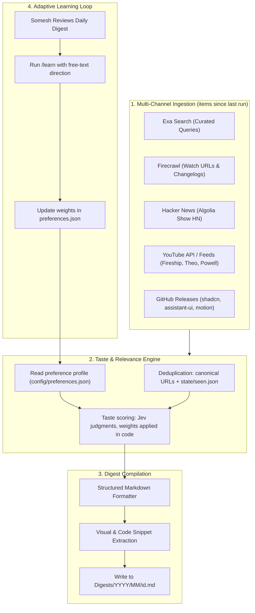

# Dispatch: vision and digest spec

> **What it is:** A private design-engineering news briefing: automated ingestion, taste-filtered scoring, markdown digests with audio, and a feedback loop that adjusts the taste model from one sentence.
>
> **Audience:** Designers, design engineers, and craft-first builders.
>
> **Frequency:** A regular digest every second day at 07:13 Stockholm time (CEST/CET), plus a weekly deep digest on Sundays. Each run covers everything new since the last run; no item is ever shown twice.
>
> **Runtime:** A private GitHub repo (`somesh-ks/knowledge-hub`) with a standalone engine that runs on GitHub Actions, locally, or from the site's Generate button. See [build-plan.md](build-plan.md) Section 4.
>
> **Build plan:** [build-plan.md](build-plan.md) is the executable plan (architecture, credentials, web app, phases, risks). This file is the vision and the digest spec. Decisions are logged in [decisions.md](../decisions.md) and operations are in [runbook.md](../runbook.md).
>
> **Reader:** `news.someshks.work`, hosted on Vercel, public but unlisted, with pre-generated audio and a passphrase-protected on-demand button.
>
> **Output:** Versioned markdown digests under `Digests/YYYY/MM/<id>.md`. The id is the Stockholm date, with `-weekly` for the weekly pass and `-2`, `-3` for further runs on the same day.
>
> **Status:** The original vision, written 2026-10-06 before the first live run. The product has since been renamed Singularity and redesigned (D30 onward); current facts are in [state.md](../state.md) and the design record is in [the ledger](../design-engineering-ledger.md). The digest schema (Section 3) and taste model (Section 4) still hold unless a decision says otherwise.

---

## 1. System architecture



---

## 2. Ingestion modules and tooling

| Channel | Tool or mechanism | Ingestion target |
| --- | --- | --- |
| **AI labs and frontier** | RSS where it exists, else Firecrawl API scrape | OpenAI, Anthropic, DeepMind, Meta AI blogs |
| **Design engineering** | Blog RSS, plus Exa Search API for pages outside known feeds | Rauno, Emil Kowalski, Josh Comeau, Paco, Jhey |
| **UI libraries and ecosystem** | GitHub `releases.atom` feeds | `shadcn/ui`, `assistant-ui`, `animata`, `react-bits`, `motion`, `lenis` |
| **Product launches and Show HN** | Hacker News Algolia API (`hn.algolia.com`) | Show HN posts since the last run with more than 30 points |
| **Video and tutorials** | YouTube channel RSS feeds | Fireship, Theo (t3.gg), Kevin Powell, Hyperplexed |
| **Ecosystem newsletters** | Direct scrape or RSS | Import AI, Bytes, Pragmatic Engineer, TLDR |

---

## 3. Digest specification

The reader sees and hears the product as Singularity. Each story runs four beats in three or four plain sentences: what happened, the number that makes it concrete, why it happened or what it changes, and the catch, which always comes from the source. It is written to be heard and plain enough to follow cold. The rules are in [voice.md](../../config/voice.md) and the limits and lint in [build-plan.md](build-plan.md) Section 7.6. The body below is generated from the frontmatter for reading in an editor or on GitHub; the site renders from the frontmatter.

```markdown
# Wednesday 7 October

11 items. 2 min read, 4 min listen.

## Top picks

### [Headline](url)
Source, Author

Three or four sentences, at most 80 words: what happened, the number, why it matters, the catch.

## Interaction craft

### [Headline](url)
...
```

**Sections** appear in this order and are omitted when empty: Top picks, Interaction craft, AI models and products, Tech releases, Research, Launches, Watch and listen.

**Tech releases** is the consumer tech beat: phones, tablets, laptops, audio, wearables, headsets, electric vehicles, chips, operating systems, and rules that change what ships. It holds up to five stories on top of the cap for everything else, ranked by how big the release is, and its stories never become Top picks.

Digests written before this voice carry a two-sentence summary and a separate "Why:" line. They still parse, render and narrate as they were written.

**Digest rules**

- No emoji, intro paragraph, dividers between items, sign-off, or "thought of the day".
- An item appears in one section only; Top picks are not repeated below.
- The read and listen times are computed from the final text, never hardcoded.
- If fewer than three items clear the bar, nothing is published: the run ends with outcome `nothing` and the site says "Nothing cleared the bar." Every run ends in one outcome (`published`, `gated`, `nothing` or `failed`); see [build-plan.md](build-plan.md) Section 7.2.
- The weekly deep digest (Sundays) uses the same schema, plus slow sources: journals (TOCHI, PACMHCI), monthly newsletters and conference proceedings.

**Archive layout**

```text
Digests/
  2026/
    10/
      2026-10-05.md
      2026-10-07.md
      2026-10-07-2.md
      2026-10-11-weekly.md
```

A second run on the same day (an on-demand run) takes the next free suffix, as in `2026-10-07-2.md`. Audio is not stored in the repo; see [build-plan.md](build-plan.md) Section 7.7.

---

## 4. Preference learning model (`preferences.json`)

The source of truth is [`preferences.json`](../../config/preferences.json) (weights, keywords, authors, disliked patterns, feedback history). Do not duplicate its schema here.

**Scoring contract** (implemented by the engine; detail in [build-plan.md](build-plan.md) Sections 7.2 and 7.5)

1. Hard filter: drop items matching `disliked_patterns` (title or lead paragraph).
2. Cheap pre-filter: keep items that match a preferred keyword or author, or come from a source tagged high-signal. Cap candidates at about 60 per run. Items from the consumer tech beat form a second pool of up to 20, ranked by how many outlets covered the story.
3. Judge: per item, category probabilities, craft depth, launch scale, and hype, sponsorship and funding flags.
4. Score in code: probability-weighted category weight, times craft depth (launch scale for consumer tech), reduced by the flags, plus a small bonus for a preferred author or keyword. Threshold and caps are code, not prompt text.
5. Publish up to 12 items (hard cap, 18 in the weekly digest) plus up to 5 Tech releases stories, at least 3 in all, grouped into sections.

**State files** (committed by the engine)

- `state/seen.json`: item ids already shown, with date; pruned after 90 days.
- `state/judgments.json`: cached judgments, so weight changes re-score without new calls; pruned after 30 days.
- `state/last-run.json`: one record per kind of run (`regular`, `weekly`, `on_demand`), each with its outcome; also holds the end of the last fetch, which defines the next window, and the last cover.
- `state/usage.json`: Speechify characters used in the current month.
- `state/source-health.json`: consecutive failures and last success per source (D21).

**`/learn` (free-text only)**

- Input: a sentence such as "more shaders, less VC funding".
- Effect: adjust matching weights by a bounded step (at most 0.05 per weight per call, 0.15 in total per call), add or remove keywords or disliked patterns, and append an entry to `feedback_history` (date, input, changes). Show the diff before committing. Runs through the in-repo `/learn` skill or the personal `sk-dispatch` skill ([build-plan.md](build-plan.md) Section 9).

---

## 5. Operation and open items

[build-plan.md](build-plan.md) owns architecture, triggers, credentials, the web app, phases and risks. [runbook.md](../runbook.md) covers day-to-day operation. This file keeps the vision, the digest schema (Section 3) and the taste model (Section 4).

Decided: the "Taste & Thought of the Day" section is cut (D8, [decisions.md](../decisions.md)).

Open items, carried from Phase 0 and checked against `config/` on 2026-10-06:

- Reconcile `preferences.json` authors: split real names from X handles (entries such as `preetsuthar17` and `cyze_dev` are still handles), normalize case, drop or source entries with no feed (X is not ingested).
- Reconcile sources: the `animata` and `react-bits` repos and Pragmatic Engineer are not in the registry; decide on each. Done: `assistant-ui`, Theo, Kevin Powell and Hyperplexed are listed, the Fireship channel id is resolved, and both the shadcn changelog and repo are listed.
- Decide the fate of the low-signal newsletters (The Rundown, Superhuman, The Neuron) and TechCrunch against the 0.02 and 0.10 weights. All four are enabled in the registry.
