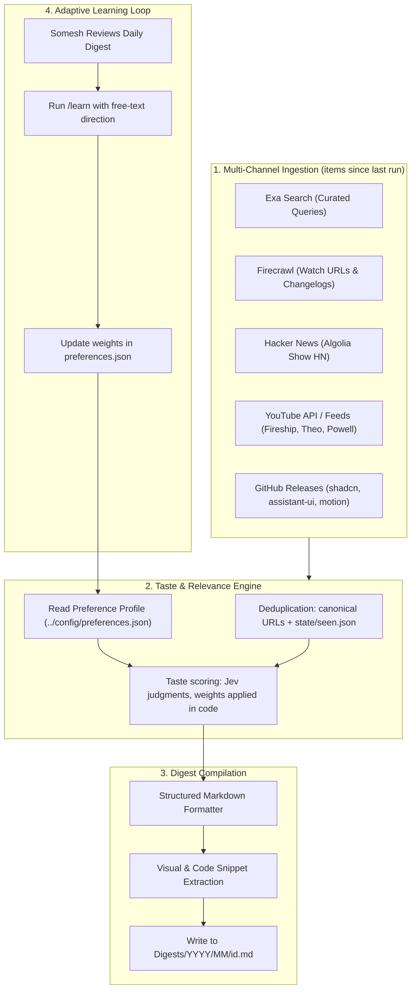

# News Outlet: Automated Curation Engine & Implementation Plan

> **Target architecture:** Automated news ingestion, taste-filtered scoring, markdown digest generation, and a self-learning feedback loop.
>
> **Audience:** Designers, design engineers, and craft-first builders.
>
> **Frequency:** Every 2 days at 07:13 Stockholm time (CEST/CET), plus a weekly deep digest on Sundays. Each run covers everything new since the last run; no item is ever shown twice.
>
> **Runtime:** A private GitHub repo with a standalone engine that runs on GitHub Actions, locally, or from the site's Generate button. See [build-plan.md](build-plan.md) Section 4.
>
> **Build plan:** [build-plan.md](build-plan.md) is the executable plan (architecture, credentials, web app, phases, risks); this file is the vision and digest spec.
>
> **Reader:** `news.someshks.work` (Cloudflare Workers static assets, public unlisted) with pre-generated audio and a gated on-demand button.
>
> **Output:** Versioned markdown digests under `Digests/YYYY/MM/<id>.md`, where the id is the date, with `-weekly` for the weekly pass.

---

## 1. System Architecture



---

## 2. Ingestion Modules & Tooling

| Channel | Tool / Mechanism | Ingestion Target |
|---------|------------------|------------------|
| **AI Labs & Frontier** | RSS where it exists, else Firecrawl API scrape | OpenAI, Anthropic, DeepMind, Meta AI blogs |
| **Design Engineering** | Blog RSS, plus Exa Search API for pages outside known feeds | Rauno, Emil Kowalski, Josh Comeau, Paco, Jhey |
| **UI Libraries & Ecosystem** | GitHub `releases.atom` feeds | `shadcn/ui`, `assistant-ui`, `animata`, `react-bits`, `motion`, `lenis` |
| **Product Launches & Show HN** | Hacker News Algolia API (`hn.algolia.com`) | Show HN posts since the last run with more than 30 points |
| **Video & Tutorials** | YouTube channel RSS feeds | Fireship, Theo (t3.gg), Kevin Powell, Hyperplexed |
| **Ecosystem Newsletters** | Direct scrape / RSS | Import AI, Bytes, Pragmatic Engineer, TLDR |

---

## 3. Digest Specification

The voice is high brevity, specific and peer to peer. Rules, limits and lint are in [build-plan.md](build-plan.md) Section 7.6. The body below is generated from the frontmatter for reading in an editor or on GitHub; the site renders from the frontmatter.

```markdown
# Wednesday 7 October

11 items. 2 min read, 4 min listen.

## Top picks

### [Headline](url)
Source, Author

Summary in at most two short sentences.

Why: one line on what the reader can use.

## Interaction craft

### [Headline](url)
...
```

**Sections** appear in this order and are omitted when empty: Top picks, Interaction craft, AI models and products, Research, Launches, Watch and listen.

**Digest rules**

- No emoji, intro paragraph, dividers between items, sign-off, or "thought of the day".
- An item appears in one section only; Top picks are not repeated below.
- The read and listen times are computed from the final text, never hardcoded.
- If fewer than three items clear the bar, nothing is published.
- The weekly deep digest (Sundays) uses the same schema, plus slow sources: journals (TOCHI, PACMHCI), monthly newsletters and conference proceedings.

**Archive layout**

```text
Digests/
  2026/
    10/
      2026-10-05.md
      2026-10-07.md
      2026-10-11-weekly.md
```

---

## 4. Preference Learning Model (`preferences.json`)

The source of truth is [`preferences.json`](../config/preferences.json) (weights, keywords, authors, disliked patterns, feedback history). Do not duplicate its schema here.

**Scoring contract** (implemented by the engine; detail in [build-plan.md](build-plan.md) Sections 7.2 and 7.5)

1. Hard filter: drop items matching `disliked_patterns` (title or lead paragraph).
2. Cheap pre-filter: keep items that match a preferred keyword or author, or come from a source tagged high-signal. Cap candidates at about 60 per run.
3. Judge: per item, category probabilities, craft depth, and hype, sponsorship and funding flags.
4. Score in code: probability-weighted category weight, times craft depth, reduced by the flags, plus a small bonus for a preferred author or keyword. Threshold and caps are code, not prompt text.
5. Publish up to 12 items (hard cap), at least 3, grouped into sections.

**State files** (committed by the engine)

- `state/seen.json`: item ids already shown, with date; pruned after 90 days.
- `state/judgments.json`: cached judgments, so weight changes re-score without new calls; pruned after 30 days.
- `state/last-run.json`: one record per kind of run, with its outcome; defines the fetch window.

**`/learn` (free-text only)**

- Input: a sentence such as "more shaders, less VC funding".
- Effect: adjust matching weights by a bounded step (at most 0.05 per weight per call, 0.15 in total per call), add or remove keywords or disliked patterns, and append an entry to `feedback_history` (date, input, changes). Show the diff before committing.

---

## 5. Roadmap, Reader Site and Cloud Operation

Superseded by [build-plan.md](build-plan.md), which owns architecture, triggers, credentials, the web app, phases and risks. This file keeps the vision, the digest schema (Section 3) and the taste model (Section 4).

Open items carried into Build Plan Phase 0:

- Reconcile `preferences.json` authors: split real names from X handles, normalize case, drop or source entries with no feed (X is not ingested).
- Reconcile sources: add `assistant-ui`, `animata` and `react-bits` repos; decide on Pragmatic Engineer, Theo, Powell and Hyperplexed; resolve the Fireship channel ID; resolve the shadcn changelog versus repo.
- Decide the fate of low-signal newsletters (The Rundown, Superhuman, The Neuron) and TechCrunch against the 0.02 and 0.10 weights.
- Decide whether to keep the "Taste & Thought of the Day" section.
